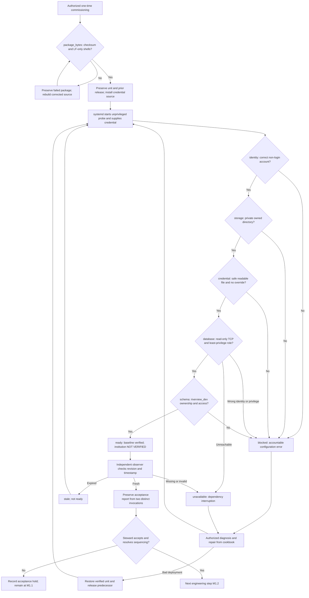

# Riverview~ runtime baseline process map

**Document Revision:** 1.0.1
**Component:** RUNTIME-BASELINE
**Repair task:** RV-M1.1-002
**Workflow:** runtime-baseline.v1
**Task:** RV-M1.1-001
**Status:** implemented diagnostic flow; Camrui execution NOT VERIFIED

`package_bytes` is an engineering preflight reported by rv.package-verification.v1,
not an institutional workflow event. It checks both scripts before host mutation.

Stable probe step IDs `identity`, `storage`, `credential`, `database`, `schema`,
`ready` are emitted in JSON on failure/success and map directly to the
[cookbook](RUNTIME_BASELINE_COOKBOOK.md). The database/schema subchecks are
read-only; no assignment events, recovery authority, worker or CME loops are
claimed here. Notifications are operator-visible exit codes/reports; automated
durable notification remains M3.2. The acceptance hold governs engineering
sequencing, not ongoing authorized institutional execution.

Restart means a new systemd diagnostic invocation and fresh credential delivery;
the latest report is replaced and immutable acceptance artifacts remain retained.

## Revision history

- 1.0.1: Add actual archive-byte preflight and failed-package rebuild path; preserved predecessor under docs/history/RV-M1.1-002/rev1.0.0.
- 1.0.0: Initial flow with errors, repeat invocation, rollback and acceptance hold.
