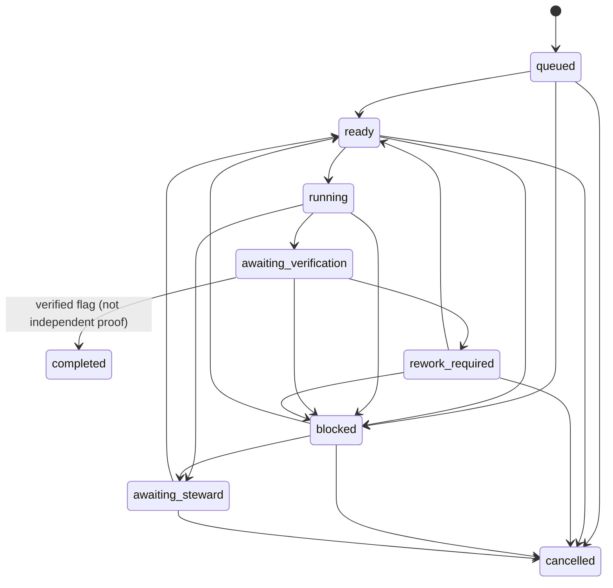

<!--
Riverview~ Controlled Document
File: docs/components/POSTGRES_LEDGER_FLOW.md
Revision: 1.0.1
Migration: ENG-REV-002
-->
# PostgreSQL ledger — component flow and Steward projection

## Transaction flow
```mermaid
flowchart TD
 A[Explicit versioned migration] --> B{Stored checksum matches?}
 B -->|Mismatch| X[Fail without schema changes]
 B -->|Already applied| C[No-op]
 B -->|New version| D[Apply SQL and checksum atomically]
 C --> E[PostgresLedger requires migrated schema]
 D --> E
 F[Caller: create or transition] --> E
 E --> G[Begin PostgreSQL transaction]
 G --> H[Advisory lock on idempotency key]
 H --> I{Existing event key?}
 I -->|Exact semantic replay| J[Return current assignment]
 I -->|Conflicting replay| X
 I -->|New| K{Create or transition?}
 K -->|Create| L[Insert assignment metadata]
 K -->|Transition| M[Lock assignment row FOR UPDATE]
 M --> N{Legal state transition?}
 N -->|No| X
 N -->|Yes| O[Update state and version]
 L --> P[Append rv.event.v1 with authority and causality]
 O --> P
 P --> Q[Commit atomically]
 Q --> R[Read assignment / ordered events]
 J --> R
 R --> S[On-demand status snapshot]
 S -. M3.1 .-> T[Live Steward dashboard]
```

## Assignment lifecycle


## Steward view — delivered versus planned
| Signal | On-demand snapshot | Live Steward view |
| --- | --- | --- |
| PostgreSQL connectivity | Yes | Not built |
| Assignment counts by state | Yes, if tables initialized | Not built |
| Last event sequence and timestamp | Yes, if tables initialized | Not built |
| Database health and failures over time | Single-point read only | Not built |
| Alerts, CME recovery, drill-down, authorization | No | Not built |

Use `scripts/postgres_ledger_steward_snapshot.py` to generate a read-only JSON status snapshot. It accepts `RIVERVIEW_PG_DSN` and `RIVERVIEW_PG_SCHEMA`. It never initializes tables, writes data, or starts a web service. If tables do not exist, it reports `not_initialized` rather than creating them.
