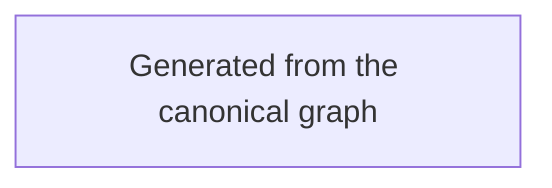

# Riverview~ event processor flow

**Document Revision:** 1.0.0  
**Component:** EVENT-PROCESSOR  
**Task:** RV-M1.3-001  
**Workflow:** assignment-progression.v1  
**Canonical source:** `process_graphs/event-processor/assignment-progression.json`

This Mermaid view is generated with `python3 scripts/process_graph.py generate`.
The canonical JSON is authoritative. Use
`python3 scripts/process_graph.py check` to detect stale output.
