# Riverview~ runtime baseline process map

**Document Revision:** 1.0.6
**Component:** RUNTIME-BASELINE
**Repair task:** RV-M1.1-011
**Workflow:** runtime-baseline.v1
**Task:** RV-M1.1-001
**Status:** credential and loopback identity corrections implemented; live acceptance in progress

```mermaid
flowchart LR
  subgraph g_rv_runtime_baseline_commissioning["RUNTIME-BASELINE / runtime-baseline.v1"]
    n0(["Committed source revision<br/>rv:runtime-baseline:commissioning:source"])
    n1["Build and verify package<br/>rv:runtime-baseline:commissioning:package"]
    n2{"Archive digest, commit, manifest and safe members valid?<br/>rv:runtime-baseline:commissioning:package-valid"}
    n3[["Preserve failed package; rebuild corrected source<br/>rv:runtime-baseline:commissioning:package-failure"]]
    n4["Extract verified archive into protected staging<br/>rv:runtime-baseline:commissioning:stage"]
    n5["Preserve predecessor; run fixed installer<br/>rv:runtime-baseline:commissioning:install"]
    n6{"Protected credential source exists?<br/>rv:runtime-baseline:commissioning:credential-present"}
    n7(["Prompt on controlling TTY with echo disabled<br/>rv:runtime-baseline:commissioning:credential-entry"])
    n8[["Fail closed; passfile remains absent<br/>rv:runtime-baseline:commissioning:tty-failure"]]
    n9["Check partial ownership, retry corrected installer<br/>rv:runtime-baseline:commissioning:retry-install"]
    n10["systemd starts unprivileged probe with LoadCredential<br/>rv:runtime-baseline:commissioning:systemd"]
    n11["Validate source; copy to private mode-0600 runtime passfile<br/>rv:runtime-baseline:commissioning:credential-copy"]
    n12{"Correct non-login service identity?<br/>rv:runtime-baseline:commissioning:identity"}
    n13{"Private service-owned state directory?<br/>rv:runtime-baseline:commissioning:storage"}
    n14{"Safe credential file and no ambient override?<br/>rv:runtime-baseline:commissioning:credential-check"}
    n15["Read-only PostgreSQL identity and privilege check<br/>rv:runtime-baseline:commissioning:database"]
    n16{"riverview_dev owner and access match?<br/>rv:runtime-baseline:commissioning:schema"}
    n17[["Report accountable blocker and preserve diagnostics<br/>rv:runtime-baseline:commissioning:blocked"]]
    n18["Diagnose and repair using cookbook; retry probe<br/>rv:runtime-baseline:commissioning:diagnose"]
    n19(["Ready: baseline verified; wider institution not verified<br/>rv:runtime-baseline:commissioning:ready"])
    n20["Independent observer validates revision and timestamp<br/>rv:runtime-baseline:commissioning:observe"]
    n21{"Observation fresh and valid?<br/>rv:runtime-baseline:commissioning:fresh"}
    n22[["Stale, missing or invalid observation is not ready<br/>rv:runtime-baseline:commissioning:stale"]]
    n23{"Steward accepts scoped M1.1 evidence and sequencing?<br/>rv:runtime-baseline:commissioning:accept-decision"}
    n24[["Record acceptance hold; independent M1.2 engineering may continue<br/>rv:runtime-baseline:commissioning:accept-hold"]]
    n25["Record scoped M1.1 technical acceptance; full DoD remains open<br/>rv:runtime-baseline:commissioning:acceptance"]
    n26["M1.2 shared-schema migration workflow<br/>rv:runtime-baseline:commissioning:m12-jump"]
  end
  n27["External graph target<br/>rv:postgres-ledger:migration:apply"]
  n0 --> n1
  n1 --> n2
  n2 -->|diagnostic_branch: No| n3
  n3 -->|recovery_route| n1
  n2 -->|Yes| n4
  n4 --> n5
  n5 --> n6
  n6 -->|No| n7
  n7 -->|diagnostic_branch: TTY failure| n8
  n8 -->|recovery_route| n9
  n9 -->|recovery_route| n4
  n6 -->|Yes| n10
  n7 -->|Captured| n10
  n10 --> n11
  n11 --> n12
  n12 -->|diagnostic_branch: No| n17
  n12 -->|Yes| n13
  n13 -->|diagnostic_branch: No| n17
  n13 -->|Yes| n14
  n14 -->|diagnostic_branch: No| n17
  n14 -->|Yes| n15
  n15 --> n16
  n16 -->|diagnostic_branch: No| n17
  n16 -->|Yes| n19
  n17 -->|recovery_route| n18
  n18 -->|recovery_route| n10
  n19 -->|verification| n20
  n20 --> n21
  n21 -->|diagnostic_branch: Expired/missing| n22
  n22 -->|recovery_route| n10
  n21 -->|verification: Fresh| n23
  n23 -->|escalation: No| n24
  n23 -->|verification: Yes| n25
  n25 -->|prerequisite| n26
  n26 -->|jump| n27
  classDef failure fill:#fee,stroke:#b00,stroke-width:2px
```

Package verification checks the exact archive digest, source commit, checksum
manifest, Linux shell compatibility, and safe archive members before host
installation. Camrui's owner-authorized administrator performs the local
deployment; no project privilege broker is installed.

Stable probe step IDs `identity`, `storage`, `credential`, `database`, `schema`,
`ready` are emitted in JSON on failure/success and map directly to the
[cookbook](RUNTIME_BASELINE_COOKBOOK.md). The database/schema subchecks are
read-only; no assignment events, recovery authority, worker or CME loops are
claimed here. Notifications are operator-visible exit codes/reports; automated
durable notification remains M3.2. The acceptance hold governs engineering
sequencing, not ongoing authorized institutional execution. PID 1's root-owned
read-only credential mount is validated separately from runtime-owned state,
then copied to a private ephemeral mode-0600 file because libpq rejects mode
0440. systemd cleans that runtime directory after the oneshot stops.

Restart means a new systemd diagnostic invocation and fresh credential delivery;
the latest report is replaced and immutable acceptance artifacts remain retained.

## Revision history

- 1.0.3: Add hash-pinned broker flow and corrected systemd credential ownership contract; predecessor `.riverview-backups/20261010T142904684465Z/docs/components/RUNTIME_BASELINE_FLOW.md`.
- 1.0.4: Add private runtime passfile copy required by libpq; predecessor is recorded under RV-M1.1-010 in `.riverview-backups/manifest.jsonl`.
- 1.0.5: Retire the broker flow and record the corrected PostgreSQL inet host check; predecessor recorded under RV-M1.1-011.

- 1.0.2: Add hidden-TTY credential capture and safe retained-release retry branches; predecessor under docs/history/RV-M1.1-007/rev1.0.1/docs/components/RUNTIME_BASELINE_FLOW.md.

- 1.0.1: Add actual archive-byte preflight and failed-package rebuild path; preserved predecessor under docs/history/RV-M1.1-002/rev1.0.0.
- 1.0.0: Initial flow with errors, repeat invocation, rollback and acceptance hold.
