# Riverview aggregate process graph

**Document Revision:** 1.0.1  
**Generated from:** canonical workflow JSON; do not edit this projection by hand.  
**Source:** `python3 scripts/process_graph.py generate`  

The graph is complete across registered workflows. Use focused component flow documents for detailed reading. Unimplemented roadmap integration points are explicitly labeled planned.

```mermaid
flowchart LR
  subgraph g_rv_event_processor_assignment_progression["EVENT-PROCESSOR / assignment-progression.v1"]
    n0(["Supervised event processor starts<br/>rv:event-processor:assignment-progression:start"])
    n1["Acquire PostgreSQL advisory leadership lock for this consumer<br/>rv:event-processor:assignment-progression:lease"]
    n2[["Another instance holds consumer lease; refuse duplicate runner<br/>rv:event-processor:assignment-progression:lock-failure"]]
    n3["Read durable per-consumer event cursor<br/>rv:event-processor:assignment-progression:read-cursor"]
    n4["Fetch ordered committed events after cursor<br/>rv:event-processor:assignment-progression:fetch"]
    n5{"Event is assignment.created?<br/>rv:event-processor:assignment-progression:created"}
    n6{"Assignment still queued?<br/>rv:event-processor:assignment-progression:queued"}
    n7["Idempotently transition assignment to ready<br/>rv:event-processor:assignment-progression:advance"]
    n8["Ignore unrelated or already advanced event<br/>rv:event-processor:assignment-progression:skip"]
    n9["Persist cursor only after successful handling<br/>rv:event-processor:assignment-progression:checkpoint"]
    n10["Log failure type and retry with bounded backoff<br/>rv:event-processor:assignment-progression:retry"]
    n11["Restart replays uncheckpointed source event safely<br/>rv:event-processor:assignment-progression:replay"]
    n12(["SIGTERM checkpointed stop and leadership release<br/>rv:event-processor:assignment-progression:stop"])
  end
  subgraph g_rv_postgres_ledger_assignment_lifecycle["POSTGRES-LEDGER / assignment-lifecycle.v1"]
    n13(["Assignment intake<br/>rv:postgres-ledger:assignment-lifecycle:intake"])
    n14["queued<br/>rv:postgres-ledger:assignment-lifecycle:queued"]
    n15["ready<br/>rv:postgres-ledger:assignment-lifecycle:ready"]
    n16["running<br/>rv:postgres-ledger:assignment-lifecycle:running"]
    n17["awaiting_verification<br/>rv:postgres-ledger:assignment-lifecycle:awaiting-verification"]
    n18["rework_required<br/>rv:postgres-ledger:assignment-lifecycle:rework"]
    n19[["blocked<br/>rv:postgres-ledger:assignment-lifecycle:blocked"]]
    n20[["awaiting_steward<br/>rv:postgres-ledger:assignment-lifecycle:awaiting-steward"]]
    n21(["completed (caller verification flag is only a claim)<br/>rv:postgres-ledger:assignment-lifecycle:completed"])
    n22(["cancelled<br/>rv:postgres-ledger:assignment-lifecycle:cancelled"])
  end
  subgraph g_rv_postgres_ledger_migration["POSTGRES-LEDGER / postgres-migration.v1"]
    n23["Confirm live host, database, schema owner/access, empty target and compatibility<br/>rv:postgres-ledger:migration:preflight"]
    n24{"Preflight safe to proceed?<br/>rv:postgres-ledger:migration:preflight-clear"}
    n25[["Stop on identity, compatibility or safety mismatch<br/>rv:postgres-ledger:migration:stop"]]
    n26["Protected full database backup; checksum and restore drill<br/>rv:postgres-ledger:migration:backup"]
    n27["Recoverable backup independently restored and verified<br/>rv:postgres-ledger:migration:backup-verified"]
    n28(["Explicit migration request for selected schema<br/>rv:postgres-ledger:migration:apply"])
    n29{"Stored checksum matches source?<br/>rv:postgres-ledger:migration:check"}
    n30[["Checksum mismatch; stop without schema changes<br/>rv:postgres-ledger:migration:drift"]]
    n31["Identical applied migration is a no-op<br/>rv:postgres-ledger:migration:noop"]
    n32["Apply versioned SQL and checksum atomically<br/>rv:postgres-ledger:migration:sql"]
    n33["PostgresLedger requires migrated target schema<br/>rv:postgres-ledger:migration:require-schema"]
    n34["Caller requests assignment create or transition<br/>rv:postgres-ledger:migration:caller"]
    n35["Begin PostgreSQL transaction<br/>rv:postgres-ledger:migration:transaction"]
    n36["Advisory lock on idempotency key<br/>rv:postgres-ledger:migration:lock"]
    n37{"Existing event key?<br/>rv:postgres-ledger:migration:key-exists"}
    n38["Exact semantic replay returns current assignment<br/>rv:postgres-ledger:migration:replay"]
    n39[["Conflicting key reuse is rejected<br/>rv:postgres-ledger:migration:collision"]]
    n40{"Create or transition?<br/>rv:postgres-ledger:migration:operation"}
    n41["Insert assignment metadata<br/>rv:postgres-ledger:migration:create"]
    n42["Lock assignment row FOR UPDATE<br/>rv:postgres-ledger:migration:row-lock"]
    n43{"Legal state transition?<br/>rv:postgres-ledger:migration:legal"}
    n44[["Reject illegal transition<br/>rv:postgres-ledger:migration:illegal"]]
    n45["Update state and workflow step<br/>rv:postgres-ledger:migration:update"]
    n46["Append event with authority and causality<br/>rv:postgres-ledger:migration:event"]
    n47["Commit assignment and event atomically<br/>rv:postgres-ledger:migration:commit"]
    n48["Read assignment and ordered events<br/>rv:postgres-ledger:migration:read"]
    n49["On-demand status snapshot<br/>rv:postgres-ledger:migration:snapshot"]
    n50["M3.1 live dashboard (planned; not implemented)<br/>rv:postgres-ledger:migration:dashboard-jump"]
  end
  subgraph g_rv_runtime_baseline_commissioning["RUNTIME-BASELINE / runtime-baseline.v1"]
    n51(["Committed source revision<br/>rv:runtime-baseline:commissioning:source"])
    n52["Build and verify package<br/>rv:runtime-baseline:commissioning:package"]
    n53{"Archive digest, commit, manifest and safe members valid?<br/>rv:runtime-baseline:commissioning:package-valid"}
    n54[["Preserve failed package; rebuild corrected source<br/>rv:runtime-baseline:commissioning:package-failure"]]
    n55["Extract verified archive into protected staging<br/>rv:runtime-baseline:commissioning:stage"]
    n56["Preserve predecessor; run fixed installer<br/>rv:runtime-baseline:commissioning:install"]
    n57{"Protected credential source exists?<br/>rv:runtime-baseline:commissioning:credential-present"}
    n58(["Prompt on controlling TTY with echo disabled<br/>rv:runtime-baseline:commissioning:credential-entry"])
    n59[["Fail closed; passfile remains absent<br/>rv:runtime-baseline:commissioning:tty-failure"]]
    n60["Check partial ownership, retry corrected installer<br/>rv:runtime-baseline:commissioning:retry-install"]
    n61["systemd starts unprivileged probe with LoadCredential<br/>rv:runtime-baseline:commissioning:systemd"]
    n62["Validate source; copy to private mode-0600 runtime passfile<br/>rv:runtime-baseline:commissioning:credential-copy"]
    n63{"Correct non-login service identity?<br/>rv:runtime-baseline:commissioning:identity"}
    n64{"Private service-owned state directory?<br/>rv:runtime-baseline:commissioning:storage"}
    n65{"Safe credential file and no ambient override?<br/>rv:runtime-baseline:commissioning:credential-check"}
    n66["Read-only PostgreSQL identity and privilege check<br/>rv:runtime-baseline:commissioning:database"]
    n67{"riverview_dev owner and access match?<br/>rv:runtime-baseline:commissioning:schema"}
    n68[["Report accountable blocker and preserve diagnostics<br/>rv:runtime-baseline:commissioning:blocked"]]
    n69["Diagnose and repair using cookbook; retry probe<br/>rv:runtime-baseline:commissioning:diagnose"]
    n70(["Ready: baseline verified; wider institution not verified<br/>rv:runtime-baseline:commissioning:ready"])
    n71["Independent observer validates revision and timestamp<br/>rv:runtime-baseline:commissioning:observe"]
    n72{"Observation fresh and valid?<br/>rv:runtime-baseline:commissioning:fresh"}
    n73[["Stale, missing or invalid observation is not ready<br/>rv:runtime-baseline:commissioning:stale"]]
    n74{"Steward accepts scoped M1.1 evidence and sequencing?<br/>rv:runtime-baseline:commissioning:accept-decision"}
    n75[["Record acceptance hold; independent M1.2 engineering may continue<br/>rv:runtime-baseline:commissioning:accept-hold"]]
    n76["Record scoped M1.1 technical acceptance; full DoD remains open<br/>rv:runtime-baseline:commissioning:acceptance"]
    n77["M1.2 shared-schema migration workflow<br/>rv:runtime-baseline:commissioning:m12-jump"]
  end
  subgraph g_rv_steward_dashboard_status["STEWARD-DASHBOARD / status-projection.v1"]
    n78(["Reserved M3.1 live-state projection target (planned; not implemented)<br/>rv:steward-dashboard:status:ingest"])
  end
  n0 --> n1
  n1 -->|diagnostic_branch: Lock unavailable| n2
  n1 -->|Acquired| n3
  n3 --> n4
  n4 --> n5
  n5 -->|Yes| n6
  n5 -->|No| n8
  n6 -->|Yes| n7
  n6 -->|No| n8
  n7 --> n9
  n8 --> n9
  n9 -->|Next poll| n3
  n3 -->|diagnostic_branch: Database or handler error| n10
  n10 -->|recovery_route| n11
  n11 -->|recovery_route| n3
  n9 -->|SIGTERM| n12
  n1 -->|prerequisite: M1.2 migrated ledger schema; not a runtime call| n33
  n13 --> n14
  n14 --> n15
  n14 --> n19
  n14 --> n22
  n15 --> n16
  n15 --> n19
  n15 --> n22
  n16 --> n17
  n16 --> n19
  n16 --> n20
  n17 -->|verified claim required; not independent proof| n21
  n17 --> n18
  n17 --> n19
  n18 --> n15
  n18 --> n19
  n18 --> n22
  n19 --> n15
  n19 --> n22
  n19 --> n20
  n20 --> n15
  n20 --> n22
  n23 -->|verification| n24
  n24 -->|diagnostic_branch: No| n25
  n24 -->|Yes| n26
  n26 -->|verification| n27
  n27 --> n28
  n28 --> n29
  n29 -->|diagnostic_branch: Mismatch| n30
  n29 -->|Already applied, identical| n31
  n29 -->|New version| n32
  n31 --> n33
  n32 --> n33
  n33 -->|prerequisite: Verified schema contract; not a runtime call| n34
  n34 --> n35
  n35 --> n36
  n36 --> n37
  n37 -->|Exact replay| n38
  n37 -->|diagnostic_branch: Conflict| n39
  n37 -->|New key| n40
  n40 -->|Create| n41
  n40 -->|Transition| n42
  n42 --> n43
  n43 -->|diagnostic_branch: No| n44
  n43 -->|Yes| n45
  n41 --> n46
  n45 --> n46
  n46 --> n47
  n47 --> n48
  n38 --> n48
  n48 --> n49
  n49 --> n50
  n50 -->|jump| n78
  n51 --> n52
  n52 --> n53
  n53 -->|diagnostic_branch: No| n54
  n54 -->|recovery_route| n52
  n53 -->|Yes| n55
  n55 --> n56
  n56 --> n57
  n57 -->|No| n58
  n58 -->|diagnostic_branch: TTY failure| n59
  n59 -->|recovery_route| n60
  n60 -->|recovery_route| n55
  n57 -->|Yes| n61
  n58 -->|Captured| n61
  n61 --> n62
  n62 --> n63
  n63 -->|diagnostic_branch: No| n68
  n63 -->|Yes| n64
  n64 -->|diagnostic_branch: No| n68
  n64 -->|Yes| n65
  n65 -->|diagnostic_branch: No| n68
  n65 -->|Yes| n66
  n66 --> n67
  n67 -->|diagnostic_branch: No| n68
  n67 -->|Yes| n70
  n68 -->|recovery_route| n69
  n69 -->|recovery_route| n61
  n70 -->|verification| n71
  n71 --> n72
  n72 -->|diagnostic_branch: Expired/missing| n73
  n73 -->|recovery_route| n61
  n72 -->|verification: Fresh| n74
  n74 -->|escalation: No| n75
  n74 -->|verification: Yes| n76
  n76 -->|prerequisite| n77
  n77 -->|jump| n28
  classDef failure fill:#fee,stroke:#b00,stroke-width:2px
```

