# Riverview~ worker adapter flow

**Document Revision:** 1.0.1
**Component:** WORKER-ADAPTER
**Canonical workflow:** `process_graphs/worker-adapter/deterministic-attempt.json`
**Generated from:** canonical workflow JSON; do not edit the Mermaid projection by hand.

```mermaid
flowchart LR
  subgraph g_rv_worker_adapter_deterministic_attempt["WORKER-ADAPTER / deterministic-attempt.v1"]
    g_rv_worker_adapter_deterministic_attempt_request_7dff0e33(["Deterministic worker request"])
    g_rv_worker_adapter_deterministic_attempt_authenticate_1608feb4["Verify random credential digest, active registration, and scope"]
    g_rv_worker_adapter_deterministic_attempt_auth_fail_78cfc724[["Reject invalid token, capability, or assignment authority scope"]]
    g_rv_worker_adapter_deterministic_attempt_lease_582df0fd["Require current M1.4 assignment fencing generation"]
    g_rv_worker_adapter_deterministic_attempt_lease_jump_5863cf02["Resolve lease and fencing contract in M1.4 scheduler"]
    g_rv_worker_adapter_deterministic_attempt_begin_9ea07cfe["Persist attributable attempt before execution"]
    g_rv_worker_adapter_deterministic_attempt_compute_6725940c["Run deterministic local SHA-256 capability"]
    g_rv_worker_adapter_deterministic_attempt_complete_check_6605f820["Recheck current lease before durable result commit"]
    g_rv_worker_adapter_deterministic_attempt_lost_17b81010[["Persist lease_lost attempt and reject stale result"]]
    g_rv_worker_adapter_deterministic_attempt_result_12aa9ef4["Persist result, digest, and successful attempt status"]
    g_rv_worker_adapter_deterministic_attempt_loss_query_cbfb3695["Expose unfinished attempts for worker-loss detection"]
  end
  g_rv_assignment_scheduler_independent_claims_start_check_f588e935["Registered target<br/>rv:assignment-scheduler:independent-claims"]
  g_rv_worker_adapter_deterministic_attempt_request_7dff0e33 --> g_rv_worker_adapter_deterministic_attempt_authenticate_1608feb4
  g_rv_worker_adapter_deterministic_attempt_authenticate_1608feb4 -->|diagnostic_branch: Credential, capability, or scope rejected| g_rv_worker_adapter_deterministic_attempt_auth_fail_78cfc724
  g_rv_worker_adapter_deterministic_attempt_authenticate_1608feb4 -->|Authorized| g_rv_worker_adapter_deterministic_attempt_lease_582df0fd
  g_rv_worker_adapter_deterministic_attempt_lease_582df0fd -->|Current lease| g_rv_worker_adapter_deterministic_attempt_begin_9ea07cfe
  g_rv_worker_adapter_deterministic_attempt_lease_jump_5863cf02 -->|jump: Follow current M1.4 lease validation| g_rv_assignment_scheduler_independent_claims_start_check_f588e935
  g_rv_worker_adapter_deterministic_attempt_begin_9ea07cfe --> g_rv_worker_adapter_deterministic_attempt_compute_6725940c
  g_rv_worker_adapter_deterministic_attempt_compute_6725940c --> g_rv_worker_adapter_deterministic_attempt_complete_check_6605f820
  g_rv_worker_adapter_deterministic_attempt_complete_check_6605f820 -->|diagnostic_branch: Lease expired or fenced| g_rv_worker_adapter_deterministic_attempt_lost_17b81010
  g_rv_worker_adapter_deterministic_attempt_complete_check_6605f820 -->|Current lease| g_rv_worker_adapter_deterministic_attempt_result_12aa9ef4
  g_rv_worker_adapter_deterministic_attempt_begin_9ea07cfe -->|diagnostic_branch: Process stops before result commit| g_rv_worker_adapter_deterministic_attempt_loss_query_cbfb3695
  g_rv_worker_adapter_deterministic_attempt_lease_582df0fd -->|prerequisite: M1.4 lease table/token contract; not a runtime call| g_rv_assignment_scheduler_independent_claims_start_check_f588e935
  classDef failure fill:#fee,stroke:#b00,stroke-width:2px
```

