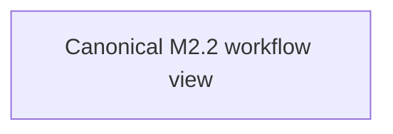

# Independent outcome verification

**Document Revision:** 1.0.0  
**Component:** OUTCOME-VERIFIER  
**Milestone:** M2.2  
**Status:** IN PROGRESS — isolated PostgreSQL engineering; not deployed  
**Canonical source:** `process_graphs/outcome-verifier/independent-result.json`

The canonical graph distinguishes persisted worker output from verification,
records verifier identity and criteria, and routes accepted, rejected, and
inconclusive decisions to separate state outcomes. Mermaid is generated with
`python3 scripts/process_graph.py generate`.

Revision history: 1.0.0 — initial M2.2 independent result verification view.
