<!--
Riverview~ Controlled Document
File: docs/components/CME_MONITOR_FLOW.md
Component: CME
File Revision: 1.0.0
Purpose: Show actual M2.4 monitoring, alert, failure and restart paths
Authority: CME observes and records; other components own execution/recovery
Changed: 2026-10-10 UTC | RV-M2.4-001 | Initial graph-synchronized focused flow
History: Git and revision/backup manifest
-->
# CME monitoring service flow

**Component:** CME  
**Workflow:** `progress-and-recovery.v1`  
**Diagnostics:** [CME monitor cookbook](CME_MONITOR_COOKBOOK.md)

```mermaid
flowchart LR
  subgraph g_rv_cme_progress_and_recovery["CME / progress-and-recovery.v1"]
    g_rv_cme_progress_and_recovery_monitor_start_3c5b8496(["Acquire the CME PostgreSQL advisory lease and begin repeated scans"])
    g_rv_cme_progress_and_recovery_observe_428defda["Read all nonterminal assignments, durable progress events, deadlines, and leases"]
    g_rv_cme_progress_and_recovery_stall_decision_e8a6e869{"Compare progress age and deadlines with explicit thresholds; preserve assignment isolation"}
    g_rv_cme_progress_and_recovery_attention_845fe834[["Append idempotent attention events for stalled, overdue, blocked, or waiting assignments"]]
    g_rv_cme_progress_and_recovery_recovery_22db97e3["Append one traceable recovery request for a stalled expired lease; CME does not execute it"]
    g_rv_cme_progress_and_recovery_resident_feedback_ff3dbee2["PLANNED — return progress and attention evidence to Grace"]
    g_rv_cme_progress_and_recovery_service_lock_cd8c9580{"Is this instance the sole holder of the CME service lease?"}
    g_rv_cme_progress_and_recovery_deadline_measurement_e28bd00c["Measure configured UTC deadline and durable progress age"]
    g_rv_cme_progress_and_recovery_worker_health_5dbdee95["Report workers healthy only from fresh unexpired lease heartbeats"]
    g_rv_cme_progress_and_recovery_monitor_failure_e312bec5[["Persist sanitized scan failure when PostgreSQL remains reachable"]]
    g_rv_cme_progress_and_recovery_retry_backoff_c0e76a05["Retry database observation with bounded exponential backoff"]
  end
  g_rv_grace_operational_integration_evidence_review_600fe7b4["Registered target<br/>rv:grace:operational-integration"]
  g_rv_cme_progress_and_recovery_monitor_start_3c5b8496 --> g_rv_cme_progress_and_recovery_service_lock_cd8c9580
  g_rv_cme_progress_and_recovery_service_lock_cd8c9580 -->|single active monitor instance| g_rv_cme_progress_and_recovery_observe_428defda
  g_rv_cme_progress_and_recovery_service_lock_cd8c9580 -->|diagnostic_branch: database unavailable or service lease held| g_rv_cme_progress_and_recovery_monitor_failure_e312bec5
  g_rv_cme_progress_and_recovery_observe_428defda --> g_rv_cme_progress_and_recovery_deadline_measurement_e28bd00c
  g_rv_cme_progress_and_recovery_deadline_measurement_e28bd00c --> g_rv_cme_progress_and_recovery_worker_health_5dbdee95
  g_rv_cme_progress_and_recovery_worker_health_5dbdee95 --> g_rv_cme_progress_and_recovery_stall_decision_e8a6e869
  g_rv_cme_progress_and_recovery_stall_decision_e8a6e869 -->|No overdue, stalled, blocked, or waiting condition; continue scan| g_rv_cme_progress_and_recovery_observe_428defda
  g_rv_cme_progress_and_recovery_stall_decision_e8a6e869 -->|escalation: Durable attention required| g_rv_cme_progress_and_recovery_attention_845fe834
  g_rv_cme_progress_and_recovery_stall_decision_e8a6e869 -->|diagnostic_branch: Query or persistence failure| g_rv_cme_progress_and_recovery_monitor_failure_e312bec5
  g_rv_cme_progress_and_recovery_attention_845fe834 -->|recovery_route: Stalled running assignment has expired lease| g_rv_cme_progress_and_recovery_recovery_22db97e3
  g_rv_cme_progress_and_recovery_attention_845fe834 -->|documentation: Future Grace integration reads authoritative attention events| g_rv_cme_progress_and_recovery_resident_feedback_ff3dbee2
  g_rv_cme_progress_and_recovery_resident_feedback_ff3dbee2 -->|jump| g_rv_grace_operational_integration_evidence_review_600fe7b4
  g_rv_cme_progress_and_recovery_recovery_22db97e3 -->|Request recorded; monitor continues unrelated work| g_rv_cme_progress_and_recovery_observe_428defda
  g_rv_cme_progress_and_recovery_monitor_failure_e312bec5 -->|recovery_route| g_rv_cme_progress_and_recovery_retry_backoff_c0e76a05
  g_rv_cme_progress_and_recovery_retry_backoff_c0e76a05 -->|recovery_route: Reacquire service lease and rescan durable state| g_rv_cme_progress_and_recovery_monitor_start_3c5b8496
  classDef failure fill:#fee,stroke:#b00,stroke-width:2px
```

