<!-- Riverview~ Controlled Document
**Document Revision:** 1.0.1
**Component:** STEWARD-DASHBOARD · generated from canonical JSON
**Task:** RV-M3.1-001
**Authority:** Read-only process view; edit the canonical JSON graph only.
-->
# Steward dashboard status-projection flow

**Task:** RV-M3.1-001 · **Component:** STEWARD-DASHBOARD  
**Source:** canonical JSON `process_graphs/steward-dashboard/status.json`; Mermaid below is generated.

```mermaid
flowchart LR
  subgraph g_rv_steward_dashboard_status["STEWARD-DASHBOARD / status-projection.v1"]
    g_rv_steward_dashboard_status_ingest_66a3387a(["Browser shell and status request"])
    g_rv_steward_dashboard_status_authenticate_64fc5881{"Host, loopback and bearer credential valid?"}
    g_rv_steward_dashboard_status_deny_request_776de47b[["Reject unauthorized or mutating request"]]
    g_rv_steward_dashboard_status_read_ledger_6f000d0e["Read bounded PostgreSQL projection"]
    g_rv_steward_dashboard_status_source_health_3cc042e8["Observe source and CME freshness"]
    g_rv_steward_dashboard_status_source_available_1fba9227{"Ledger available and initialized?"}
    g_rv_steward_dashboard_status_source_failure_7a84936b[["Show unavailable or not initialized truthfully"]]
    g_rv_steward_dashboard_status_privacy_filter_7710f632["Filter private rows and payloads"]
    g_rv_steward_dashboard_status_render_cached_529d8c25["Render shell and current local view"]
    g_rv_steward_dashboard_status_navigate_9ce45297["Switch tabs without inference or full reconstruction"]
    g_rv_steward_dashboard_status_page_events_3087075e["Fetch bounded event and assignment pages"]
    g_rv_steward_dashboard_status_inspect_detail_fa591a4b["Lazy-load assignment attempts and verifier evidence"]
    g_rv_steward_dashboard_status_export_snapshot_5d8d925e["Export bounded redacted diagnostic snapshot"]
    g_rv_steward_dashboard_status_database_failure_fa21a93b[["Database request failed or exceeded timeout"]]
    g_rv_steward_dashboard_status_reconnect_71d9d56c["Retry read after service or database recovery"]
    g_rv_steward_dashboard_status_jump_ledger_c6cfb39d["Authoritative assignment and event ledger"]
    g_rv_steward_dashboard_status_jump_cme_36e2d25f["CME monitoring, health and attention source"]
    g_rv_steward_dashboard_status_service_start_ebd3f698(["systemd starts the dashboard service"])
    g_rv_steward_dashboard_status_prepare_passfile_2eebe68e["Validate systemd pgpass and copy to private runtime storage"]
    g_rv_steward_dashboard_status_credential_failure_69b3e373[["Reject unsafe or unavailable runtime credential"]]
  end
  g_rv_postgres_ledger_assignment_lifecycle_intake_c1d0abf1["Registered target<br/>rv:postgres-ledger:assignment-lifecycle"]
  g_rv_cme_progress_and_recovery_monitor_start_3c5b8496["Registered target<br/>rv:cme:progress-and-recovery"]
  g_rv_steward_dashboard_status_ingest_66a3387a --> g_rv_steward_dashboard_status_authenticate_64fc5881
  g_rv_steward_dashboard_status_authenticate_64fc5881 -->|diagnostic_branch: No / invalid host or bearer; write verb| g_rv_steward_dashboard_status_deny_request_776de47b
  g_rv_steward_dashboard_status_authenticate_64fc5881 -->|Authorized GET| g_rv_steward_dashboard_status_read_ledger_6f000d0e
  g_rv_steward_dashboard_status_read_ledger_6f000d0e --> g_rv_steward_dashboard_status_source_health_3cc042e8
  g_rv_steward_dashboard_status_source_health_3cc042e8 --> g_rv_steward_dashboard_status_source_available_1fba9227
  g_rv_steward_dashboard_status_source_available_1fba9227 -->|diagnostic_branch: Unavailable / stale / uninitialized| g_rv_steward_dashboard_status_source_failure_7a84936b
  g_rv_steward_dashboard_status_source_available_1fba9227 -->|Readable rows| g_rv_steward_dashboard_status_privacy_filter_7710f632
  g_rv_steward_dashboard_status_privacy_filter_7710f632 --> g_rv_steward_dashboard_status_render_cached_529d8c25
  g_rv_steward_dashboard_status_render_cached_529d8c25 -->|Local view change| g_rv_steward_dashboard_status_navigate_9ce45297
  g_rv_steward_dashboard_status_render_cached_529d8c25 -->|Bounded refresh| g_rv_steward_dashboard_status_page_events_3087075e
  g_rv_steward_dashboard_status_page_events_3087075e -->|Explicit inspect| g_rv_steward_dashboard_status_inspect_detail_fa591a4b
  g_rv_steward_dashboard_status_render_cached_529d8c25 -->|Explicit snapshot| g_rv_steward_dashboard_status_export_snapshot_5d8d925e
  g_rv_steward_dashboard_status_read_ledger_6f000d0e -->|diagnostic_branch: Connection/query failure| g_rv_steward_dashboard_status_database_failure_fa21a93b
  g_rv_steward_dashboard_status_database_failure_fa21a93b -->|recovery_route| g_rv_steward_dashboard_status_reconnect_71d9d56c
  g_rv_steward_dashboard_status_reconnect_71d9d56c --> g_rv_steward_dashboard_status_read_ledger_6f000d0e
  g_rv_steward_dashboard_status_jump_ledger_c6cfb39d -->|jump| g_rv_postgres_ledger_assignment_lifecycle_intake_c1d0abf1
  g_rv_steward_dashboard_status_jump_cme_36e2d25f -->|jump| g_rv_cme_progress_and_recovery_monitor_start_3c5b8496
  g_rv_steward_dashboard_status_read_ledger_6f000d0e -->|documentation| g_rv_steward_dashboard_status_jump_ledger_c6cfb39d
  g_rv_steward_dashboard_status_source_health_3cc042e8 -->|documentation| g_rv_steward_dashboard_status_jump_cme_36e2d25f
  g_rv_steward_dashboard_status_service_start_ebd3f698 --> g_rv_steward_dashboard_status_prepare_passfile_2eebe68e
  g_rv_steward_dashboard_status_prepare_passfile_2eebe68e -->|diagnostic_branch: Credential validation or private copy failed| g_rv_steward_dashboard_status_credential_failure_69b3e373
  g_rv_steward_dashboard_status_prepare_passfile_2eebe68e -->|prerequisite: Runtime credential available before requests| g_rv_steward_dashboard_status_ingest_66a3387a
  classDef failure fill:#fee,stroke:#b00,stroke-width:2px
```

The service authenticates read requests, reads PostgreSQL in a bounded
read-only transaction, filters private records, and exposes paged projections.
Unavailable sources remain visible as unavailable. UI navigation renders from
the current browser cache and does not wait for a provider or database request.
See the [troubleshooting cookbook](STATUS_DASHBOARD_COOKBOOK.md).
