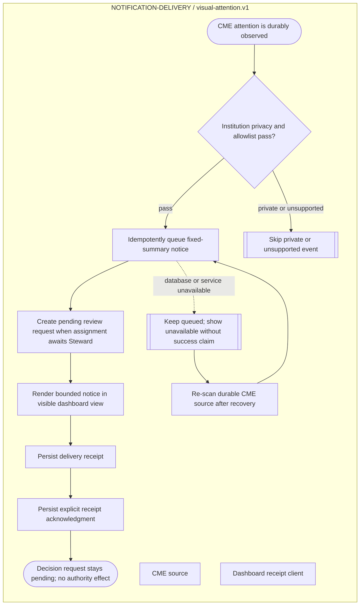

<!--
Riverview~ Controlled Document
File: docs/components/NOTIFICATION_DELIVERY_FLOW.md
Component: NOTIFICATION-DELIVERY
File Revision: 1.0.0
Purpose: Focused notification lifecycle flow generated from canonical JSON
Authority: Documentation only
Changed: 2026-10-11 UTC | RV-M3.2-001 | Register visual attention flow
History: Git and revision/backup manifest
-->
# Notification delivery flow

Canonical source: `process_graphs/notification-delivery/visual-attention.json`.
Generate this diagram with `python3 scripts/process_graph.py generate`; do not
edit the Mermaid source independently.

