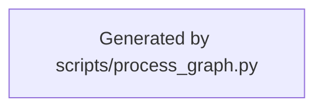

<!--
Riverview~ Controlled Document
File: docs/components/REPOSITORY_KNOWLEDGE_FLOW.md
Component: REPOSITORY-KNOWLEDGE-PROVIDER
Document Revision: 1.0.0
Purpose: Display pinned contract retrieval, failure and worker handoff
Authority: A source lookup cannot grant work authority
Changed: 2026-10-11 UTC | RV-M3.3-REPOSITORY-KNOWLEDGE | Initial graph view
Generated from: process_graphs/knowledge-provider/repository-contracts.json
History: Git and .riverview-backups/manifest.jsonl
-->
# Repository knowledge retrieval and handoff

**Canonical workflow:** `rv:repository-knowledge-provider:pinned-worker-contracts`  
**Generated from:** canonical JSON graph; do not hand-edit the Mermaid block.  
**Cookbook:** [diagnosis and recovery](REPOSITORY_KNOWLEDGE_COOKBOOK.md)

## Diagnostic mapping

| Stable node | Expected evidence | Failure meaning | Safe resume |
|---|---|---|---|
| `rv:repository-knowledge-provider:pinned-worker-contracts:pin` | Runtime/package commit equals approved full commit | Source identity is stale or unapproved | Rebuild/publish exact pinned package; lookup again |
| `rv:repository-knowledge-provider:pinned-worker-contracts:integrity` | Clean tracked sources or matching package digests | Source bytes may differ from verified commit | Preserve current evidence and install an exact package |
| `rv:repository-knowledge-provider:pinned-worker-contracts:read` | All bounded source files decode | Missing, oversized or invalid source | Keep work waiting; repair the package/contract revision |
| `rv:repository-knowledge-provider:pinned-worker-contracts:verified` | Complete result with refs/revision/hash | Source retrieval verified; not action authorization | Worker continues to its independent authority and verification gates |
