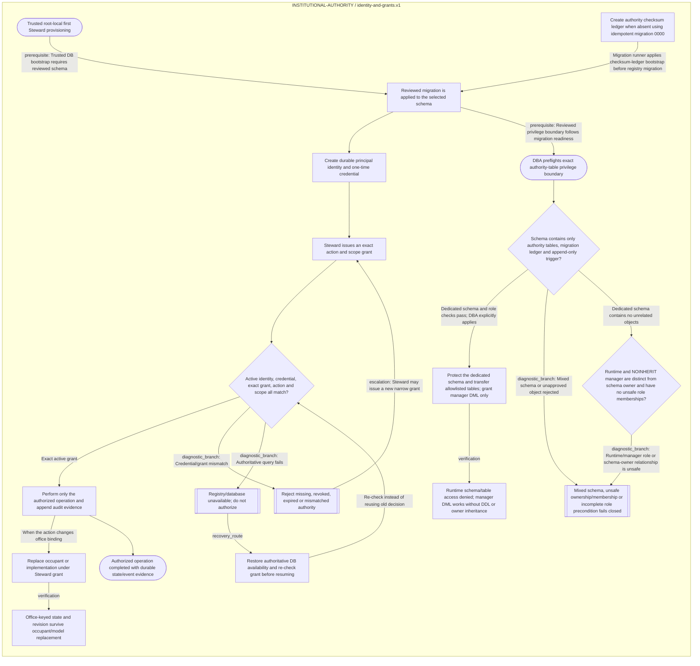

<!--
Riverview~ Controlled Document
File: docs/components/INSTITUTIONAL_AUTHORITY_FLOW.md
Component: INSTITUTIONAL-AUTHORITY
File Revision: 1.0.4
Purpose: Map root-local bootstrap, authorization, office state and recovery
Authority: Deny when principal, credential, grant, or source state is uncertain
Changed: 2026-10-11 UTC | RV-M4.1-001 | Remove trailing-space Markdown hardbreaks
Changed: 2026-10-11 UTC | RV-M4.1-DB-BOUNDARY-GRAPH | Regenerate focused authority diagram for the database privilege boundary
Changed: 2026-10-11 UTC | RV-M4.1-LEAST-PRIVILEGE | Render dedicated-schema gate and scoped manager DML path
History: Git and .riverview-backups/manifest.jsonl
-->
# Institutional authority and office continuity flow

**Canonical workflow:** `rv:institutional-authority:identity-and-grants`
**Generated from:** canonical JSON graph. Do not hand-edit the Mermaid block.
**Cookbook:** [diagnosis and recovery](INSTITUTIONAL_AUTHORITY_COOKBOOK.md)

## Diagnostic mapping

| Step ID | Expected result | Failure signal | First read-only check | Recovery/resume |
|---|---|---|---|---|
| `rv:institutional-authority:identity-and-grants:bootstrap` | One active Steward identity | Steward missing or duplicate bootstrap | Count active Steward principals | Use the protected local bootstrap procedure; never reset the schema |
| `rv:institutional-authority:identity-and-grants:authenticate` | Active credential digest maps to an active principal | `AuthorityDenied` | Check principal and credential status without selecting digest | Rotate through Steward identity management; resume at authorization |
| `rv:institutional-authority:identity-and-grants:authorize` | Exact action and scope grant exists and is valid | denied/expired/revoked grant | Read grant ID, action, scope, and validity window | Steward issues a new least-scope grant; retry the denied operation |
| `rv:institutional-authority:identity-and-grants:replace-binding` | Binding revision increments and office state stays stable | foreign-key or state-revision conflict | Read binding, occupant, implementation, and office-state revisions | Correct the target identity; do not rewrite office state |
| `rv:institutional-authority:identity-and-grants:registry-unavailable` | Service reports unavailable, not authorized | PostgreSQL error or stale connection | Check registry DB health and migration ledger | Restore DB access; re-evaluate exact grant before retry |

Only a bound current occupant/implementation is shown as current. No browser
authorization API exists in this milestone.
