# Grace Operational Integration

**Document Revision:** 1.0.12
**Status:** PARTIALLY IMPLEMENTED — deterministic objective/work-order infrastructure and office-bound ResidentReasoner integration verified in isolated PostgreSQL tests; no live resident/model commissioning.
**Canonical source:** `process_graphs/grace/operational-integration.json` and `process_graphs/cme/progress-and-recovery.json`.
**Generation:** `python3 scripts/process_graph.py generate`; do not edit the Mermaid projection manually.

This flow registers the objective intake, authority binding, office-bound
reasoning, durable plan, assignment fanout, CME observation, artifact
verification, follow-up, and genuine Steward escalation required by M4.4. The
deterministic infrastructure and isolated persistent-resident integration are
implemented and tested; live resident commissioning, sustained follow-up, and
operational Grace acceptance remain open.

The implemented infrastructure slice is documented in
docs/components/GRACE_EXECUTION_PIPELINE.md. It covers exact-grant objective
intake, commit-pinned bounded evidence selection, typed proposal persistence,
transactional authorized assignment handoff, one bounded local artifact worker
action, and independent artifact verification. Deterministic tests do not establish
live model reasoning, commissioned worker service, dashboard integration, repeated
unattended operation, or full M4.4 acceptance. Nodes distinguish tested
infrastructure from the remaining operational Grace work.

Stable jump points connect Grace delegation to
`rv:worker-adapter:deterministic-attempt:continuous-cycle`, CME progress to
`rv:cme:progress-and-recovery:observe`, and CME attention feedback to
`rv:grace:operational-integration:evidence-review`.

```mermaid
flowchart LR
  subgraph g_rv_cme_progress_and_recovery["CME / progress-and-recovery.v1"]
    g_rv_cme_progress_and_recovery_monitor_start_3c5b8496(["Acquire the CME PostgreSQL advisory lease and begin repeated scans"])
    g_rv_cme_progress_and_recovery_observe_428defda["Read all nonterminal assignments, durable progress events, deadlines, and leases"]
    g_rv_cme_progress_and_recovery_stall_decision_e8a6e869{"Compare progress age and deadlines with explicit thresholds; preserve assignment isolation"}
    g_rv_cme_progress_and_recovery_attention_845fe834[["Append idempotent attention events for stalled, overdue, blocked, or waiting assignments"]]
    g_rv_cme_progress_and_recovery_recovery_22db97e3["Append one traceable recovery request for a stalled expired lease; CME does not execute it"]
    g_rv_cme_progress_and_recovery_resident_feedback_ff3dbee2["PLANNED — return progress and attention evidence to Grace"]
    g_rv_cme_progress_and_recovery_service_lock_cd8c9580{"Is this instance the sole holder of the CME service lease?"}
    g_rv_cme_progress_and_recovery_deadline_measurement_e28bd00c["Measure configured UTC deadline and durable progress age"]
    g_rv_cme_progress_and_recovery_worker_health_5dbdee95["Report workers healthy only from fresh unexpired lease heartbeats"]
    g_rv_cme_progress_and_recovery_monitor_failure_e312bec5[["Persist sanitized scan failure when PostgreSQL remains reachable"]]
    g_rv_cme_progress_and_recovery_retry_backoff_c0e76a05["Retry database observation with bounded exponential backoff"]
    g_rv_cme_progress_and_recovery_systemd_launch_1c419c2e(["systemd starts the isolated CME monitor service"])
    g_rv_cme_progress_and_recovery_credential_validation_88942fa5{"Validate exact systemd credential, DSN, and non-root runtime identity"}
    g_rv_cme_progress_and_recovery_credential_failure_57557600[["Reject invalid monitor credential or runtime configuration without exposing secrets"]]
  end
  g_rv_grace_operational_integration_evidence_review_600fe7b4["Registered target<br/>rv:grace:operational-integration"]
  g_rv_cme_progress_and_recovery_monitor_start_3c5b8496 --> g_rv_cme_progress_and_recovery_service_lock_cd8c9580
  g_rv_cme_progress_and_recovery_service_lock_cd8c9580 -->|single active monitor instance| g_rv_cme_progress_and_recovery_observe_428defda
  g_rv_cme_progress_and_recovery_service_lock_cd8c9580 -->|diagnostic_branch: database unavailable or service lease held| g_rv_cme_progress_and_recovery_monitor_failure_e312bec5
  g_rv_cme_progress_and_recovery_observe_428defda --> g_rv_cme_progress_and_recovery_deadline_measurement_e28bd00c
  g_rv_cme_progress_and_recovery_deadline_measurement_e28bd00c --> g_rv_cme_progress_and_recovery_worker_health_5dbdee95
  g_rv_cme_progress_and_recovery_worker_health_5dbdee95 --> g_rv_cme_progress_and_recovery_stall_decision_e8a6e869
  g_rv_cme_progress_and_recovery_stall_decision_e8a6e869 -->|No overdue, stalled, blocked, or waiting condition; continue scan| g_rv_cme_progress_and_recovery_observe_428defda
  g_rv_cme_progress_and_recovery_stall_decision_e8a6e869 -->|escalation: Durable attention required| g_rv_cme_progress_and_recovery_attention_845fe834
  g_rv_cme_progress_and_recovery_stall_decision_e8a6e869 -->|diagnostic_branch: Query or persistence failure| g_rv_cme_progress_and_recovery_monitor_failure_e312bec5
  g_rv_cme_progress_and_recovery_attention_845fe834 -->|recovery_route: Stalled running assignment has expired lease| g_rv_cme_progress_and_recovery_recovery_22db97e3
  g_rv_cme_progress_and_recovery_attention_845fe834 -->|documentation: Future Grace integration reads authoritative attention events| g_rv_cme_progress_and_recovery_resident_feedback_ff3dbee2
  g_rv_cme_progress_and_recovery_resident_feedback_ff3dbee2 -->|jump| g_rv_grace_operational_integration_evidence_review_600fe7b4
  g_rv_cme_progress_and_recovery_recovery_22db97e3 -->|Request recorded; monitor continues unrelated work| g_rv_cme_progress_and_recovery_observe_428defda
  g_rv_cme_progress_and_recovery_monitor_failure_e312bec5 -->|recovery_route| g_rv_cme_progress_and_recovery_retry_backoff_c0e76a05
  g_rv_cme_progress_and_recovery_retry_backoff_c0e76a05 -->|recovery_route: Reacquire service lease and rescan durable state| g_rv_cme_progress_and_recovery_monitor_start_3c5b8496
  g_rv_cme_progress_and_recovery_systemd_launch_1c419c2e --> g_rv_cme_progress_and_recovery_credential_validation_88942fa5
  g_rv_cme_progress_and_recovery_credential_validation_88942fa5 -->|Credential and runtime identity valid| g_rv_cme_progress_and_recovery_monitor_start_3c5b8496
  g_rv_cme_progress_and_recovery_credential_validation_88942fa5 -->|diagnostic_branch: Missing, unsafe, or overridden credential/configuration| g_rv_cme_progress_and_recovery_credential_failure_57557600
  g_rv_cme_progress_and_recovery_credential_failure_57557600 -->|recovery_route: Correct protected configuration; systemd restart policy retries bounded failures| g_rv_cme_progress_and_recovery_systemd_launch_1c419c2e
  classDef failure fill:#fee,stroke:#b00,stroke-width:2px
```

## CME progress and recovery view

```mermaid
flowchart LR
  subgraph g_rv_grace_operational_integration["RESIDENT-ORCHESTRATION / grace-engineering-objective.v1"]
    g_rv_grace_operational_integration_objective_intake_55567c14(["IMPLEMENTED INFRASTRUCTURE — exact objective.submit grant persists objective and receipt event"])
    g_rv_grace_operational_integration_authority_check_71ce44bf["IMPLEMENTED — objective.submit and assignment.create use exact active grants; no proposal grants authority"]
    g_rv_grace_operational_integration_reason_decompose_d48619ca["DETERMINISTIC CONTRACT TESTED — typed PlanProposal boundary; live model reasoning remains uncommissioned"]
    g_rv_grace_operational_integration_durable_plan_26bc431c["IMPLEMENTED — objective, complete evidence provenance, and unapproved plan persist in PostgreSQL"]
    g_rv_grace_operational_integration_assignment_fanout_81ca8043["IMPLEMENTED SINGLE WORK ORDER — exact-grant intake links assignment and objective transactionally"]
    g_rv_grace_operational_integration_worker_dispatch_20506b72["DETERMINISTIC ADAPTER TESTED — lease-dispatched worker writes one bounded artifact; live executor remains outstanding"]
    g_rv_grace_operational_integration_cme_progress_68f6775b["PLANNED — subscribe to durable progress, stall, and recovery events from CME"]
    g_rv_grace_operational_integration_evidence_review_600fe7b4["IMPLEMENTED TEST PATH — independently reopened artifact and accepted verifier record determine completion"]
    g_rv_grace_operational_integration_verification_feedback_3d572dc6["PLANNED — consume independent verifier decision and evidence"]
    g_rv_grace_operational_integration_objective_check_1e4d916a{"PLANNED — determine whether objective acceptance criteria are independently met"}
    g_rv_grace_operational_integration_replan_58351ccd["PLANNED — revise plan and initiate follow-up work after evidence or failure"]
    g_rv_grace_operational_integration_steward_escalation_ca57acbb[["PLANNED — request only genuine Steward decision or authority"]]
    g_rv_grace_operational_integration_objective_complete_a6f22d23(["TEST VERIFIED — objective closes only after persisted independent ACCEPTED verification"])
    g_rv_grace_operational_integration_bounded_evidence_selection_eb29b3f5["IMPLEMENTED — select complete task-relevant passages from commit-pinned repository sources"]
    g_rv_grace_operational_integration_proposal_validation_90e4c0ca["IMPLEMENTED — persist only typed proposals after complete VERIFIED grounding"]
    g_rv_grace_operational_integration_work_order_authorization_829196dd["IMPLEMENTED — assignment.create exact grant precedes durable CME handoff"]
    g_rv_grace_operational_integration_independent_artifact_check_2502f001["IMPLEMENTED TEST ADAPTER — reopen artifact and verify digest, task identity, criteria, and provenance"]
    g_rv_grace_operational_integration_waiting_and_failure_0a7985d4[["IMPLEMENTED — unavailable/missing/oversized evidence and worker failures remain non-complete"]]
    g_rv_grace_operational_integration_governed_objective_api_39b3aa23["Authenticated dashboard request plus exact objective.submit grant persists a bounded human objective; grounding may wait fail-closed"]
    g_rv_grace_operational_integration_typed_proposal_api_9e97178a["Typed PlanProposal is persisted only after verified grounding and complete acceptance criteria; proposal does not grant authority"]
    g_rv_grace_operational_integration_persistent_service_loop_3c9f3eb8["Supervised loop reloads durable objectives, dispatches eligible proposals, polls the existing leased worker, verifies outcomes, and records heartbeat"]
    g_rv_grace_operational_integration_dispatch_retry_limit_3d51ab17{"Persist authorization/dispatch failures; stop automatic dispatch after three attempts and expose the proposal for operator attention"}
    g_rv_grace_operational_integration_dashboard_objective_projection_4a2e9051["Authenticated dashboard reads bounded objective, assignment, artifact digest, verifier decision, and service freshness from PostgreSQL"]
    g_rv_grace_operational_integration_worker_retry_ceiling_11dc0c66{"Apply the configured persistent retry-safe recovery ceiling; exhausted assignments remain blocked with a recovery record"}
    g_rv_grace_operational_integration_verification_failure_isolation_cf6b467b[["Verifier invocation failures are persisted per attempt, capped at three, and skipped so unrelated verification candidates continue"]]
    g_rv_grace_operational_integration_office_bound_resident_runtime_93950d11["ISOLATED INTEGRATION VERIFIED — persistent runtime authenticates the current office.state.write occupant grant and requires a bound office implementation before resident reasoning"]
    g_rv_grace_operational_integration_office_state_restart_and_replacement_0c6a704e["ISOLATED INTEGRATION VERIFIED — reconstructed resident runtime resumes office-keyed plan under replacement binding; stale occupant grant is denied"]
    g_rv_grace_operational_integration_stale_resident_denied_bacbbff8[["A revoked or stale resident exact grant cannot persist a proposal; CME worker and verifier authorization remain separate"]]
  end
  g_rv_worker_adapter_deterministic_attempt_continuous_cycle_b746f9c4["Registered target<br/>rv:worker-adapter:deterministic-attempt"]
  g_rv_cme_progress_and_recovery_observe_428defda["Registered target<br/>rv:cme:progress-and-recovery"]
  g_rv_outcome_verifier_independent_result_decision_5500806a["Registered target<br/>rv:outcome-verifier:independent-result"]
  g_rv_grace_operational_integration_objective_intake_55567c14 --> g_rv_grace_operational_integration_authority_check_71ce44bf
  g_rv_grace_operational_integration_authority_check_71ce44bf --> g_rv_grace_operational_integration_reason_decompose_d48619ca
  g_rv_grace_operational_integration_reason_decompose_d48619ca --> g_rv_grace_operational_integration_durable_plan_26bc431c
  g_rv_grace_operational_integration_durable_plan_26bc431c --> g_rv_grace_operational_integration_assignment_fanout_81ca8043
  g_rv_grace_operational_integration_assignment_fanout_81ca8043 --> g_rv_grace_operational_integration_worker_dispatch_20506b72
  g_rv_grace_operational_integration_worker_dispatch_20506b72 -->|jump| g_rv_worker_adapter_deterministic_attempt_continuous_cycle_b746f9c4
  g_rv_grace_operational_integration_assignment_fanout_81ca8043 --> g_rv_grace_operational_integration_cme_progress_68f6775b
  g_rv_grace_operational_integration_cme_progress_68f6775b -->|jump| g_rv_cme_progress_and_recovery_observe_428defda
  g_rv_grace_operational_integration_evidence_review_600fe7b4 --> g_rv_grace_operational_integration_objective_check_1e4d916a
  g_rv_grace_operational_integration_evidence_review_600fe7b4 --> g_rv_grace_operational_integration_verification_feedback_3d572dc6
  g_rv_grace_operational_integration_verification_feedback_3d572dc6 -->|jump| g_rv_outcome_verifier_independent_result_decision_5500806a
  g_rv_grace_operational_integration_objective_check_1e4d916a -->|verification: PLANNED — all criteria independently verified| g_rv_grace_operational_integration_objective_complete_a6f22d23
  g_rv_grace_operational_integration_objective_check_1e4d916a -->|recovery_route: PLANNED — unmet criteria or new evidence| g_rv_grace_operational_integration_replan_58351ccd
  g_rv_grace_operational_integration_objective_check_1e4d916a -->|escalation: PLANNED — genuine decision required| g_rv_grace_operational_integration_steward_escalation_ca57acbb
  g_rv_grace_operational_integration_replan_58351ccd --> g_rv_grace_operational_integration_durable_plan_26bc431c
  g_rv_grace_operational_integration_steward_escalation_ca57acbb -->|PLANNED — resume after recorded decision| g_rv_grace_operational_integration_durable_plan_26bc431c
  g_rv_grace_operational_integration_objective_intake_55567c14 --> g_rv_grace_operational_integration_bounded_evidence_selection_eb29b3f5
  g_rv_grace_operational_integration_bounded_evidence_selection_eb29b3f5 --> g_rv_grace_operational_integration_proposal_validation_90e4c0ca
  g_rv_grace_operational_integration_bounded_evidence_selection_eb29b3f5 -->|diagnostic_branch| g_rv_grace_operational_integration_waiting_and_failure_0a7985d4
  g_rv_grace_operational_integration_proposal_validation_90e4c0ca --> g_rv_grace_operational_integration_work_order_authorization_829196dd
  g_rv_grace_operational_integration_work_order_authorization_829196dd --> g_rv_grace_operational_integration_assignment_fanout_81ca8043
  g_rv_grace_operational_integration_work_order_authorization_829196dd -->|diagnostic_branch| g_rv_grace_operational_integration_waiting_and_failure_0a7985d4
  g_rv_grace_operational_integration_independent_artifact_check_2502f001 --> g_rv_grace_operational_integration_objective_check_1e4d916a
  g_rv_grace_operational_integration_independent_artifact_check_2502f001 -->|diagnostic_branch| g_rv_grace_operational_integration_waiting_and_failure_0a7985d4
  g_rv_grace_operational_integration_evidence_review_600fe7b4 --> g_rv_grace_operational_integration_independent_artifact_check_2502f001
  g_rv_grace_operational_integration_governed_objective_api_39b3aa23 --> g_rv_grace_operational_integration_objective_intake_55567c14
  g_rv_grace_operational_integration_objective_intake_55567c14 --> g_rv_grace_operational_integration_typed_proposal_api_9e97178a
  g_rv_grace_operational_integration_typed_proposal_api_9e97178a --> g_rv_grace_operational_integration_persistent_service_loop_3c9f3eb8
  g_rv_grace_operational_integration_persistent_service_loop_3c9f3eb8 --> g_rv_grace_operational_integration_work_order_authorization_829196dd
  g_rv_grace_operational_integration_persistent_service_loop_3c9f3eb8 --> g_rv_grace_operational_integration_worker_dispatch_20506b72
  g_rv_grace_operational_integration_persistent_service_loop_3c9f3eb8 --> g_rv_grace_operational_integration_independent_artifact_check_2502f001
  g_rv_grace_operational_integration_persistent_service_loop_3c9f3eb8 -->|documentation| g_rv_grace_operational_integration_dashboard_objective_projection_4a2e9051
  g_rv_grace_operational_integration_persistent_service_loop_3c9f3eb8 -->|diagnostic_branch| g_rv_grace_operational_integration_dispatch_retry_limit_3d51ab17
  g_rv_grace_operational_integration_dispatch_retry_limit_3d51ab17 -->|escalation| g_rv_grace_operational_integration_waiting_and_failure_0a7985d4
  g_rv_grace_operational_integration_persistent_service_loop_3c9f3eb8 -->|recovery_route| g_rv_grace_operational_integration_worker_retry_ceiling_11dc0c66
  g_rv_grace_operational_integration_persistent_service_loop_3c9f3eb8 -->|diagnostic_branch| g_rv_grace_operational_integration_verification_failure_isolation_cf6b467b
  g_rv_grace_operational_integration_verification_failure_isolation_cf6b467b -->|recovery_route| g_rv_grace_operational_integration_independent_artifact_check_2502f001
  g_rv_grace_operational_integration_verification_failure_isolation_cf6b467b -->|documentation| g_rv_grace_operational_integration_dashboard_objective_projection_4a2e9051
  g_rv_grace_operational_integration_office_bound_resident_runtime_93950d11 -->|prerequisite: exact office grant and current binding verified before resident proposal| g_rv_grace_operational_integration_reason_decompose_d48619ca
  g_rv_grace_operational_integration_reason_decompose_d48619ca -->|plan and outcomes are stored under stable office identity| g_rv_grace_operational_integration_office_state_restart_and_replacement_0c6a704e
  g_rv_grace_operational_integration_office_bound_resident_runtime_93950d11 -->|diagnostic_branch: revoked credential or unbound office fails closed| g_rv_grace_operational_integration_stale_resident_denied_bacbbff8
  g_rv_grace_operational_integration_stale_resident_denied_bacbbff8 -->|recovery_route: record no proposal; replace/reissue only through existing authorized identity lifecycle| g_rv_grace_operational_integration_waiting_and_failure_0a7985d4
  classDef failure fill:#fee,stroke:#b00,stroke-width:2px
```

Revision history: 1.0.0 — initial planned M4.4 view; canonical views are generated.
