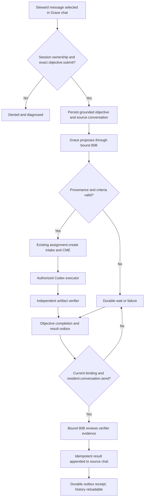

<!--
Riverview~ Controlled Document
File: docs/components/GRACE_EXECUTION_PIPELINE.md
Component: RESIDENT-ORCHESTRATION
File Revision: 1.1.4
Purpose: Specify the deterministic, governed objective-to-work-order infrastructure slice
Authority: Engineering contract; not evidence of production Grace commissioning
Changed: 2026-10-11 UTC | RV-M4.4-PERSISTENT-EXECUTION | Link persistent reconciliation and authenticated dashboard handoff
Changed: 2026-10-13 UTC | RV-GRACE-CONVERSATION-WORKORDER-CONTRACT | Document explicit message-origin objective intake and its exact Steward grant
Changed: 2026-10-13 UTC | RV-CODEX-CLI-ADAPTER-001 | Record the source-only bounded Codex artifact adapter and commissioning gates
Changed: 2026-10-13 UTC | RV-GRACE-CODEX-DISPATCH | Wire a registered Codex capability through leased execution and independent Markdown verification
Changed: 2026-10-13 UTC | RV-GRACE-CODEX-DISPATCH-CREDENTIAL | Bind the Codex API key to a protected systemd credential and exact Engineering scope
Changed: 2026-10-13 UTC | RV-CODEX-SUBSCRIPTION-SUPERVISOR-001 | Replace API-key execution with a bounded one-objective ChatGPT-session mode
Changed: 2026-10-13 UTC | RV-SUPERVISED-CODEX-DISPATCH-001 | Pin supervised reasoning, dispatch, claim, verification, and completion to one objective
Changed: 2026-10-14 UTC | RV-GRACE-ADB-LOOP-001 | Route proposals through the bound 80B and return independently verified results to source chat
Changed: 2026-10-15 UTC | RV-GRACE-WORKORDER-RETRY-003 | Reuse immutable acceptance criteria on authorized same-origin retries
Changed: 2026-10-15 UTC | RV-GRACE-GROUNDING-BOUNDED-001 | Rank complete task-relevant passages within the evidence envelope
Changed: 2026-10-15 UTC | RV-GRACE-OBJECTIVE-REGROUND-001 | Allow a verified same-origin retry to advance WAITING_FOR_EVIDENCE atomically
Changed: 2026-10-15 UTC | RV-GRACE-OBJECTIVE-CONTEXT-001 | Include the exact resident reasoning contract in durable assignment context
Changed: 2026-10-15 UTC | RV-GRACE-PROPOSAL-TIMEOUT-001 | Bound 80B proposal inference to a shared 60-second request deadline
Changed: 2026-10-15 UTC | RV-GRACE-AUTHORIZED-SNAPSHOT-001 | Revalidate resident authority through the restricted office-state capability
-->
# Grace Execution Pipeline — infrastructure slice

**Status:** Implemented for deterministic, isolated integration; not a commissioned operational Grace resident.

The persistent reconciliation loop, governed dashboard routes, objective projections,
restart behavior, and the bounded-retry dispatch policy are specified in
[`GRACE_PERSISTENT_EXECUTION.md`](GRACE_PERSISTENT_EXECUTION.md). Diagnosis and recovery
steps are in [`GRACE_EXECUTION_COOKBOOK.md`](GRACE_EXECUTION_COOKBOOK.md). Neither document
claims live installation or Camrui commissioning.

**Source:** src/riverview_core/resident_execution/ and the existing assignment, scheduler, worker, and verifier modules.

## Lifecycle and authority

1. GraceExecutionPipeline.submit_objective(...) requires the exact objective.submit grant for the supplied scope. It writes the bounded human request, criteria, authenticated submitter, and objective.received event together.
2. ground_objective(objective_id) asks TaskRelevantRepositoryKnowledgeProvider for the resident contract at one pinned Git commit. The provider verifies the full allowlisted source set and selects ranked, complete paragraphs within a 7 KiB selection budget, leaving room for the provenance envelope under the 8 KiB serialized evidence limit. It records the selection policy and query-term coverage; it does not claim every lexical match was passed to the model. Paragraphs are never clipped. Missing sources or a selection with no complete passage that fits waits/fails closed.
   A same-origin retry may call grounding again while the durable objective is `WAITING_FOR_EVIDENCE`. Verified evidence atomically advances either `RECEIVED` or `WAITING_FOR_EVIDENCE` to `GROUNDED`; the state predicate prevents a second concurrent retry from overwriting an already grounded or later-stage objective. Incomplete evidence remains pending with a new revision and event.
3. record_proposal(objective_id, PlanProposal) accepts only the existing typed plan. It stores the unapproved plan and hash. This method is a persistence boundary, not a reasoning engine.
4. authorize_and_dispatch(...) requires exact assignment.create, the same scope as intake, and complete verified evidence. It uses AuthorizedAssignmentIntake; assignment + creation event + objective/work-order link are one PostgreSQL transaction. The event processor remains responsible for queued-to-ready.
5. ContinuousWorker obtains a lease, rechecks its registered engineering.bounded-artifact.v1 capability, and writes one small JSON work product into a mode-0700 workspace. The worker has no shell, command, or caller-selected path.
6. BoundedArtifactVerifier reopens the artifact by an assignment-derived name, verifies bytes/provenance/shape independently, and the existing adapter persists verification before completion. The objective can be marked complete only from a completed assignment plus persisted ACCEPTED verification.
7. For a `grace.readiness_router.v1` binding, ResidentReasoner proposals use the router's typed `propose()` method, which checks the router revision and calls only the authorized 80B provider. The 0.6B and 30B cannot substitute for an Engineering proposal. Provider, served model, digest and reasoning stage are persisted with the plan.
8. Conversation-origin objectives with an independently accepted completion enter a PostgreSQL-backed result outbox. The persistent service rechecks Grace's current office binding and exact `resident.conversation.send` grant, asks the bound 80B to review verifier evidence, and appends one assistant response to the original conversation. A stable objective-derived response ID makes retries idempotent; the outbox is acknowledged only after the conversation event is durable. Provider or authorization failure leaves it pending for retry.

`read_reasoning_context(...)` includes the exact `repo://riverview/resident-engineering.v1`
contract reference expected by the resident knowledge adapter. Without it, the
generic repository path returns `NO_MATCH` and the persistent service waits before
calling the bound reasoning provider. With it, the existing pinned resident source
set is selected and revalidated; the reference grants no authority. Both grounding
and regrounding must still be complete and verified before a proposal is requested.
The owner-session 80B proposal HTTP call and ResidentReasoner caller share the
explicit `RIVERVIEW_RESIDENT_REASONING_TIMEOUT` deadline, bounded to 1–60 seconds.
The commissioned default is 60 seconds; model output remains subject to the
existing 256-token proposal budget, typed schema, binding revalidation, and CME
authorization. Chat routing retains its separate per-stage limits.
After inference, the reasoner revalidates the active occupant, exact office-state
grant and binding revision through the runtime-authorized office-state function.
It does not directly read protected AuthorityRegistry tables.

The authenticated chat UI exposes an explicit Steward action for a selected,
persisted user-authored conversation message. `POST
/api/v1/resident/conversations/{conversation_id}/work-orders` accepts only the
source sequence and Steward-entered acceptance criteria. The server rechecks the
account session, Steward website role, exact conversation read grant, source
message principal/ownership, and `objective.submit` on the fixed
`work-order:engineering` scope before persisting an objective with conversation
origin. A same-source retry revalidates that exact grant, reuses the durable
objective, and retains the original acceptance criteria; retry input cannot
rewrite them. A blank criteria field is accepted only when the same source
already has an objective. Ordinary chat is never promoted automatically. This
is objective intake; it is not a Grace proposal, assignment dispatch, worker
authorization, or proof of execution.

The return-to-chat path is source implemented, not production commissioned. It returns artifact reference, digest and independent verifier evidence for Grace's 80B review; the reviewer does not reopen arbitrary files. PostgreSQL integration tests require `RIVERVIEW_TEST_PG_DSN`; this checkout has no such DSN. The execution service and exact resident-send, assignment-create, executor and verifier grants remain commissioning prerequisites. No code in this increment creates or broadens grants.

This source increment is not proof of the live demonstration: no production deployment or migration occurred, PostgreSQL integration tests were skipped without a test DSN, and no real Codex artifact was produced here.

Cancellation is supported only before execution for queued/ready assignments and requires exact assignment.cancel. Running work cannot be force-cancelled by this slice; CME lease/recovery behavior remains authoritative.

## Interfaces and bounds

- Objective ID: objective: followed by 1–120 ASCII letters, digits, ., _, :, or -.
- Request: UTF-8, 1–4,096 bytes. Acceptance criteria: 1–20 strings, each at most 1,000 characters.
- Plan: the current resident_reasoning.PlanProposal and PlanStep contract.
- Dispatch currently accepts exactly one proposed step. It rejects multi-step
  proposals rather than silently discarding dependency/fanout information.
- Evidence: knowledge-provider v1 KnowledgeResult, full pinned-source verification plus deterministic ranked passage selection; max serialized evidence 8 KiB. All source refs, Git revision/hash, selection policy and term-coverage counts persist with the objective.
- Work order: assignment ID, objective ref, exact authority scope, contract ref, workflow ID/step, and correlation ID persist in the assignment ledger.
- Conversation origin: selected message sequence and conversation ID are attached to `objective.received`; only the authenticated linked Steward principal can submit from the chat route.
- Worker request: CodingWorkOrder carries assignment/objective identity, pinned repository revision, bounded task scope, criteria, exact allowed operation (write_bounded_json_artifact), and a 1–90 second timeout.
- The default bounded-artifact worker is deterministic and is not a general coding executor. The separate Codex CLI executor exists and is selected only by explicit configuration; this increment does not claim a real Codex run or commissioned resident service.
- Result: status, workspace URI/name, SHA-256, size, source revision/hash. No credential or objective authorization is inferred from a worker result.
- Failure, unavailable provider, serialization failure, oversized context, rejected authorization, incomplete verification, and cancellation do not produce objective completion.

## Verification

Run deterministic selector tests:

\`\`\`bash
PYTHONPATH=src python3 -m unittest discover -s tests -p 'test_resident_knowledge.py' -v
\`\`\`

Run PostgreSQL integration tests with a disposable test DSN:

\`\`\`bash
RIVERVIEW_TEST_PG_DSN='postgresql://…' PYTHONPATH=src python3 -m unittest discover -s tests -p 'test_grace_execution.py' -v
\`\`\`

Tests include authorized and unauthorized intake, commit-pinned selection, missing and oversized evidence, worker failure, incomplete verification, actual filesystem artifact creation, independent artifact reading, persisted ledger completion, and objective event history. These are model-independent infrastructure tests; they do not demonstrate live model reasoning, a resident service, a human dashboard interaction, or operational Grace acceptance.

### Codex CLI adapter — source-only checkpoint

`resident_execution.codex_cli.CodexCLIExecutionAdapter` accepts a typed
assignment, one operator-configured repository reference and pinned commit, and
a fixed `deliverable.md` output. It creates a fresh local clone, invokes the
configured Codex executable with `workspace-write`, network access disabled, a
noninteractive approval policy, bounded wall time and file size, and discarded
stdout/stderr. It rejects the interactive user's `~/.codex` directory and
returns only the assignment, source revision, artifact digest, and a
`verification_required` result. Synthetic tests use a fake executable; they do
not prove real Codex authentication or model execution.

`scripts/run_grace_execution_service.py` can now select this adapter only when
`RIVERVIEW_ENGINEERING_ADAPTER=codex-cli` is explicitly set. It registers the
exact `engineering.codex-cli-artifact.v1` capability through the existing
worker registry; worker registration and every claim/execution still require
the exact `worker.register` and `assignment.execute` grants in the assignment
scope. Startup preflight requires a configured executable, dedicated
`CODEX_HOME`, isolated workspace, pinned repository, and artifact directory.
The normal CME lease, preflight/regrounding, execution-intent, attempt/result,
and independent verification records remain the execution path. The
`CodexMarkdownVerifier` independently reopens the assignment-bound file,
checks ownership/mode/size/digest, objective binding, source provenance, and
literal acceptance criteria. The result path and digest are retained in the
worker result and Grace objective completion event/projection.

The capability registry records capability, active worker, and exact authority
scope; startup preflight plus the current Grace execution health heartbeat
provide dependency/readiness evidence. The Codex adapter no longer accepts or
passes `OPENAI_API_KEY`. Its supervised ChatGPT mode is available only to the
owning `admin1` identity from a TTY, uses that user's existing `CODEX_HOME`
directly without copying credentials, requires one explicit objective ID and
an exact terminal confirmation, and returns after that one bounded execution
cycle. It also requires the configured reasoning model identity to contain
`80b`; otherwise the run fails closed. The cycle dispatches and claims only the
selected assignment, then invokes the existing independent verifier and
completion reconciliation for that objective. A worker claim still requires
the existing exact `assignment.execute` grant, and dispatch still requires
`assignment.create` for the configured work-order scope.

This source path is not commissioned. The execution service and exact executor,
verifier, resident, and dispatch credentials/grants remain unavailable, and
the current live Grace reasoning route is not the 80B model. A ChatGPT login
was verified only for Camrui's interactive Codex CLI account; no account files
were copied and no real assignment was executed. Synthetic tests verify the
bounded adapter contracts but are not evidence of a live artifact.

The generated workflow below is a projection of process_graphs/grace/operational-integration.json. Regenerate with python3 scripts/process_graph.py generate; verify with python3 scripts/process_graph.py check.
