# Grace Operational Integration

**Document Revision:** 1.0.40
**Status:** PARTIALLY IMPLEMENTED — deterministic objective/work-order infrastructure and office-bound ResidentReasoner integration verified in isolated PostgreSQL tests; no live resident/model commissioning.
**Canonical source:** `process_graphs/grace/operational-integration.json` and `process_graphs/cme/progress-and-recovery.json`.
**Generation:** `python3 scripts/process_graph.py generate`; do not edit the Mermaid projection manually.

This flow registers the objective intake, authority binding, office-bound
reasoning, durable plan, assignment fanout, CME observation, artifact
verification, follow-up, and genuine Steward escalation required by M4.4. The
deterministic infrastructure and isolated persistent-resident integration are
implemented and tested; live resident commissioning, sustained follow-up, and
operational Grace acceptance remain open.

The implemented infrastructure slice is documented in
docs/components/GRACE_EXECUTION_PIPELINE.md. It covers exact-grant objective
intake, commit-pinned bounded evidence selection, typed proposal persistence,
transactional authorized assignment handoff, one bounded local artifact worker
action, and independent artifact verification. Deterministic tests do not establish
live model reasoning, commissioned worker service, dashboard integration, repeated
unattended operation, or full M4.4 acceptance. Nodes distinguish tested
infrastructure from the remaining operational Grace work.

Stable jump points connect Grace delegation to
`rv:worker-adapter:deterministic-attempt:continuous-cycle`, CME progress to
`rv:cme:progress-and-recovery:observe`, and CME attention feedback to
`rv:grace:operational-integration:evidence-review`.

```mermaid
flowchart LR
  subgraph g_rv_cme_progress_and_recovery["CME / progress-and-recovery.v1"]
    g_rv_cme_progress_and_recovery_monitor_start_3c5b8496(["Acquire the CME PostgreSQL advisory lease and begin repeated scans"])
    g_rv_cme_progress_and_recovery_observe_428defda["Read all nonterminal assignments, durable progress events, deadlines, and leases"]
    g_rv_cme_progress_and_recovery_stall_decision_e8a6e869{"Compare progress age and deadlines with explicit thresholds; preserve assignment isolation"}
    g_rv_cme_progress_and_recovery_attention_845fe834[["Append idempotent attention events for stalled, overdue, blocked, or waiting assignments"]]
    g_rv_cme_progress_and_recovery_recovery_22db97e3["Append one traceable recovery request for a stalled expired lease; CME does not execute it"]
    g_rv_cme_progress_and_recovery_resident_feedback_ff3dbee2["PLANNED — return progress and attention evidence to Grace"]
    g_rv_cme_progress_and_recovery_service_lock_cd8c9580{"Is this instance the sole holder of the CME service lease?"}
    g_rv_cme_progress_and_recovery_deadline_measurement_e28bd00c["Measure configured UTC deadline and durable progress age"]
    g_rv_cme_progress_and_recovery_worker_health_5dbdee95["Report workers healthy only from fresh unexpired lease heartbeats"]
    g_rv_cme_progress_and_recovery_monitor_failure_e312bec5[["Persist sanitized scan failure when PostgreSQL remains reachable"]]
    g_rv_cme_progress_and_recovery_retry_backoff_c0e76a05["Retry database observation with bounded exponential backoff"]
    g_rv_cme_progress_and_recovery_systemd_launch_1c419c2e(["systemd starts the isolated CME monitor service"])
    g_rv_cme_progress_and_recovery_credential_validation_88942fa5{"Validate exact systemd credential, DSN, and non-root runtime identity"}
    g_rv_cme_progress_and_recovery_credential_failure_57557600[["Reject invalid monitor credential or runtime configuration without exposing secrets"]]
  end
  g_rv_grace_operational_integration_evidence_review_600fe7b4["Registered target<br/>rv:grace:operational-integration"]
  g_rv_cme_progress_and_recovery_monitor_start_3c5b8496 --> g_rv_cme_progress_and_recovery_service_lock_cd8c9580
  g_rv_cme_progress_and_recovery_service_lock_cd8c9580 -->|single active monitor instance| g_rv_cme_progress_and_recovery_observe_428defda
  g_rv_cme_progress_and_recovery_service_lock_cd8c9580 -->|diagnostic_branch: database unavailable or service lease held| g_rv_cme_progress_and_recovery_monitor_failure_e312bec5
  g_rv_cme_progress_and_recovery_observe_428defda --> g_rv_cme_progress_and_recovery_deadline_measurement_e28bd00c
  g_rv_cme_progress_and_recovery_deadline_measurement_e28bd00c --> g_rv_cme_progress_and_recovery_worker_health_5dbdee95
  g_rv_cme_progress_and_recovery_worker_health_5dbdee95 --> g_rv_cme_progress_and_recovery_stall_decision_e8a6e869
  g_rv_cme_progress_and_recovery_stall_decision_e8a6e869 -->|No overdue, stalled, blocked, or waiting condition; continue scan| g_rv_cme_progress_and_recovery_observe_428defda
  g_rv_cme_progress_and_recovery_stall_decision_e8a6e869 -->|escalation: Durable attention required| g_rv_cme_progress_and_recovery_attention_845fe834
  g_rv_cme_progress_and_recovery_stall_decision_e8a6e869 -->|diagnostic_branch: Query or persistence failure| g_rv_cme_progress_and_recovery_monitor_failure_e312bec5
  g_rv_cme_progress_and_recovery_attention_845fe834 -->|recovery_route: Stalled running assignment has expired lease| g_rv_cme_progress_and_recovery_recovery_22db97e3
  g_rv_cme_progress_and_recovery_attention_845fe834 -->|documentation: Future Grace integration reads authoritative attention events| g_rv_cme_progress_and_recovery_resident_feedback_ff3dbee2
  g_rv_cme_progress_and_recovery_resident_feedback_ff3dbee2 -->|jump| g_rv_grace_operational_integration_evidence_review_600fe7b4
  g_rv_cme_progress_and_recovery_recovery_22db97e3 -->|Request recorded; monitor continues unrelated work| g_rv_cme_progress_and_recovery_observe_428defda
  g_rv_cme_progress_and_recovery_monitor_failure_e312bec5 -->|recovery_route| g_rv_cme_progress_and_recovery_retry_backoff_c0e76a05
  g_rv_cme_progress_and_recovery_retry_backoff_c0e76a05 -->|recovery_route: Reacquire service lease and rescan durable state| g_rv_cme_progress_and_recovery_monitor_start_3c5b8496
  g_rv_cme_progress_and_recovery_systemd_launch_1c419c2e --> g_rv_cme_progress_and_recovery_credential_validation_88942fa5
  g_rv_cme_progress_and_recovery_credential_validation_88942fa5 -->|Credential and runtime identity valid| g_rv_cme_progress_and_recovery_monitor_start_3c5b8496
  g_rv_cme_progress_and_recovery_credential_validation_88942fa5 -->|diagnostic_branch: Missing, unsafe, or overridden credential/configuration| g_rv_cme_progress_and_recovery_credential_failure_57557600
  g_rv_cme_progress_and_recovery_credential_failure_57557600 -->|recovery_route: Correct protected configuration; systemd restart policy retries bounded failures| g_rv_cme_progress_and_recovery_systemd_launch_1c419c2e
  classDef failure fill:#fee,stroke:#b00,stroke-width:2px
```



## CME progress and recovery view

```mermaid
flowchart LR
  subgraph g_rv_grace_operational_integration["RESIDENT-ORCHESTRATION / grace-engineering-objective.v1"]
    g_rv_grace_operational_integration_objective_intake_55567c14(["IMPLEMENTED — exact objective.submit persists one objective per authenticated conversation message origin; retries revalidate the grant and retain original criteria"])
    g_rv_grace_operational_integration_objective_intake_retry_fdc5836e["SAME-SOURCE RETRY — revalidate objective.submit, retain immutable criteria, and rerun grounding for the existing durable objective"]
    g_rv_grace_operational_integration_authority_check_71ce44bf["IMPLEMENTED — objective.submit and assignment.create use exact active grants; no proposal grants authority"]
    g_rv_grace_operational_integration_reason_decompose_d48619ca["ISOLATED PERSISTENT INTEGRATION TESTED — existing ResidentReasoner handles grounded objectives and stores office-keyed plans; live model and supervised resident commissioning remain unverified"]
    g_rv_grace_operational_integration_durable_plan_26bc431c["IMPLEMENTED — objective, complete evidence provenance, and unapproved plan persist in PostgreSQL"]
    g_rv_grace_operational_integration_assignment_fanout_81ca8043["IMPLEMENTED MULTI-STEP — persist one assignment per ordered proposal step; dispatch only when all dependency steps have independent verification"]
    g_rv_grace_operational_integration_worker_dispatch_20506b72["DETERMINISTIC ADAPTER TESTED — lease-dispatched worker writes one bounded artifact; live executor remains outstanding"]
    g_rv_grace_operational_integration_cme_progress_68f6775b["PLANNED — subscribe to durable progress, stall, and recovery events from CME"]
    g_rv_grace_operational_integration_evidence_review_600fe7b4["IMPLEMENTED TEST PATH — independently reopened artifact and accepted verifier record determine completion"]
    g_rv_grace_operational_integration_verification_feedback_3d572dc6["PLANNED — consume independent verifier decision and evidence"]
    g_rv_grace_operational_integration_objective_check_1e4d916a{"PLANNED — determine whether objective acceptance criteria are independently met"}
    g_rv_grace_operational_integration_replan_58351ccd["IMPLEMENTED IN SOURCE — model-reviewed same-objective continuation is durable, bounded by original criteria, revalidates Grace binding, and returns through existing CME grants, leases, and verifier; production unverified"]
    g_rv_grace_operational_integration_steward_escalation_ca57acbb[["PLANNED — request only genuine Steward decision or authority"]]
    g_rv_grace_operational_integration_objective_complete_a6f22d23(["TEST VERIFIED — objective closes only after persisted independent ACCEPTED verification"])
    g_rv_grace_operational_integration_bounded_evidence_selection_eb29b3f5["IMPLEMENTED — verify the full pinned source set and deterministically select ranked complete passages within the evidence bound; retain source provenance and coverage metadata"]
    g_rv_grace_operational_integration_proposal_validation_90e4c0ca["IMPLEMENTED — persist only typed proposals after complete VERIFIED grounding"]
    g_rv_grace_operational_integration_work_order_authorization_829196dd["IMPLEMENTED — assignment.create exact grant precedes durable CME handoff"]
    g_rv_grace_operational_integration_independent_artifact_check_2502f001["IMPLEMENTED TEST ADAPTER — reopen artifact and verify digest, task identity, criteria, and provenance"]
    g_rv_grace_operational_integration_waiting_and_failure_0a7985d4[["IMPLEMENTED — incomplete evidence remains pending; an authenticated retry after source correction either atomically advances the same objective to GROUNDED or records another pending revision"]]
    g_rv_grace_operational_integration_governed_objective_api_39b3aa23["Authenticated exact-grant request persists one receipt; VERIFIED grounding advances RECEIVED or WAITING_FOR_EVIDENCE to GROUNDED atomically, while incomplete evidence stays pending"]
    g_rv_grace_operational_integration_typed_proposal_api_9e97178a["Typed PlanProposal is persisted only after verified grounding and complete acceptance criteria; proposal does not grant authority"]
    g_rv_grace_operational_integration_persistent_service_loop_3c9f3eb8["Persistent loop reads and records authorized Grace objectives/events, dispatches eligible proposals, polls the existing leased worker, verifies outcomes, and persists heartbeat through the narrowly scoped runtime ACL; missing privileges remain a visible failure"]
    g_rv_grace_operational_integration_dispatch_retry_limit_3d51ab17{"Persist authorization/dispatch failures; stop automatic dispatch after three attempts and expose the proposal for operator attention"}
    g_rv_grace_operational_integration_dashboard_objective_projection_4a2e9051["Authenticated dashboard reads bounded objective, assignment, artifact digest, verifier decision, and service freshness from PostgreSQL"]
    g_rv_grace_operational_integration_worker_retry_ceiling_11dc0c66{"Apply the configured persistent retry-safe recovery ceiling; exhausted assignments remain blocked with a recovery record"}
    g_rv_grace_operational_integration_verification_failure_isolation_cf6b467b[["Verifier invocation failures are persisted per attempt, capped at three, and skipped so unrelated verification candidates continue"]]
    g_rv_grace_operational_integration_office_bound_resident_runtime_93950d11["ISOLATED INTEGRATION VERIFIED — persistent runtime authenticates the current office.state.write occupant grant and requires a bound office implementation before resident reasoning"]
    g_rv_grace_operational_integration_office_state_restart_and_replacement_0c6a704e["ISOLATED INTEGRATION VERIFIED — reconstructed resident runtime resumes office-keyed plan under replacement binding; stale occupant grant is denied"]
    g_rv_grace_operational_integration_stale_resident_denied_bacbbff8[["A stale resident grant is denied before grounding/provider use even if it is later reissued; office-state writes recheck the bound principal under a binding-row lock"]]
    g_rv_grace_operational_integration_conversation_origin_intake_ba92fbfa["Explicit Steward promotion validates a persisted principal-authored Grace message, conversation read grant, and exact objective.submit grant on work-order:engineering"]
    g_rv_grace_operational_integration_codex_capability_check_d39b996a{"SOURCE INTEGRATED — exact Codex artifact capability is registered through the existing worker registry; deployment remains blocked on service identity and grants"}
    g_rv_grace_operational_integration_codex_resource_check_71ed8b3b{"Sandbox readiness PASS on Camrui: reviewed per-executable bwrap AppArmor profile and bounded authenticated Codex artifact test; source release and owner-session service still not commissioned"}
    g_rv_grace_operational_integration_codex_authority_gate_738aae11{"Authorized fixed exact-scope standing grants provisioned through AuthorityRegistry; runtime exact worker.register and assignment.execute checks remain mandatory"}
    g_rv_grace_operational_integration_codex_cli_run_ade47dcf["INTEGRATED LEGACY ARTIFACT CAPABILITY — only deliverable.md may change; a separate exact-scope source-change capability produces a pinned patch and never applies it to production"]
    g_rv_grace_operational_integration_codex_artifact_verification_ab484b65["INTEGRATED SOURCE — separate verifier reopens the assignment-bound Markdown artifact and checks mode, size, digest, provenance and literal acceptance criteria"]
    g_rv_grace_operational_integration_codex_execution_failed_f49befea[["Sanitized Codex failures retain bounded error codes; a typed CodexActionFailure without a durable assignment artifact is retryable after lease expiry, while generic or artifact-bearing unknown outcomes remain blocked"]]
    g_rv_grace_operational_integration_codex_execution_recovery_5c33f626["Persisted CME recovery requeues a typed Codex no-artifact failure only after lease expiry, verified objective provenance, remaining retry budget, and no attempt/result/verifier/artifact; if the same assignment is WAITING_FOR_EVIDENCE, fresh VERIFIED grounding can atomically restore ready only after the same effect and lease checks; worker claim revalidates the exact grant"]
    g_rv_grace_operational_integration_engineering_resource_request_5f8561c6[["PLANNED — persist pending resource request for HR/Helen or Steward decision; Helen is not commissioned and no allocation is presumed"]]
    g_rv_grace_operational_integration_router_backed_grace_proposal_931750ec["SOURCE IMPLEMENTED — Persistent ResidentReasoner proposals use the active router binding and require actual 80B provenance; smaller stages cannot substitute"]
    g_rv_grace_operational_integration_verified_result_chat_return_108e1033["SOURCE IMPLEMENTED — Independently accepted objective result is reviewed by bound 80B and appended once to its source conversation with durable provenance"]
    g_rv_grace_operational_integration_verified_result_return_retry_ce159ed9["SOURCE IMPLEMENTED — Failed authorization/provider return remains in durable outbox; deterministic response identity prevents duplicate chat events after restart"]
    g_rv_grace_operational_integration_owner_session_provisioning_8f41090c["Implemented, isolated-tested provisioning: fixed AuthorityRegistry grants and protected credentials; stage reviewed owner-session unit without enabling or starting it"]
    g_rv_grace_operational_integration_objective_step_persistence_dd2c700f["Persist proposal step, dependency list, lifecycle state, and unique assignment identity in PostgreSQL"]
    g_rv_grace_operational_integration_dependency_ready_dispatch_b967d24b{"Dispatch only the first pending step whose dependencies are independently verified; reuse current CME lease and grants"}
    g_rv_grace_operational_integration_codex_source_change_b577dd01["Separate authorized source-change capability emits a scoped patch, inventory, digest, and fixed-test result from a pinned disposable clone"]
    g_rv_grace_operational_integration_codex_patch_independent_verification_4d8f66d4["Independent verifier reapplies patch to a clean pinned clone, checks exact authorized changed-file set and digest, and reruns fixed tests"]
    g_rv_grace_operational_integration_codex_source_scope_failure_ef462df9[["Reject source changes outside the assignment path allowlist or configured capability scope; no patch is applied to source checkout"]]
    g_rv_grace_operational_integration_objective_steps_b695f9d6["ISOLATED POSTGRES TESTED — persist stable ordered objective steps and per-step assignment identities; require accepted dependency verification before dispatch"]
    g_rv_grace_operational_integration_codex_owner_preflight_fb787eac["SOURCE IMPLEMENTED — resolve CODEX_HOME from RIVERVIEW_CODEX_HOME under private service state; require admin1-owned 0700 home and 0600 empty auth bind target, both Code Mode features, pinned companion path, AF_NETLINK for bwrap --unshare-net, and owner-session MemoryDenyWriteExecute=no; retain workspace-write, network-disabled, AppArmor confinement"]
    g_rv_grace_operational_integration_codex_owner_package_recovery_5bc0b582["BLOCKED UNTIL PACKAGE COMPLETE — preserve the objective and retry budget; install reviewed CLI package with executable Code Mode host through ordinary release procedure, never expose or copy owner credentials"]
  end
  g_rv_worker_adapter_deterministic_attempt_continuous_cycle_b746f9c4["Registered target<br/>rv:worker-adapter:deterministic-attempt"]
  g_rv_cme_progress_and_recovery_observe_428defda["Registered target<br/>rv:cme:progress-and-recovery"]
  g_rv_outcome_verifier_independent_result_decision_5500806a["Registered target<br/>rv:outcome-verifier:independent-result"]
  g_rv_grace_operational_integration_objective_intake_55567c14 --> g_rv_grace_operational_integration_authority_check_71ce44bf
  g_rv_grace_operational_integration_authority_check_71ce44bf --> g_rv_grace_operational_integration_reason_decompose_d48619ca
  g_rv_grace_operational_integration_reason_decompose_d48619ca --> g_rv_grace_operational_integration_durable_plan_26bc431c
  g_rv_grace_operational_integration_durable_plan_26bc431c --> g_rv_grace_operational_integration_assignment_fanout_81ca8043
  g_rv_grace_operational_integration_assignment_fanout_81ca8043 --> g_rv_grace_operational_integration_worker_dispatch_20506b72
  g_rv_grace_operational_integration_worker_dispatch_20506b72 -->|jump| g_rv_worker_adapter_deterministic_attempt_continuous_cycle_b746f9c4
  g_rv_grace_operational_integration_assignment_fanout_81ca8043 --> g_rv_grace_operational_integration_cme_progress_68f6775b
  g_rv_grace_operational_integration_cme_progress_68f6775b -->|jump| g_rv_cme_progress_and_recovery_observe_428defda
  g_rv_grace_operational_integration_evidence_review_600fe7b4 --> g_rv_grace_operational_integration_objective_check_1e4d916a
  g_rv_grace_operational_integration_evidence_review_600fe7b4 --> g_rv_grace_operational_integration_verification_feedback_3d572dc6
  g_rv_grace_operational_integration_verification_feedback_3d572dc6 -->|jump| g_rv_outcome_verifier_independent_result_decision_5500806a
  g_rv_grace_operational_integration_objective_check_1e4d916a -->|verification: PLANNED — all criteria independently verified| g_rv_grace_operational_integration_objective_complete_a6f22d23
  g_rv_grace_operational_integration_objective_check_1e4d916a -->|recovery_route: PLANNED — unmet criteria or new evidence| g_rv_grace_operational_integration_replan_58351ccd
  g_rv_grace_operational_integration_objective_check_1e4d916a -->|escalation: PLANNED — genuine decision required| g_rv_grace_operational_integration_steward_escalation_ca57acbb
  g_rv_grace_operational_integration_replan_58351ccd --> g_rv_grace_operational_integration_durable_plan_26bc431c
  g_rv_grace_operational_integration_steward_escalation_ca57acbb -->|PLANNED — resume after recorded decision| g_rv_grace_operational_integration_durable_plan_26bc431c
  g_rv_grace_operational_integration_objective_intake_55567c14 --> g_rv_grace_operational_integration_bounded_evidence_selection_eb29b3f5
  g_rv_grace_operational_integration_bounded_evidence_selection_eb29b3f5 --> g_rv_grace_operational_integration_proposal_validation_90e4c0ca
  g_rv_grace_operational_integration_bounded_evidence_selection_eb29b3f5 -->|diagnostic_branch| g_rv_grace_operational_integration_waiting_and_failure_0a7985d4
  g_rv_grace_operational_integration_proposal_validation_90e4c0ca --> g_rv_grace_operational_integration_work_order_authorization_829196dd
  g_rv_grace_operational_integration_work_order_authorization_829196dd --> g_rv_grace_operational_integration_assignment_fanout_81ca8043
  g_rv_grace_operational_integration_work_order_authorization_829196dd -->|diagnostic_branch| g_rv_grace_operational_integration_waiting_and_failure_0a7985d4
  g_rv_grace_operational_integration_independent_artifact_check_2502f001 --> g_rv_grace_operational_integration_objective_check_1e4d916a
  g_rv_grace_operational_integration_independent_artifact_check_2502f001 -->|diagnostic_branch| g_rv_grace_operational_integration_waiting_and_failure_0a7985d4
  g_rv_grace_operational_integration_evidence_review_600fe7b4 --> g_rv_grace_operational_integration_independent_artifact_check_2502f001
  g_rv_grace_operational_integration_governed_objective_api_39b3aa23 --> g_rv_grace_operational_integration_objective_intake_55567c14
  g_rv_grace_operational_integration_objective_intake_55567c14 --> g_rv_grace_operational_integration_bounded_evidence_selection_eb29b3f5
  g_rv_grace_operational_integration_objective_intake_55567c14 -->|recovery_route: Retry the same authenticated source without changing original objective acceptance criteria| g_rv_grace_operational_integration_objective_intake_retry_fdc5836e
  g_rv_grace_operational_integration_objective_intake_retry_fdc5836e -->|Reground the same objective; verified evidence advances it once to normal proposal processing| g_rv_grace_operational_integration_typed_proposal_api_9e97178a
  g_rv_grace_operational_integration_objective_intake_retry_fdc5836e -->|diagnostic_branch: Revoked exact grant or mismatched source identity fails closed without changing the objective| g_rv_grace_operational_integration_waiting_and_failure_0a7985d4
  g_rv_grace_operational_integration_typed_proposal_api_9e97178a --> g_rv_grace_operational_integration_persistent_service_loop_3c9f3eb8
  g_rv_grace_operational_integration_persistent_service_loop_3c9f3eb8 --> g_rv_grace_operational_integration_work_order_authorization_829196dd
  g_rv_grace_operational_integration_persistent_service_loop_3c9f3eb8 --> g_rv_grace_operational_integration_worker_dispatch_20506b72
  g_rv_grace_operational_integration_persistent_service_loop_3c9f3eb8 --> g_rv_grace_operational_integration_independent_artifact_check_2502f001
  g_rv_grace_operational_integration_persistent_service_loop_3c9f3eb8 -->|documentation| g_rv_grace_operational_integration_dashboard_objective_projection_4a2e9051
  g_rv_grace_operational_integration_persistent_service_loop_3c9f3eb8 -->|diagnostic_branch| g_rv_grace_operational_integration_dispatch_retry_limit_3d51ab17
  g_rv_grace_operational_integration_dispatch_retry_limit_3d51ab17 -->|escalation| g_rv_grace_operational_integration_waiting_and_failure_0a7985d4
  g_rv_grace_operational_integration_persistent_service_loop_3c9f3eb8 -->|recovery_route| g_rv_grace_operational_integration_worker_retry_ceiling_11dc0c66
  g_rv_grace_operational_integration_persistent_service_loop_3c9f3eb8 -->|diagnostic_branch| g_rv_grace_operational_integration_verification_failure_isolation_cf6b467b
  g_rv_grace_operational_integration_verification_failure_isolation_cf6b467b -->|recovery_route| g_rv_grace_operational_integration_independent_artifact_check_2502f001
  g_rv_grace_operational_integration_verification_failure_isolation_cf6b467b -->|documentation| g_rv_grace_operational_integration_dashboard_objective_projection_4a2e9051
  g_rv_grace_operational_integration_office_bound_resident_runtime_93950d11 -->|prerequisite: exact office grant and current binding verified before resident proposal| g_rv_grace_operational_integration_reason_decompose_d48619ca
  g_rv_grace_operational_integration_reason_decompose_d48619ca -->|plan and outcomes are stored under stable office identity| g_rv_grace_operational_integration_office_state_restart_and_replacement_0c6a704e
  g_rv_grace_operational_integration_office_bound_resident_runtime_93950d11 -->|diagnostic_branch: revoked credential or unbound office fails closed| g_rv_grace_operational_integration_stale_resident_denied_bacbbff8
  g_rv_grace_operational_integration_stale_resident_denied_bacbbff8 -->|recovery_route: record no proposal; replace/reissue only through existing authorized identity lifecycle| g_rv_grace_operational_integration_waiting_and_failure_0a7985d4
  g_rv_grace_operational_integration_conversation_origin_intake_ba92fbfa -->|Create durable objective with conversation origin| g_rv_grace_operational_integration_objective_intake_55567c14
  g_rv_grace_operational_integration_conversation_origin_intake_ba92fbfa -->|diagnostic_branch: Missing Steward session, message ownership, or exact submission grant| g_rv_grace_operational_integration_waiting_and_failure_0a7985d4
  g_rv_grace_operational_integration_persistent_service_loop_3c9f3eb8 -->|prerequisite: Codex is an optional candidate adapter; current worker remains the deterministic artifact adapter| g_rv_grace_operational_integration_codex_capability_check_d39b996a
  g_rv_grace_operational_integration_codex_capability_check_d39b996a -->|prerequisite: Only registered capability may proceed to live readiness assessment| g_rv_grace_operational_integration_codex_resource_check_71ed8b3b
  g_rv_grace_operational_integration_codex_capability_check_d39b996a -->|escalation: Capability absent or unsupported; create a durable pending request only through existing authority| g_rv_grace_operational_integration_engineering_resource_request_5f8561c6
  g_rv_grace_operational_integration_codex_resource_check_71ed8b3b -->|prerequisite: Resource readiness is distinct from capability existence and authorization| g_rv_grace_operational_integration_codex_authority_gate_738aae11
  g_rv_grace_operational_integration_codex_resource_check_71ed8b3b -->|diagnostic_branch: Missing binary, dedicated identity/credential, capacity, or fresh dependency evidence| g_rv_grace_operational_integration_codex_execution_failed_f49befea
  g_rv_grace_operational_integration_codex_authority_gate_738aae11 -->|prerequisite: Exact worker registration and assignment execution grants required| g_rv_grace_operational_integration_codex_cli_run_ade47dcf
  g_rv_grace_operational_integration_codex_authority_gate_738aae11 -->|diagnostic_branch: Missing, denied, or unavailable exact grant; never infer approval| g_rv_grace_operational_integration_codex_execution_failed_f49befea
  g_rv_grace_operational_integration_codex_cli_run_ade47dcf -->|prerequisite: Produced artifact is untrusted until separately verified| g_rv_grace_operational_integration_codex_artifact_verification_ab484b65
  g_rv_grace_operational_integration_codex_cli_run_ade47dcf -->|diagnostic_branch: Git safe-directory refusal or repository pin mismatch before CLI launch; provider failure, timeout, output-bound violation, or unexpected workspace change| g_rv_grace_operational_integration_codex_execution_failed_f49befea
  g_rv_grace_operational_integration_codex_execution_failed_f49befea -->|recovery_route: Proven pre-execution no-effect uses one durable retry-safe recovery record; uncertain post-launch outcomes remain held for Steward decision| g_rv_grace_operational_integration_codex_execution_recovery_5c33f626
  g_rv_grace_operational_integration_codex_execution_recovery_5c33f626 -->|prerequisite: Reground dynamic resource and credential readiness before retry| g_rv_grace_operational_integration_codex_resource_check_71ed8b3b
  g_rv_grace_operational_integration_codex_artifact_verification_ab484b65 -->|prerequisite: Only an independent acceptance decision may feed objective completion| g_rv_grace_operational_integration_evidence_review_600fe7b4
  g_rv_grace_operational_integration_reason_decompose_d48619ca -->|prerequisite: Persistent grounded objective reasoning is routed through the exact authorized 80B binding| g_rv_grace_operational_integration_router_backed_grace_proposal_931750ec
  g_rv_grace_operational_integration_router_backed_grace_proposal_931750ec -->|Typed proposal and actual provider provenance persist before dispatch| g_rv_grace_operational_integration_durable_plan_26bc431c
  g_rv_grace_operational_integration_objective_complete_a6f22d23 -->|Only a durable independently accepted completion enters the result outbox| g_rv_grace_operational_integration_verified_result_chat_return_108e1033
  g_rv_grace_operational_integration_verified_result_chat_return_108e1033 -->|diagnostic_branch: Current binding, exact send grant, provider, or durable insert unavailable| g_rv_grace_operational_integration_verified_result_return_retry_ce159ed9
  g_rv_grace_operational_integration_verified_result_return_retry_ce159ed9 -->|recovery_route: Persistent poll retries; deterministic conversation response ID makes replay idempotent| g_rv_grace_operational_integration_verified_result_chat_return_108e1033
  g_rv_grace_operational_integration_codex_resource_check_71ed8b3b -->|prerequisite: Sandbox and subscription CLI readiness pass before owner-session staging| g_rv_grace_operational_integration_owner_session_provisioning_8f41090c
  g_rv_grace_operational_integration_owner_session_provisioning_8f41090c -->|prerequisite: Fixed standing grants and protected credentials are provisioned; no unit activation occurs here| g_rv_grace_operational_integration_codex_authority_gate_738aae11
  g_rv_grace_operational_integration_owner_session_provisioning_8f41090c -->|diagnostic_branch: Principal, grant, credential metadata, immutable source, or unit validation conflict; fail closed| g_rv_grace_operational_integration_codex_execution_failed_f49befea
  g_rv_grace_operational_integration_codex_execution_recovery_5c33f626 -->|recovery_route: Requeue only after proof and durable idempotent recovery; executor claim rechecks exact assignment.execute authorization| g_rv_grace_operational_integration_codex_cli_run_ade47dcf
  g_rv_grace_operational_integration_durable_plan_26bc431c -->|Typed proposal steps are persisted with dependencies and per-step lifecycle| g_rv_grace_operational_integration_objective_step_persistence_dd2c700f
  g_rv_grace_operational_integration_objective_step_persistence_dd2c700f -->|Persistent service selects a pending dependency-ready step| g_rv_grace_operational_integration_dependency_ready_dispatch_b967d24b
  g_rv_grace_operational_integration_dependency_ready_dispatch_b967d24b -->|Create exact-scope CME assignment with a unique step identity| g_rv_grace_operational_integration_worker_dispatch_20506b72
  g_rv_grace_operational_integration_codex_source_change_b577dd01 -->|verification: Patch inventory and digest are independently reapplied and tested| g_rv_grace_operational_integration_codex_patch_independent_verification_4d8f66d4
  g_rv_grace_operational_integration_codex_source_change_b577dd01 -->|diagnostic_branch: Changed path outside exact assignment/configured allowlist is rejected| g_rv_grace_operational_integration_codex_source_scope_failure_ef462df9
  g_rv_grace_operational_integration_codex_source_scope_failure_ef462df9 -->|recovery_route: Correct authorized scope in a new assignment; never widen from model output| g_rv_grace_operational_integration_codex_source_change_b577dd01
  g_rv_grace_operational_integration_assignment_fanout_81ca8043 -->|prerequisite: Persist ordered steps and stable per-step assignment identity before dispatch| g_rv_grace_operational_integration_objective_steps_b695f9d6
  g_rv_grace_operational_integration_objective_steps_b695f9d6 -->|Dispatch only after dependencies have accepted independent verification| g_rv_grace_operational_integration_codex_cli_run_ade47dcf
  g_rv_grace_operational_integration_codex_owner_preflight_fb787eac -->|diagnostic_branch: Missing local state or Code Mode companion fails closed before spending assignment execution| g_rv_grace_operational_integration_codex_owner_package_recovery_5bc0b582
  g_rv_grace_operational_integration_codex_owner_package_recovery_5bc0b582 -->|recovery_route: Retry startup preflight after reviewed package and owner-session mount are verified| g_rv_grace_operational_integration_codex_owner_preflight_fb787eac
  g_rv_grace_operational_integration_waiting_and_failure_0a7985d4 -->|recovery_route: Only the same blocked Codex assignment may resume after fresh VERIFIED grounding and atomic no-effect, expired-lease, objective, and exact-grant rechecks| g_rv_grace_operational_integration_codex_execution_recovery_5c33f626
  classDef failure fill:#fee,stroke:#b00,stroke-width:2px
```

Revision history: 1.0.0 — initial planned M4.4 view; canonical views are generated.
