# Riverview~ worker adapter flow

**Document Revision:** 1.0.9
**Component:** WORKER-ADAPTER
**Canonical workflow:** `process_graphs/worker-adapter/deterministic-attempt.json`
**Generated from:** canonical workflow JSON; do not edit the Mermaid projection by hand.

```mermaid
flowchart LR
  subgraph g_rv_worker_adapter_deterministic_attempt["WORKER-ADAPTER / deterministic-attempt.v1"]
    g_rv_worker_adapter_deterministic_attempt_request_7dff0e33(["Deterministic worker request"])
    g_rv_worker_adapter_deterministic_attempt_authenticate_1608feb4["Verify random credential digest, active registration, and scope"]
    g_rv_worker_adapter_deterministic_attempt_auth_fail_78cfc724[["Reject invalid token, capability, or assignment authority scope"]]
    g_rv_worker_adapter_deterministic_attempt_claim_ad2357b6["Claim oldest ready assignment inside authenticated scope"]
    g_rv_worker_adapter_deterministic_attempt_lease_582df0fd["Require current M1.4 assignment fencing generation"]
    g_rv_worker_adapter_deterministic_attempt_lease_jump_5863cf02["Resolve lease and fencing contract in M1.4 scheduler"]
    g_rv_worker_adapter_deterministic_attempt_begin_9ea07cfe["Persist attributable attempt before deterministic result computation"]
    g_rv_worker_adapter_deterministic_attempt_compute_6725940c["Run deterministic local SHA-256 capability"]
    g_rv_worker_adapter_deterministic_attempt_complete_check_6605f820["Recheck current lease before durable result commit"]
    g_rv_worker_adapter_deterministic_attempt_lost_17b81010[["Persist lease_lost attempt and reject stale result"]]
    g_rv_worker_adapter_deterministic_attempt_result_12aa9ef4["Persist result, digest, and successful attempt status"]
    g_rv_worker_adapter_deterministic_attempt_loss_query_cbfb3695["Expose unfinished attempts for worker-loss detection"]
    g_rv_worker_adapter_deterministic_attempt_continuous_cycle_b746f9c4(["Continuously poll for one independently claimable assignment"])
    g_rv_worker_adapter_deterministic_attempt_ground_c2193741["Ground assignment against the replaceable knowledge provider"]
    g_rv_worker_adapter_deterministic_attempt_ground_gate_bfc2d024{"Is assignment grounding VERIFIED and retrieval complete?"}
    g_rv_worker_adapter_deterministic_attempt_preflight_70fdc212["Preflight the action contract before execution"]
    g_rv_worker_adapter_deterministic_attempt_preflight_gate_ce23b57c{"Is the requested action preflight VERIFIED?"}
    g_rv_worker_adapter_deterministic_attempt_reground_5d56433b["Refresh assignment context before action or on a recovery trigger"]
    g_rv_worker_adapter_deterministic_attempt_reground_gate_f5063204{"Is the current assignment context VERIFIED?"}
    g_rv_worker_adapter_deterministic_attempt_evidence_wait_e57f58d4[["Persist non-VERIFIED status and wait for fresh evidence for this assignment; only a same-scope Codex assignment with revalidated VERIFIED grounding and no unresolved effect may enter the bounded resume path"]]
    g_rv_worker_adapter_deterministic_attempt_action_cef7346f["Invoke the assigned, preflighted execution capability"]
    g_rv_worker_adapter_deterministic_attempt_action_failure_d12eae6a[["Record assignment-local failure and reground without stopping other polls"]]
    g_rv_worker_adapter_deterministic_attempt_learning_83260d87["Persist learning outcome and provenance without automatic promotion"]
    g_rv_worker_adapter_deterministic_attempt_cycle_recovery_addf7cd2["Reconcile expired leases after interruption with effect-aware durable recovery"]
    g_rv_worker_adapter_deterministic_attempt_steward_shutdown_974b0b16(["Stop polling only when explicit Steward shutdown control is asserted"])
    g_rv_worker_adapter_deterministic_attempt_recovery_intent_d549a47e["Persist effect class before invoking the worker action"]
    g_rv_worker_adapter_deterministic_attempt_recovery_scan_12e05359["Select expired running leases at startup or recovery poll"]
    g_rv_worker_adapter_deterministic_attempt_recovery_policy_13bb5685{"Can this incomplete effect be safely repeated?"}
    g_rv_worker_adapter_deterministic_attempt_recovery_retry_cd947e91["Fence prior generation and requeue only retry-safe work"]
    g_rv_worker_adapter_deterministic_attempt_recovery_unknown_673fc7f3[["Hold unknown external outcome in awaiting_steward"]]
    g_rv_worker_adapter_deterministic_attempt_recovery_preserve_f9e86f59["Preserve durable result and continue to independent verification"]
    g_rv_worker_adapter_deterministic_attempt_recovery_audit_fb03175c["Persist one decision per assignment and lease generation"]
    g_rv_worker_adapter_deterministic_attempt_verification_jump_0fedcb93["Continue preserved results at independent verifier"]
    g_rv_worker_adapter_deterministic_attempt_local_endpoint_check_ae8f9d87["Require literal loopback endpoint and bounded complete response"]
    g_rv_worker_adapter_deterministic_attempt_local_inference_call_8fb3f636["Run registered local inference capability on grounded input"]
    g_rv_worker_adapter_deterministic_attempt_local_inference_failure_d21fb2df[["Reject unavailable, oversized, malformed, or truncated inference output"]]
    g_rv_worker_adapter_deterministic_attempt_structured_artifact_6b88f0e1["Persist bounded JSON output and canonical digest under current lease"]
    g_rv_worker_adapter_deterministic_attempt_verified_grounding_resume_5364b9b9["Re-ground the same blocked Codex assignment; atomically return it to ready only when the original work order remains verified, lease is absent or expired, prior typed intents are retry-safe, and no attempt, result, verification, or artifact exists; ordinary claim rechecks exact assignment.execute grant"]
  end
  g_rv_assignment_scheduler_independent_claims_start_check_f588e935["Registered target<br/>rv:assignment-scheduler:independent-claims"]
  g_rv_outcome_verifier_independent_result_verification_intake_faa4dd99["Registered target<br/>rv:outcome-verifier:independent-result"]
  g_rv_worker_adapter_deterministic_attempt_request_7dff0e33 --> g_rv_worker_adapter_deterministic_attempt_authenticate_1608feb4
  g_rv_worker_adapter_deterministic_attempt_authenticate_1608feb4 -->|diagnostic_branch: Credential, capability, or scope rejected| g_rv_worker_adapter_deterministic_attempt_auth_fail_78cfc724
  g_rv_worker_adapter_deterministic_attempt_lease_582df0fd -->|Current lease| g_rv_worker_adapter_deterministic_attempt_begin_9ea07cfe
  g_rv_worker_adapter_deterministic_attempt_lease_jump_5863cf02 -->|jump: Follow current M1.4 lease validation| g_rv_assignment_scheduler_independent_claims_start_check_f588e935
  g_rv_worker_adapter_deterministic_attempt_begin_9ea07cfe --> g_rv_worker_adapter_deterministic_attempt_compute_6725940c
  g_rv_worker_adapter_deterministic_attempt_compute_6725940c --> g_rv_worker_adapter_deterministic_attempt_complete_check_6605f820
  g_rv_worker_adapter_deterministic_attempt_complete_check_6605f820 -->|diagnostic_branch: Lease expired or fenced| g_rv_worker_adapter_deterministic_attempt_lost_17b81010
  g_rv_worker_adapter_deterministic_attempt_complete_check_6605f820 -->|Current lease| g_rv_worker_adapter_deterministic_attempt_result_12aa9ef4
  g_rv_worker_adapter_deterministic_attempt_begin_9ea07cfe -->|diagnostic_branch: Process stops before result commit| g_rv_worker_adapter_deterministic_attempt_loss_query_cbfb3695
  g_rv_worker_adapter_deterministic_attempt_lease_582df0fd -->|prerequisite: M1.4 lease table/token contract; not a runtime call| g_rv_assignment_scheduler_independent_claims_start_check_f588e935
  g_rv_worker_adapter_deterministic_attempt_authenticate_1608feb4 -->|Credential and capability valid| g_rv_worker_adapter_deterministic_attempt_claim_ad2357b6
  g_rv_worker_adapter_deterministic_attempt_claim_ad2357b6 -->|Exact scope match| g_rv_worker_adapter_deterministic_attempt_lease_582df0fd
  g_rv_worker_adapter_deterministic_attempt_continuous_cycle_b746f9c4 -->|poll| g_rv_worker_adapter_deterministic_attempt_claim_ad2357b6
  g_rv_worker_adapter_deterministic_attempt_claim_ad2357b6 -->|claimed task| g_rv_worker_adapter_deterministic_attempt_ground_c2193741
  g_rv_worker_adapter_deterministic_attempt_ground_c2193741 --> g_rv_worker_adapter_deterministic_attempt_ground_gate_bfc2d024
  g_rv_worker_adapter_deterministic_attempt_ground_gate_bfc2d024 -->|diagnostic_branch: not VERIFIED| g_rv_worker_adapter_deterministic_attempt_evidence_wait_e57f58d4
  g_rv_worker_adapter_deterministic_attempt_ground_gate_bfc2d024 -->|VERIFIED| g_rv_worker_adapter_deterministic_attempt_preflight_70fdc212
  g_rv_worker_adapter_deterministic_attempt_preflight_70fdc212 --> g_rv_worker_adapter_deterministic_attempt_preflight_gate_ce23b57c
  g_rv_worker_adapter_deterministic_attempt_preflight_gate_ce23b57c -->|diagnostic_branch: not VERIFIED| g_rv_worker_adapter_deterministic_attempt_evidence_wait_e57f58d4
  g_rv_worker_adapter_deterministic_attempt_preflight_gate_ce23b57c -->|VERIFIED| g_rv_worker_adapter_deterministic_attempt_reground_5d56433b
  g_rv_worker_adapter_deterministic_attempt_reground_5d56433b --> g_rv_worker_adapter_deterministic_attempt_reground_gate_f5063204
  g_rv_worker_adapter_deterministic_attempt_reground_gate_f5063204 -->|diagnostic_branch: not VERIFIED| g_rv_worker_adapter_deterministic_attempt_evidence_wait_e57f58d4
  g_rv_worker_adapter_deterministic_attempt_reground_gate_f5063204 -->|VERIFIED| g_rv_worker_adapter_deterministic_attempt_action_cef7346f
  g_rv_worker_adapter_deterministic_attempt_action_cef7346f -->|diagnostic_branch: assignment-local failure| g_rv_worker_adapter_deterministic_attempt_action_failure_d12eae6a
  g_rv_worker_adapter_deterministic_attempt_action_failure_d12eae6a -->|recovery_route: failure context| g_rv_worker_adapter_deterministic_attempt_reground_5d56433b
  g_rv_worker_adapter_deterministic_attempt_evidence_wait_e57f58d4 -->|continue unrelated work| g_rv_worker_adapter_deterministic_attempt_continuous_cycle_b746f9c4
  g_rv_worker_adapter_deterministic_attempt_learning_83260d87 -->|next poll| g_rv_worker_adapter_deterministic_attempt_continuous_cycle_b746f9c4
  g_rv_worker_adapter_deterministic_attempt_cycle_recovery_addf7cd2 -->|recovery_route: resume polling| g_rv_worker_adapter_deterministic_attempt_continuous_cycle_b746f9c4
  g_rv_worker_adapter_deterministic_attempt_continuous_cycle_b746f9c4 -->|escalation: explicit Steward stop| g_rv_worker_adapter_deterministic_attempt_steward_shutdown_974b0b16
  g_rv_worker_adapter_deterministic_attempt_reground_gate_f5063204 -->|VERIFIED before action| g_rv_worker_adapter_deterministic_attempt_recovery_intent_d549a47e
  g_rv_worker_adapter_deterministic_attempt_recovery_intent_d549a47e -->|durable intent exists| g_rv_worker_adapter_deterministic_attempt_action_cef7346f
  g_rv_worker_adapter_deterministic_attempt_cycle_recovery_addf7cd2 -->|recovery_route: startup or recovery polling boundary| g_rv_worker_adapter_deterministic_attempt_recovery_scan_12e05359
  g_rv_worker_adapter_deterministic_attempt_recovery_scan_12e05359 -->|expired lease locked| g_rv_worker_adapter_deterministic_attempt_recovery_policy_13bb5685
  g_rv_worker_adapter_deterministic_attempt_recovery_scan_12e05359 -->|diagnostic_branch: result already committed| g_rv_worker_adapter_deterministic_attempt_recovery_preserve_f9e86f59
  g_rv_worker_adapter_deterministic_attempt_recovery_preserve_f9e86f59 --> g_rv_worker_adapter_deterministic_attempt_recovery_audit_fb03175c
  g_rv_worker_adapter_deterministic_attempt_recovery_preserve_f9e86f59 -->|awaiting_verification| g_rv_worker_adapter_deterministic_attempt_verification_jump_0fedcb93
  g_rv_worker_adapter_deterministic_attempt_verification_jump_0fedcb93 -->|jump: independent evidence gate| g_rv_outcome_verifier_independent_result_verification_intake_faa4dd99
  g_rv_worker_adapter_deterministic_attempt_recovery_policy_13bb5685 -->|diagnostic_branch: effect class is retry_safe| g_rv_worker_adapter_deterministic_attempt_recovery_retry_cd947e91
  g_rv_worker_adapter_deterministic_attempt_recovery_policy_13bb5685 -->|diagnostic_branch: external or legacy outcome uncertain| g_rv_worker_adapter_deterministic_attempt_recovery_unknown_673fc7f3
  g_rv_worker_adapter_deterministic_attempt_recovery_retry_cd947e91 -->|fenced and requeued| g_rv_worker_adapter_deterministic_attempt_recovery_audit_fb03175c
  g_rv_worker_adapter_deterministic_attempt_recovery_unknown_673fc7f3 -->|no blind replay| g_rv_worker_adapter_deterministic_attempt_recovery_audit_fb03175c
  g_rv_worker_adapter_deterministic_attempt_recovery_audit_fb03175c -->|recovery_route: continue unrelated work| g_rv_worker_adapter_deterministic_attempt_continuous_cycle_b746f9c4
  g_rv_worker_adapter_deterministic_attempt_action_cef7346f -->|action output reaches durable attempt boundary| g_rv_worker_adapter_deterministic_attempt_begin_9ea07cfe
  g_rv_worker_adapter_deterministic_attempt_result_12aa9ef4 -->|durable result| g_rv_worker_adapter_deterministic_attempt_learning_83260d87
  g_rv_worker_adapter_deterministic_attempt_action_cef7346f -->|capability is local.inference.v1| g_rv_worker_adapter_deterministic_attempt_local_inference_call_8fb3f636
  g_rv_worker_adapter_deterministic_attempt_local_inference_call_8fb3f636 --> g_rv_worker_adapter_deterministic_attempt_local_endpoint_check_ae8f9d87
  g_rv_worker_adapter_deterministic_attempt_local_endpoint_check_ae8f9d87 -->|diagnostic_branch: endpoint or response validation fails| g_rv_worker_adapter_deterministic_attempt_local_inference_failure_d21fb2df
  g_rv_worker_adapter_deterministic_attempt_local_inference_failure_d21fb2df -->|recovery_route: fail this assignment; retry-safe recovery only| g_rv_worker_adapter_deterministic_attempt_action_failure_d12eae6a
  g_rv_worker_adapter_deterministic_attempt_local_endpoint_check_ae8f9d87 -->|complete bounded response| g_rv_worker_adapter_deterministic_attempt_structured_artifact_6b88f0e1
  g_rv_worker_adapter_deterministic_attempt_structured_artifact_6b88f0e1 -->|exact grant and current lease rechecked| g_rv_worker_adapter_deterministic_attempt_complete_check_6605f820
  g_rv_worker_adapter_deterministic_attempt_evidence_wait_e57f58d4 -->|recovery_route: A later fresh VERIFIED grounding result permits only the same assignment to be checked against its original objective, lease, effect, artifact, and exact-scope invariants| g_rv_worker_adapter_deterministic_attempt_verified_grounding_resume_5364b9b9
  g_rv_worker_adapter_deterministic_attempt_verified_grounding_resume_5364b9b9 -->|Atomic evidence recovery returns the existing assignment to ready; the normal authenticated claim rechecks assignment.execute before leasing| g_rv_worker_adapter_deterministic_attempt_claim_ad2357b6
  g_rv_worker_adapter_deterministic_attempt_verified_grounding_resume_5364b9b9 -->|diagnostic_branch: Fresh grounding remains non-VERIFIED or any lease, objective, intent, attempt, verifier, artifact, or scope invariant fails; preserve blocked state| g_rv_worker_adapter_deterministic_attempt_evidence_wait_e57f58d4
  classDef failure fill:#fee,stroke:#b00,stroke-width:2px
```

## Supervised service workflow

**Canonical workflow:** `process_graphs/worker-adapter/supervised-services.json`

Generated view of the governed intake API, systemd executor and independent verifier. Credential and preflight failures remain fail-closed. Runtime transitions are shown only where the implementation invokes the target.

```mermaid
flowchart LR
  subgraph g_rv_worker_adapter_supervised_services["WORKER-ADAPTER / supervised-services.v1"]
    g_rv_worker_adapter_supervised_services_start_f78f6059(["systemd starts the exact M3.3 service"])
    g_rv_worker_adapter_supervised_services_credential_gate_afcd75fc["validate root-owned PID 1 credentials and private database passfile"]
    g_rv_worker_adapter_supervised_services_config_gate_3ce3e906{"are exact identity, scope, package pin, and database preflight valid?"}
    g_rv_worker_adapter_supervised_services_startup_failure_e7560671[["fail closed without exposing credentials or continuing work"]]
    g_rv_worker_adapter_supervised_services_registration_92ac8ca7["verify or idempotently register the exact scoped worker identity"]
    g_rv_worker_adapter_supervised_services_executor_loop_79e987f3["enter the persistent assignment executor loop"]
    g_rv_worker_adapter_supervised_services_restart_reconcile_a326fc90["reconcile expired durable attempts before later claims"]
    g_rv_worker_adapter_supervised_services_verifier_poll_26d22aed["poll only successful deterministic results awaiting verification"]
    g_rv_worker_adapter_supervised_services_verification_handoff_1632110c["submit result under distinct verifier identity and grant"]
    g_rv_worker_adapter_supervised_services_intake_start_89328bef(["start bounded loopback-only governed assignment request API"])
    g_rv_worker_adapter_supervised_services_intake_auth_9204eca0["persist only through exact assignment.create authority check"]
    g_rv_worker_adapter_supervised_services_intake_denied_6dd7fb79[["reject unauthorized request without ledger mutation"]]
    g_rv_worker_adapter_supervised_services_intake_persist_7e83e6b6["persist authorized assignment and creation event atomically"]
    g_rv_worker_adapter_supervised_services_repository_test_b79aac5c["Run only the pinned repository knowledge regression module with a bounded timeout"]
    g_rv_worker_adapter_supervised_services_test_failure_06d8649f[["Persist this assignment failure and keep the continuous worker polling"]]
    g_rv_worker_adapter_supervised_services_artifact_file_77f1f2db["Atomically preserve the actual bounded test report under the private StateDirectory"]
    g_rv_worker_adapter_supervised_services_artifact_check_1f5f590c["Reopen file, check package/source/result digests, and independently rerun the pinned suite"]
    g_rv_worker_adapter_supervised_services_artifact_rejected_a112fed3[["Reject missing, changed, incomplete, or failing report and leave assignment for rework"]]
  end
  g_rv_worker_adapter_deterministic_attempt_continuous_cycle_b746f9c4["Registered target<br/>rv:worker-adapter:deterministic-attempt"]
  g_rv_worker_adapter_deterministic_attempt_cycle_recovery_addf7cd2["Registered target<br/>rv:worker-adapter:deterministic-attempt"]
  g_rv_outcome_verifier_independent_result_verification_intake_faa4dd99["Registered target<br/>rv:outcome-verifier:independent-result"]
  g_rv_event_processor_assignment_progression_created_8baea8e6["Registered target<br/>rv:event-processor:assignment-progression"]
  g_rv_worker_adapter_deterministic_attempt_action_failure_d12eae6a["Registered target<br/>rv:worker-adapter:deterministic-attempt"]
  g_rv_worker_adapter_supervised_services_start_f78f6059 --> g_rv_worker_adapter_supervised_services_credential_gate_afcd75fc
  g_rv_worker_adapter_supervised_services_credential_gate_afcd75fc --> g_rv_worker_adapter_supervised_services_config_gate_3ce3e906
  g_rv_worker_adapter_supervised_services_config_gate_3ce3e906 -->|diagnostic_branch: credential, database, identity, or pin invalid| g_rv_worker_adapter_supervised_services_startup_failure_e7560671
  g_rv_worker_adapter_supervised_services_config_gate_3ce3e906 -->|diagnostic_branch: all preflight conditions pass| g_rv_worker_adapter_supervised_services_registration_92ac8ca7
  g_rv_worker_adapter_supervised_services_registration_92ac8ca7 -->|executor unit| g_rv_worker_adapter_supervised_services_executor_loop_79e987f3
  g_rv_worker_adapter_supervised_services_registration_92ac8ca7 -->|verifier unit| g_rv_worker_adapter_supervised_services_verifier_poll_26d22aed
  g_rv_worker_adapter_supervised_services_executor_loop_79e987f3 -->|documentation: lifecycle implementation is in the deterministic-attempt workflow| g_rv_worker_adapter_deterministic_attempt_continuous_cycle_b746f9c4
  g_rv_worker_adapter_supervised_services_restart_reconcile_a326fc90 -->|recovery_route: recover expired leases before assignment claim| g_rv_worker_adapter_deterministic_attempt_cycle_recovery_addf7cd2
  g_rv_worker_adapter_supervised_services_verifier_poll_26d22aed -->|candidate result available| g_rv_worker_adapter_supervised_services_verification_handoff_1632110c
  g_rv_worker_adapter_supervised_services_verification_handoff_1632110c -->|jump: independent verifier contract| g_rv_outcome_verifier_independent_result_verification_intake_faa4dd99
  g_rv_worker_adapter_supervised_services_intake_start_89328bef --> g_rv_worker_adapter_supervised_services_intake_auth_9204eca0
  g_rv_worker_adapter_supervised_services_intake_auth_9204eca0 -->|diagnostic_branch: missing, invalid, or wrong-scope grant| g_rv_worker_adapter_supervised_services_intake_denied_6dd7fb79
  g_rv_worker_adapter_supervised_services_intake_auth_9204eca0 -->|diagnostic_branch: exact assignment.create grant held through transaction| g_rv_worker_adapter_supervised_services_intake_persist_7e83e6b6
  g_rv_worker_adapter_supervised_services_intake_persist_7e83e6b6 -->|jump: durable assignment.created event| g_rv_event_processor_assignment_progression_created_8baea8e6
  g_rv_worker_adapter_supervised_services_registration_92ac8ca7 -->|executor startup| g_rv_worker_adapter_supervised_services_restart_reconcile_a326fc90
  g_rv_worker_adapter_supervised_services_executor_loop_79e987f3 -->|claimed, VERIFIED assignment reaches fixed engineering action| g_rv_worker_adapter_supervised_services_repository_test_b79aac5c
  g_rv_worker_adapter_supervised_services_repository_test_b79aac5c -->|diagnostic_branch: timeout, unsafe package, or test execution error| g_rv_worker_adapter_supervised_services_test_failure_06d8649f
  g_rv_worker_adapter_supervised_services_repository_test_b79aac5c -->|persist actual test output and run metadata| g_rv_worker_adapter_supervised_services_artifact_file_77f1f2db
  g_rv_worker_adapter_supervised_services_artifact_file_77f1f2db -->|result is durably awaiting independent verification| g_rv_worker_adapter_supervised_services_verifier_poll_26d22aed
  g_rv_worker_adapter_supervised_services_verifier_poll_26d22aed -->|verifier selects a persisted result| g_rv_worker_adapter_supervised_services_artifact_check_1f5f590c
  g_rv_worker_adapter_supervised_services_artifact_check_1f5f590c -->|diagnostic_branch: artifact or independent rerun fails| g_rv_worker_adapter_supervised_services_artifact_rejected_a112fed3
  g_rv_worker_adapter_supervised_services_artifact_check_1f5f590c -->|all independently evaluated report criteria pass| g_rv_worker_adapter_supervised_services_verification_handoff_1632110c
  g_rv_worker_adapter_supervised_services_test_failure_06d8649f -->|recovery_route: assignment-local failure; return to later polling| g_rv_worker_adapter_deterministic_attempt_action_failure_d12eae6a
  classDef failure fill:#fee,stroke:#b00,stroke-width:2px
```

