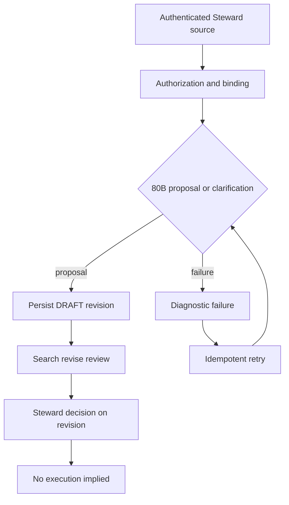

# =============================================================================
# RIVERVIEW~ CONTROLLED DOCUMENT
# File: docs/components/INSTITUTIONAL_PROPOSALS_FLOW.md
# Component: INSTITUTIONAL-PROPOSALS
# Revision: 1.0.0
# Purpose: Troubleshoot proposal formalization, persistence, search, and review flow
# Status: Development contract; production acceptance not performed
# Authority: Steward retains proposal decision and execution authorization
# Dependencies: PostgreSQL proposal registry; authenticated Grace conversation
# Changed: 2026-10-16 UTC | RV-INSTITUTIONAL-PROPOSAL-LIFECYCLE-001 | Initial proposal flow
# Source: process_graphs/grace/institutional-proposal-lifecycle.json
# Verification: python3 scripts/process_graph.py check; tests/test_institutional_proposals.py
# History: Git and .riverview-backups/manifest.jsonl
# =============================================================================

## Workflow

## Troubleshooting checkpoints

- `resident_conversation_not_authorized`: verify the authenticated Steward owns the conversation and retains exact `resident.conversation.read` and `resident.conversation.send` grants for Grace's office.
- `proposal_drafting_unavailable`: verify the active binding still matches the configured provider digest, the bound provider is 80B-capable, generation ended normally, and the strict proposal contract was returned. The API does not silently use the 0.6B fallback for substantive proposal drafting.
- `proposal_idempotency_conflict`: preserve the existing record. Confirm the original proposal key was not reused for another principal, conversation, source message set, or content.
- Empty search results mean no matching current non-archived proposal was found. No synthetic proposal is generated by retrieval.
- A proposal in `DRAFT`, `READY_FOR_REVIEW`, or `UNDER_REVIEW` cannot be treated as a work order. Current objective intake and exact grants remain independently enforced.
