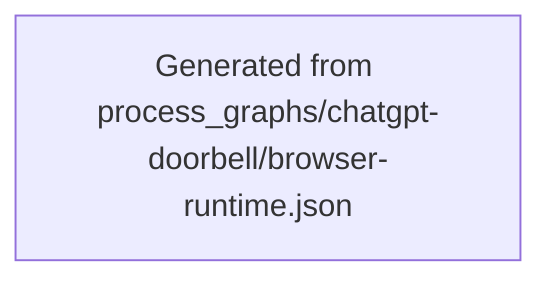

<!--
Riverview~ Controlled Document
File: docs/components/CHATGPT_DOORBELL_FLOW.md
Component: CHATGPT-DOORBELL
File Revision: 1.0.0
Purpose: Generated New-Core Linux doorbell process view
Changed: 2026-10-17 UTC | RV-C3-DOORBELL-001 | Register fixed browser wake workflow
-->
# ChatGPT Doorbell Flow

The browser workflow ends at verified fixed-message submission. Comms5 mailbox
and Grace response transitions remain an external dependency until the owner
contract is available; this graph does not represent them as implemented.

