# =============================================================================
# RIVERVIEW~ CONTROLLED DOCUMENT
# File: docs/components/WORK_REGISTRY_FLOW.md
# Component: UNIVERSAL-WORK-REGISTRY
# File Revision: 1.0.0
# Purpose: Show observed registry and explicit v4 receipt paths, failures, and recovery
# Execution Model: Documentation projection generated from the canonical registry graph
# Authority: Observational only; receipt events do not authorize execution
# Changed: 2026-10-18 UTC | RV-WORK-REGISTRY-DOD-REMEDIATION-001 | Add focused registry and receipt bridge flow.
# History: New document; generated Mermaid is synchronized from process_graphs/work-registry/observational-registry.json
# =============================================================================
# Universal Work Registry workflow

This diagram describes the implemented request-driven registry, browser read projection, and explicitly invoked v4 receipt bridge. It does not show automatic GitHub polling, dispatch, or existing-session wake because those capabilities are not implemented.

```mermaid
flowchart LR
  subgraph g_rv_work_registry_observational_registry["UNIVERSAL-WORK-REGISTRY / observational-registry.v1"]
    g_rv_work_registry_observational_registry_register_worker_dd0a26fd(["Register persistent worker identity and capabilities"])
    g_rv_work_registry_observational_registry_start_session_f0c316bf["Start independently identified session and report heartbeat/activity"]
    g_rv_work_registry_observational_registry_record_work_bfc7cd18["Record sequential work orders, dispatcher receipts, and optional inference job metadata"]
    g_rv_work_registry_observational_registry_acknowledge_assignment_9294e5bd["Codex startup acknowledges the assigned work-order ID and binds observed session"]
    g_rv_work_registry_observational_registry_explicit_receipt_event_d38cd2e0["Explicitly record acknowledged, in-progress, blocked, or completed receipt and mirror v4 status"]
    g_rv_work_registry_observational_registry_receipt_state_conflict_dac58da4[["Reject unmapped, invalid, unauthorized-owner, or stale expected-state receipt"]]
    g_rv_work_registry_observational_registry_receipt_mirror_failure_bc97a0b2[["Atomic v4 mirror write fails after registry state has committed"]]
    g_rv_work_registry_observational_registry_read_only_diagnostic_766f8e4f["Inspect filtered registry and v4 status without mutation"]
    g_rv_work_registry_observational_registry_receipt_owner_reconciliation_0e18740d[["Work-order owner reconciles a conflicting state before an explicit retry"]]
    g_rv_work_registry_observational_registry_receipt_mirror_recovery_e166416e["Replay the same explicit event to reconcile the atomic v4 mirror"]
    g_rv_work_registry_observational_registry_read_dashboard_5799576c["Authenticated dashboard reads every dynamic worker, session, and work order"]
    g_rv_work_registry_observational_registry_grace_permission_boundary_4c5c0c33["Future Grace read/event adapter must check existing exact authority grants"]
    g_rv_work_registry_observational_registry_retain_history_6762e70a(["Retain completed and disconnected historical sessions and work orders"])
  end
  g_rv_grace_operational_integration_assignment_fanout_81ca8043["Registered target<br/>rv:grace:operational-integration"]
  g_rv_work_registry_observational_registry_register_worker_dd0a26fd --> g_rv_work_registry_observational_registry_start_session_f0c316bf
  g_rv_work_registry_observational_registry_start_session_f0c316bf --> g_rv_work_registry_observational_registry_record_work_bfc7cd18
  g_rv_work_registry_observational_registry_start_session_f0c316bf --> g_rv_work_registry_observational_registry_acknowledge_assignment_9294e5bd
  g_rv_work_registry_observational_registry_record_work_bfc7cd18 --> g_rv_work_registry_observational_registry_explicit_receipt_event_d38cd2e0
  g_rv_work_registry_observational_registry_acknowledge_assignment_9294e5bd --> g_rv_work_registry_observational_registry_explicit_receipt_event_d38cd2e0
  g_rv_work_registry_observational_registry_explicit_receipt_event_d38cd2e0 -->|diagnostic_branch| g_rv_work_registry_observational_registry_receipt_state_conflict_dac58da4
  g_rv_work_registry_observational_registry_receipt_state_conflict_dac58da4 -->|diagnostic_branch| g_rv_work_registry_observational_registry_read_only_diagnostic_766f8e4f
  g_rv_work_registry_observational_registry_read_only_diagnostic_766f8e4f -->|escalation| g_rv_work_registry_observational_registry_receipt_owner_reconciliation_0e18740d
  g_rv_work_registry_observational_registry_receipt_owner_reconciliation_0e18740d -->|recovery_route| g_rv_work_registry_observational_registry_explicit_receipt_event_d38cd2e0
  g_rv_work_registry_observational_registry_explicit_receipt_event_d38cd2e0 -->|diagnostic_branch| g_rv_work_registry_observational_registry_receipt_mirror_failure_bc97a0b2
  g_rv_work_registry_observational_registry_receipt_mirror_failure_bc97a0b2 -->|diagnostic_branch| g_rv_work_registry_observational_registry_read_only_diagnostic_766f8e4f
  g_rv_work_registry_observational_registry_read_only_diagnostic_766f8e4f -->|recovery_route| g_rv_work_registry_observational_registry_receipt_mirror_recovery_e166416e
  g_rv_work_registry_observational_registry_receipt_mirror_recovery_e166416e -->|recovery_route| g_rv_work_registry_observational_registry_explicit_receipt_event_d38cd2e0
  g_rv_work_registry_observational_registry_explicit_receipt_event_d38cd2e0 -->|verification| g_rv_work_registry_observational_registry_read_dashboard_5799576c
  g_rv_work_registry_observational_registry_record_work_bfc7cd18 --> g_rv_work_registry_observational_registry_read_dashboard_5799576c
  g_rv_work_registry_observational_registry_acknowledge_assignment_9294e5bd --> g_rv_work_registry_observational_registry_read_dashboard_5799576c
  g_rv_work_registry_observational_registry_read_dashboard_5799576c -->|documentation| g_rv_work_registry_observational_registry_grace_permission_boundary_4c5c0c33
  g_rv_work_registry_observational_registry_grace_permission_boundary_4c5c0c33 -->|jump| g_rv_grace_operational_integration_assignment_fanout_81ca8043
  g_rv_work_registry_observational_registry_record_work_bfc7cd18 --> g_rv_work_registry_observational_registry_retain_history_6762e70a
  classDef failure fill:#fee,stroke:#b00,stroke-width:2px
```

## Stable step mapping

| Stable node ID | Observed operation |
| --- | --- |
| `rv:work-registry:observational-registry:register-worker` | Persist a worker identity and capability metadata. |
| `rv:work-registry:observational-registry:start-session` | Persist a session separately; heartbeat is not model reasoning. |
| `rv:work-registry:observational-registry:record-work` | Create/update a work order or inference-job observation. |
| `rv:work-registry:observational-registry:acknowledge-assignment` | Startup binds an explicitly supplied existing order to a session. |
| `rv:work-registry:observational-registry:explicit-receipt-event` | Explicit caller reports acknowledged, in-progress, blocked, or completed. |
| `rv:work-registry:observational-registry:receipt-state-conflict` | Mapping, ownership, validation, or expected-state check rejects the event. |
| `rv:work-registry:observational-registry:receipt-mirror-recovery` | After registry persistence but failed v4 mirror, diagnose and replay the same event. |
| `rv:work-registry:observational-registry:read-only-diagnostic` | Read a filtered registry snapshot and current v4 status without mutation. |
| `rv:work-registry:observational-registry:read-dashboard` | Authenticated dashboard reads the registry snapshot. |
| `rv:work-registry:observational-registry:grace-permission-boundary` | Future Grace adapter requires its existing exact institutional grant. |
| `rv:work-registry:observational-registry:retain-history` | Completed and disconnected history remains observable. |

See [`WORK_REGISTRY_COOKBOOK.md`](WORK_REGISTRY_COOKBOOK.md) for diagnostics and recovery steps for each failure path.
