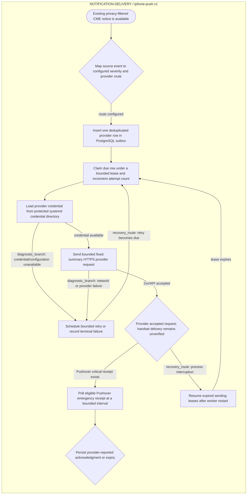

<!--
Riverview~ Controlled Document
File: docs/components/NOTIFICATION_IPHONE_DELIVERY_FLOW.md
Component: NOTIFICATION-DELIVERY
File Revision: 1.0.1
Purpose: Show the durable provider push-delivery workflow
Authority: Documentation only
Changed: 2026-10-18 UTC | RV-IPHONE-NOTIFICATIONS-001 | Initial canonical flow projection
History: Git and .riverview-backups/manifest.jsonl
-->
# iPhone notification delivery flow

Canonical source: `process_graphs/notification-delivery/iphone-push.json`.
Generate this diagram with `python3 scripts/process_graph.py generate`; do not
edit the Mermaid source independently.

