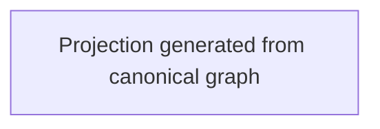

<!-- Riverview~ Controlled Document
File: docs/components/RESIDENT_LEARNING_FLOW.md
Component: RESIDENT-LEARNING-GOVERNANCE
File Revision: 1.0.0
Purpose: Focused generated lifecycle, denial, diagnostics, and recovery graph
Execution Model: Static generated projection; no runtime execution
Observability: Every branch terminates in a typed denial, pending state, or authorized recovery
Dependencies: process_graphs/resident-learning/lifecycle.json; scripts/process_graph.py
Authority: Describes existing contract and grants no permission
Changed: 2026-10-18 UTC | RV-W2-DOD-001 | Add focused resident-learning lifecycle graph projection
Contracts: docs/architecture/RESIDENT_LEARNING_GOVERNANCE.md
Tests: python scripts/process_graph.py check; tests/test_process_graph.py
History: Git and .riverview-backups/manifest.jsonl
-->

# Resident learning lifecycle

This view is generated from `process_graphs/resident-learning/lifecycle.json`.

See the [implementation cookbook](RESIDENT_LEARNING_COOKBOOK.md) for safe local checks, diagnosis, and restoration steps. This graph is descriptive; it does not turn on a caller or create any authority.
