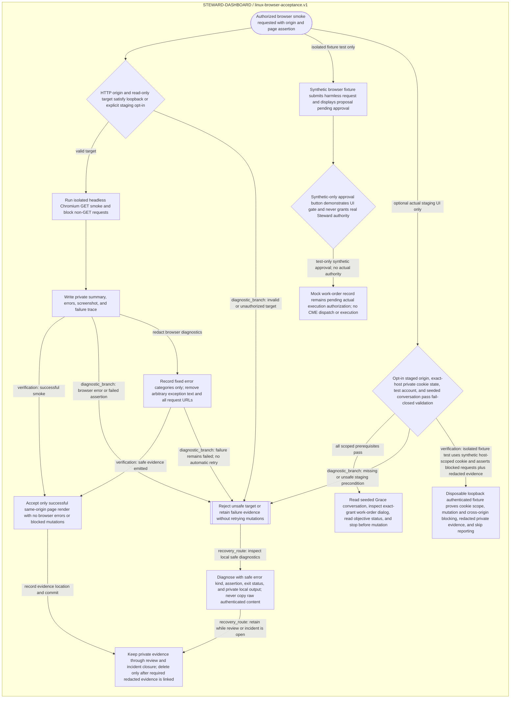

<!--
Riverview~ Controlled Document
File: docs/operations/LINUX_BROWSER_ACCEPTANCE_FLOW.md
Component: LINUX-BROWSER-ACCEPTANCE
File Revision: 1.0.1
Purpose: Show the guarded Linux browser acceptance and evidence recovery workflow
Execution Model: Request-driven operator workflow
Observability: Local runner summary and private per-test error reports; no live dashboard consumer
Dependencies: Python Playwright runner; canonical process graph
Authority: Read-only local/staging browser checks; no production writes, approvals, or work execution
Changed: 2026-10-18 UTC | RV-C2-DOD-REMEDIATION-001 | Initial focused workflow view
Contracts: docs/operations/LINUX_BROWSER_ACCEPTANCE.md
Tests: python3 scripts/process_graph.py check
History: Git and revision/backup manifest
-->
# Linux browser acceptance flow

This focused view is generated from `process_graphs/steward-dashboard/linux-browser-acceptance.json`; do not edit the diagram by hand. It distinguishes unsafe targets, browser failures, privacy-safe reporting, and manual evidence retention. It does not assert a live Grace deployment or a Steward-facing status page.

