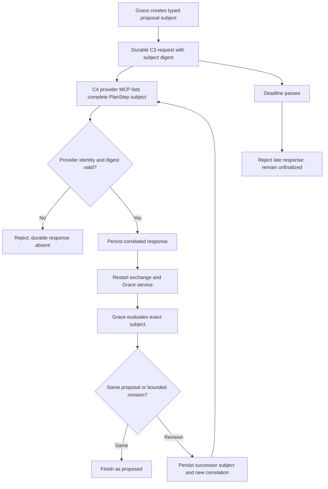

<!--
Riverview Controlled Document
File: docs/development/W2_P0_CONTROLLED_ACCEPTANCE.md
Component: W2-P0-INTEGRATED-REVIEW-ACCEPTANCE
File Revision: 1.0.2
Purpose: Specify isolated PostgreSQL acceptance for Grace exact-subject provider review
Authority: Offline synthetic test only; no live provider, browser, production DB, credentials, or grants
Changed: 2026-10-18 UTC | RV-W2-P0-INTEGRATED-REVIEW-ACCEPTANCE | Initial test contract and recovery guidance
Changed: 2026-10-18 UTC | RV-W2-P0-INTEGRATED-REVIEW-ACCEPTANCE | Document integrated synthetic C2 wake and C3 receipt path
Changed: 2026-10-18 UTC | RV-W2-P0-INTEGRATED-REVIEW-ACCEPTANCE | Correct W1 event timestamp source and terminal proposal assertions
Changed: 2026-10-18 UTC | RV-W2-P0-INTEGRATED-REVIEW-ACCEPTANCE | Document C3 successor API and expiry terminal semantics
History: Git and docs/development/RV-W2-P0-INTEGRATED-ACCEPTANCE_REVISION_RECORD.md
-->
# W2 P0 controlled acceptance

## Purpose and status

This is a request-driven acceptance harness for the integrated Grace proposal
review path. It is not a runtime worker and does not activate learning or the
ChatGPT browser doorbell. Its database fixture creates a unique `rvtest_*`
schema on the explicitly configured disposable PostgreSQL test database and
drops that schema during teardown.

The W2 acceptance source is `tests/test_w2_p0_integrated_review_acceptance.py`.
On W3's assembled C2/C3 integration head this exercises the C3 durable exact
subject, synthetic C2 owner-loop wake, one C3 fenced receipt, C4 typed provider
MCP round trip, Grace finish/revise evaluation, and restart recovery. It does
not activate or contact a real browser or provider.

## Isolated execution

Run from the repository root with a disposable PostgreSQL 16 DSN:

```powershell
$env:PYTHONPATH = 'src'
python -m unittest tests.test_w2_p0_integrated_review_acceptance -v
```

`RIVERVIEW_TEST_PG_DSN` must point to an isolated test database. The tests do
not load credentials from production or contact a provider. When the DSN is
absent, unittest reports the cases as skipped; a skip is not acceptance
evidence. Record the exact W3 combined commit, test command, pass/fail/skip
counts, graph/revision checks, and any remaining component gate on issue #120.

## Reviewed lifecycle and failure paths



The integrated tests invoke C2's `DoorbellWakeWorker` through Grace's existing
owner hook with a synthetic bridge. The actual C3 exchange grants one
metadata-only fenced claim and records one durable receipt under the configured
C2 owner identity. The test confirms the exact request becomes available for
the provider MCP claim and a second owner cycle is idle. No browser is contacted.

## Observable assertions

- The stored review subject is immutable, has the exact C3 canonical digest,
  and exposes every typed `PlanStep` field through C4 MCP.
- A different provider cannot claim the correlated request.
- A modified typed step, missing digest, or mismatched digest cannot persist a
  response under the original review subject.
- Duplicate correlated submission is idempotent and returns the original
  response digest.
- Before Grace consumes an exact response, the objective remains unfinalized.
- A matching review finishes; a changed proposal creates a successor with a
  new subject, revision, request ID, and correlation ID.
- A restart resumes the persisted response or admitted successor without
  reasoning twice; only the final matching revision becomes proposed.
- An expired subject cannot accept a late response or finalize the objective.

## Troubleshooting and safe recovery

| Signal | First diagnostic | Expected result | Safe response |
|---|---|---|---|
| All cases skip | `python -c "import os; print(bool(os.getenv('RIVERVIEW_TEST_PG_DSN')))"` | `True` only in the isolated test job | Configure the disposable CI/test DSN; do not substitute a production DSN. |
| Subject digest mismatch | Inspect the returned subject and `review_subject_sha256` from the same correlated row | C3 and C4 canonical SHA-256 agree over subject ID, revision, and full proposal | Preserve the typed proposal and reject mismatches; do not recalculate or overwrite a durable digest by hand. |
| Provider claim denied | Inspect the synthetic `ProviderTokenMap` entry and request/correlation IDs | Only the matching test provider/principal sees and claims the request | Fix the fixture identity mapping; never broaden grants to make the test pass. |
| Late response | Read `reasoning_exchange_status` for the synthetic request | `delivery_state=expired`, no response digest, and Grace remains unfinalized | Keep the request expired; create a new test case with a new objective if more coverage is needed. |
| MCP import reports `ModuleNotFoundError: jwt` | Check the active Python environment and controlled CI dependency install | The controlled suite installs declared PyJWT test dependency | Run in the controlled checkout or a project test environment with declared dependencies; do not change runtime credentials or test import behavior. |
| Test interrupted before teardown | Verify the exact DSN is disposable, then list schemas matching this run's unique `rvtest_<uuid>` value | Only the test fixture schema is present | Prefer normal fixture teardown. Any manual cleanup must target the exact schema created by this test run, never a wildcard or production database. |
| Local PostgreSQL unavailable | `Get-Command docker` and inspect controlled GitHub Actions run | Disposable CI PostgreSQL is the evidence source | Report local DSN absence explicitly and rely only on the exact-head controlled run. |
| Trace export fails on event timestamp | Inspect the `grace_objective_events` migration | Event time is `occurred_at` | Query the canonical timestamp column and keep payload fields allowlisted. |

## Rollback and limits

The initial acceptance files are new; there is no source predecessor to restore.
Remove the W2 test-only commit or revert that commit on the W2 branch to roll
back the harness. Do not drop schemas outside the fixture's unique disposable
database. The test has no runtime registration and no production effect.

The canonical system process graph and integrated workflow registry remain
owned by W3. W2 has supplied this test lifecycle to W3 for registration; graph
validation and any operational Steward view remain separate integration gates.
No live trigger, recurring worker autonomy, or production readiness is claimed.
