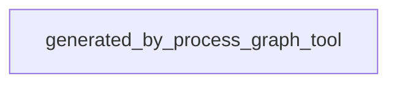

<!--
Riverview~ Controlled Document
File: docs/components/RIVERVIEW_V2_WORKSPACE_SHELL_FLOW.md
Component: RIVERVIEW-V2-WORKSPACE-SHELL · generated from canonical JSON
File Revision: 1.0.0
Purpose: Show normal, decision, failure, and recovery paths for the local preview
Authority: Presentation-only process flow; edit canonical JSON graph only
Changed: 2026-10-20 UTC | RV-WEB-V2-SHELL-001 | Initial generated process view
History: Git and revision/backup manifest
-->
# Riverview V2 workspace shell preview flow

**Task:** `RV-WEB-V2-SHELL-001` · **Component:** `RIVERVIEW-V2-WORKSPACE-SHELL`  
**Source:** canonical JSON `process_graphs/riverview-v2/workspace-shell.json`; Mermaid below is generated.

The process describes the local fixture-only shell. Unsafe methods and paths are rejected; restarting the preview resets only in-memory preview state. See the [component specification](RIVERVIEW_V2_WORKSPACE_SHELL.md) and [recovery cookbook](RIVERVIEW_V2_WORKSPACE_SHELL_COOKBOOK.md).
