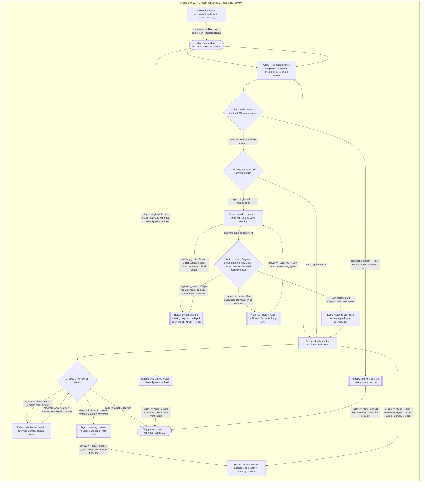

<!--
Riverview~ Controlled Document
File: docs/components/RIVERVIEW_V2_WORKSPACE_SHELL_FLOW.md
Component: RIVERVIEW-V2-WORKSPACE-SHELL · generated from canonical JSON
File Revision: 1.0.3
Purpose: Show normal, decision, failure, and recovery paths for loopback and authenticated LAN preview
Authority: Presentation-only process flow; edit canonical JSON graph only
Changed: 2026-10-20 UTC | RV-WEB-V2-LAN-PREVIEW-001 | Extend generated process view for authenticated LAN access
History: Git and revision/backup manifest
-->
# Riverview V2 workspace shell preview flow

**Task:** `RV-WEB-V2-SHELL-001` · **Component:** `RIVERVIEW-V2-WORKSPACE-SHELL`  
**Source:** canonical JSON `process_graphs/riverview-v2/workspace-shell.json`; Mermaid below is generated.

The process describes the fixture-only shell in loopback or password-protected trusted-LAN mode. The LAN mode requires a local salted password hash, verifies the client subnet and Host, and rejects non-read-only methods; HTTP credentials are confined to trusted LAN use. Restarting revokes sessions and resets in-memory selection/lockout state. See the [component specification](RIVERVIEW_V2_WORKSPACE_SHELL.md) and [recovery cookbook](RIVERVIEW_V2_WORKSPACE_SHELL_COOKBOOK.md).
