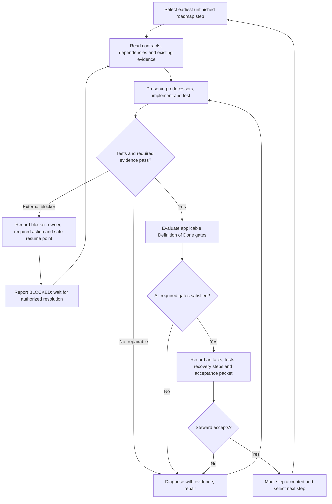

# Riverview~ Codex Engineering Campaign and Process Map

**Document Revision:** 1.0.2  
**Status:** Engineering execution specification (not a claim of deployed automation)  
**Date:** 2026-10-21  
**Component:** ENG-CODEX-CAMPAIGN  
**Owner:** Steward  
**Scope:** All numbered steps of `docs/ROADMAP.md`, M1.1 through M5.4.

## Mission

Codex is the engineering implementer for the **entire** Riverview roadmap, not merely M1.1. Read `AI_HINTS.md`, the full roadmap, the lifecycle and Component Definition of Done (DoD) standards, and relevant architecture contracts. Start at the earliest unfinished step. Deliver small coherent increments, but keep the entire institution and downstream interfaces in view. Do not invent new approval systems or claim that Codex automatically runs forever: continuous orchestration requires a separately deployed, authorized mechanism.

## The five-stage process

1. **SELECT** — Choose the earliest unfinished roadmap step. Identify required outcome, dependencies, authoritative files, execution host, and existing evidence. **Output:** step ID and scoped acceptance checklist.
2. **UNDERSTAND** — Inspect relevant code *and its dependencies*, contracts, current deployment, prior test results and predecessor revisions. Reuse proven evidence; investigate only gaps. **Output:** implementation plan and reproducible baseline.
3. **BUILD + TEST** — Preserve exact predecessors, implement smallest coherent change, run tests, diagnose and repair failures, repeat until passing or genuinely blocked. Never require a chat turn for routine engineering iterations. **Output:** implementation, test logs, and changed-file inventory.
4. **VERIFY DoD** — Evaluate every applicable gate in `docs/standards/COMPONENT_DEFINITION_OF_DONE.md`: code, functionality, documentation, recovery cookbook, versioned flowchart, live Steward operational view, operational autonomy, execution model and external observability. Mark N/A only where justified; partial is not PASS. For roadmap infrastructure steps, separate step-level acceptance from full component DoD and explicitly list later dependent gates. **Output:** evidence matrix with PASS/FAIL/PARTIAL/NOT VERIFIED and references.
5. **RECORD + HANDOFF** — Record exact outcome, commit/PR and deployment IDs, host, timestamp, commands, test counts, limitations, blocked items, restoration instructions and next roadmap cursor. Do not advance past an unaccepted gate or claim approval on behalf of the Steward. **Output:** concise acceptance packet and next action.

## Mandatory Codex session completion indicator

After the normal RECORD + HANDOFF report for **every assignment**, display a prominent, final completion banner in the terminal response. This applies to investigation, website development, documentation, testing, and operational tasks as well as roadmap implementation. It is a visibility aid, not a new approval gate or a substitute for existing Definition of Done evidence.

Use the known Codex window identifier (for example C1, C2, C3, C4, W1, W2, W3, or W4); if unknown, use `CODEX` rather than inventing one. Use this format, adapting task and result:

```text
████████████████████████████████
████  C1 — DONE  ██████████████
████████████████████████████████
RESULT: SUCCESS | BLOCKED | FAILED
TASK: Brief assignment description
████████████████████████████████
```

- `DONE` means the Codex assignment has ended, **not** that its requested outcome succeeded. `SUCCESS` requires all applicable assignment acceptance criteria and Definition of Done gates; `BLOCKED` identifies a genuine boundary preventing further authorized work; `FAILED` identifies an unsuccessful attempt. Never mark an unfinished objective SUCCESS because a subtask, test, PR, or deployment completed.
- Display the banner only after the final report; do not display it while work continues. Keep the final report and blocker evidence intact.
- When the terminal supports it, render the banner in a high-visibility red foreground; do not rely on ANSI escapes in plain chat output. The block-character banner is the required fallback if color or font enlargement is unavailable.
- This is a session-reporting convention. It does not itself install a terminal hook or guarantee that a Codex session has loaded the latest guidance. At the beginning of a fresh assignment, read this campaign through `AI_HINTS.md` and use the convention in the final response.

## Flowchart (canonical process)



## Troubleshooting from observable outcomes

| Stage | Expected evidence | Failure signal | First diagnostic action | Resume |
| --- | --- | --- | --- | --- |
| SELECT | Step ID, scope, dependencies | Ambiguous cursor or missing contract | Compare roadmap with last accepted evidence; do not guess completion | SELECT |
| UNDERSTAND | Repo/commit, target host, baseline, dependency map | Stale checkout, unavailable host, conflicting contract | Inspect exact version and dependency; record discrepancy | UNDERSTAND |
| BUILD + TEST | Diff, predecessor hash, commands, exit codes, logs | Failed test, deployment error, missing permissions | Locate first failing operation and relevant logs; classify code vs environment vs authorization | BUILD + TEST after repair |
| VERIFY | Gate-by-gate evidence matrix | Any required gate PARTIAL, FAIL or NOT VERIFIED | Name exact missing artifact or test; avoid general re-audits | BUILD + TEST |
| RECORD | Reproducible report, commit/deployment IDs, blocker register | Missing evidence or acceptance | Produce missing report; do not move cursor | RECORD |
| BLOCKED | Blocker ID, owner, authority, safe resume point | Secret, privilege, external approval, inaccessible execution host | Request one specific authorized action; never expose credentials | UNDERSTAND after resolution |

Every implemented component must also have a **component-specific** versioned process flowchart with normal path, errors, retries, restart/recovery, observable signals and diagnostic commands. A single generic campaign diagram does not satisfy that component DoD requirement. Keep the top-level chart simple; put technical commands and details in linked cookbooks.

## Non-negotiable component delivery contract — every roadmap step

The following requirements are **inherited from** `docs/standards/COMPONENT_DEFINITION_OF_DONE.md` Rev 1.3 and `docs/architecture/OBSERVABILITY_AND_SPATIAL_CONTRACT_v0.1.md`. This campaign cannot waive, defer silently, or weaken them. Every Codex task must name the owning component and explicitly address each item, including when a dependent infrastructure capability is scheduled for a later roadmap step.

1. **Real implementation and contracts:** accountable identity/version, inputs, outputs, events, authority, persistence, dependencies, idempotency, failures, recovery, and configuration; no mock substituted for deployed behavior.
2. **Machine-readable API/visibility hooks:** expose or register with an owning service the component ID/version, readiness/health, heartbeat, freshness timestamp, workflow and step IDs, assignment/event correlation and cursor, failures/retries, dependency state, blockers, decisions, and recovery status as applicable. Specify transport (HTTP API, events, metrics or structured logs), payload schema, authentication/authorization, retention, refresh interval and error semantics. Hooks must be independently testable. A request-driven library can inherit its owning service's hook; record why.
3. **Internal process visibility:** every consequential state transition must have an authoritative durable event or equivalent trace, with timestamp, correlation and diagnostic reference. A real operator can determine *what ran, what is running, what is waiting, why it stopped, and what resumes it*. Never invent progress or equate a missing heartbeat with health.
4. **Versioned flowchart and step mapping:** commit a human-readable Mermaid/source-controlled diagram for the actual component, with normal path, decision points, failure, retry, pause, authorization, restart and recovery. Each meaningful flowchart node has a stable workflow/step identifier mapped to observed state, and links to a diagnostic cookbook. A top-level chart alone is insufficient. Diagram is not a substitute for working code.
5. **Steward web visibility:** a real browser-accessible, permission-filtered operational view must consume authoritative machine-readable hooks or projections. Show identity/version, current status, workflow-node highlight, last meaningful progress, heartbeat age/freshness, assignments, failures, blocker/decision owner, notifications and drill-down diagnostics. Show `not_initialized`, `unavailable`, `stale`, `degraded`, `blocked`, `failed` and `healthy` truthfully where applicable. Never display a static screenshot or one-time JSON as a live dashboard. An API is not automatically a web dashboard.
6. **Simple process-first troubleshooting:** for each flowchart node specify expected input, action, output/evidence, failure code/signal, first read-only diagnostic, recovery/rollback, and resume point. Supply a consolidated read-only diagnostic command/report. A Steward must be able to follow the process and find the fault without reconstructing source code.
7. **Autonomy and recovery:** declare event-driven/scheduled/request-driven execution model; prove repeated work, restart, persistence, retry/replay and interruption recovery as applicable; register permission, credential, approval and external blockers with owner, timeout, notification and resume trigger. Do not add artificial one-shot or turn-based gates.
8. **Synchronized release evidence:** committed code, real functional tests, versioned documentation, recovery cookbook, versioned diagrams, live Steward view, autonomy/blocker evidence, execution-model declaration and external-observer tests. Provide exact URLs/paths, commit/deployment IDs, tests and observed outputs. Apply all seven DoD gates and cross-cutting checks; the Steward must accept. A missing applicable gate means **NOT DONE**, not a future TODO disguised as PASS.

**Phasing without losing the contract:** M3.1 delivers the shared browser dashboard, but earlier components must already define and test their observability hooks and workflow mappings as they are built. Until a live Steward view actually exists, report its gate as **PARTIAL/FAIL**, with explicit dependency on M3.1; do not call the affected component fully DoD-complete. Roadmap step acceptance and full component DoD are distinct; neither may be mislabeled. If strict DoD blocks step acceptance until later infrastructure exists, flag that dependency to the Steward for a sequencing decision, not an invented waiver.

## Component handoff template

Each Codex implementation task must deliver or explicitly mark NOT VERIFIED:

| Deliverable | Evidence to link |
| --- | --- |
| Component identity and execution contract | source, revision, inputs/outputs, event/authority model |
| External visibility hooks / API | schema, endpoint or transport, access policy, independent client test |
| Authoritative state and workflow mapping | persisted events, step IDs, timestamps, correlation IDs |
| Process flowchart | versioned Mermaid source, normal/error/recovery branches |
| Steward web display | real URL, live state, freshness, drill-down and error-state test |
| Troubleshooting cookbook | node-to-error mapping, read-only diagnostic, recovery/resume commands |
| Reliability/autonomy | repeated/restart/blocked/approval/recovery evidence |
| DoD acceptance | seven gates plus cross-cutting results, exceptions and Steward decision |

Do not build disconnected per-component dashboards or a parallel status database. Shared read-only projections and stable identities must serve web, future castle/spatial and VR views; UI location does not confer authority. Undercurrent/private data must not leak into ordinary status projections.

## Working rules

- Prefer Codex-led repository implementation, consolidated automated tests, and one evidence report to a series of manual SSH commands.
- Execute against Camrui only when Codex actually has authorized network/SSH access; otherwise prepare one reproducible deployment/test runner and label live results NOT VERIFIED. Never fabricate access or test outcomes.
- Never embed passwords in source, reports or command lines. Privileged changes and secrets require authorized handling.
- Preserve original bytes and SHA-256 before each revision; increment each changed file's revision; keep predecessor history and restoration guidance. Follow `AI_HINTS.md` and lifecycle standard.
- The existing M1.1 evidence establishes Ubuntu/PostgreSQL readiness, `riverview` database, `riverview_dev` schema, `riverview_core` permissions, and a successful password-authenticated TCP login. Do not repeat these unless deployment changes or a relevant test fails.
- **Current M1.1 gap:** service/runtime identity and persistent secure credential delivery are not verified as commissioned; formal acceptance packet and Steward acceptance remain outstanding. The always-on event processor is M1.3, not a requirement to invent prematurely for M1.1.
- Stop only for a genuine external blocker or an explicitly required Steward decision. A blocked step does not silently advance. A completed Codex session is not evidence that the entire roadmap continues automatically.

## First Codex assignment

Continue **M1.1**, using existing test evidence. Implement the smallest secure and reproducible runtime identity / credential delivery commissioning and validation method, document the service identity and storage ownership, provide a consolidated SSH-based test runner if needed, and produce a DoD evidence packet. Do not reset existing database credentials or change the `public` schema. Report what was actually executed versus prepared. Then present M1.1 for Steward acceptance; only after acceptance proceed to M1.2.

## Revision history

- **1.0.2 — 2026-10-21:** Require a visible, status-qualified completion banner after every Codex assignment handoff; no changes to DoD or execution authority. Predecessor: `docs/history/CODEX_ENGINEERING_CAMPAIGN_rev1.0.1.md` (original blob `6f044244096a125d0d0dd9a1b411af33cef923af`).

- **1.0.1 — 2026-10-09:** Make API hooks, internal state visibility, component flowcharts, Steward web status, diagnostic mapping and full DoD evidence mandatory for every component. Predecessor: `docs/history/CODEX_ENGINEERING_CAMPAIGN_rev1.0.0.md`.
- **1.0.0 — 2026-10-09:** Initial full-roadmap Codex campaign, simple canonical flow, observable troubleshooting table, and M1.1 handoff.
