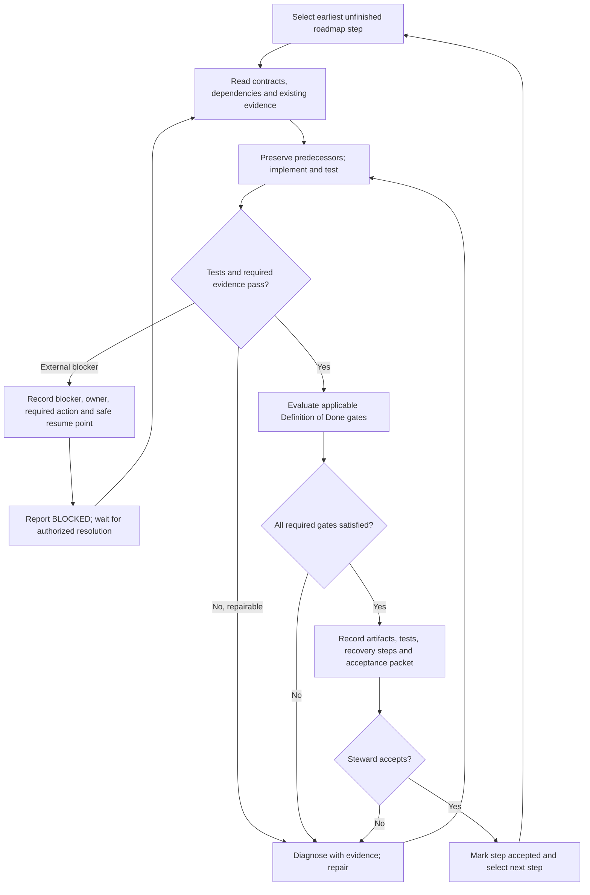

# Riverview~ Codex Engineering Campaign and Process Map

**Document Revision:** 1.0.0  
**Status:** Engineering execution specification (not a claim of deployed automation)  
**Date:** 2026-10-09  
**Component:** ENG-CODEX-CAMPAIGN  
**Owner:** Steward  
**Scope:** All numbered steps of `docs/ROADMAP.md`, M1.1 through M5.4.

## Mission

Codex is the engineering implementer for the **entire** Riverview roadmap, not merely M1.1. Read `AI_HINTS.md`, the full roadmap, the lifecycle and Component Definition of Done (DoD) standards, and relevant architecture contracts. Start at the earliest unfinished step. Deliver small coherent increments, but keep the entire institution and downstream interfaces in view. Do not invent new approval systems or claim that Codex automatically runs forever: continuous orchestration requires a separately deployed, authorized mechanism.

## The five-stage process

1. **SELECT** — Choose the earliest unfinished roadmap step. Identify required outcome, dependencies, authoritative files, execution host, and existing evidence. **Output:** step ID and scoped acceptance checklist.
2. **UNDERSTAND** — Inspect relevant code *and its dependencies*, contracts, current deployment, prior test results and predecessor revisions. Reuse proven evidence; investigate only gaps. **Output:** implementation plan and reproducible baseline.
3. **BUILD + TEST** — Preserve exact predecessors, implement smallest coherent change, run tests, diagnose and repair failures, repeat until passing or genuinely blocked. Never require a chat turn for routine engineering iterations. **Output:** implementation, test logs, and changed-file inventory.
4. **VERIFY DoD** — Evaluate every applicable gate in `docs/standards/COMPONENT_DEFINITION_OF_DONE.md`: code, functionality, documentation, recovery cookbook, versioned flowchart, live Steward operational view, operational autonomy, execution model and external observability. Mark N/A only where justified; partial is not PASS. For roadmap infrastructure steps, separate step-level acceptance from full component DoD and explicitly list later dependent gates. **Output:** evidence matrix with PASS/FAIL/PARTIAL/NOT VERIFIED and references.
5. **RECORD + HANDOFF** — Record exact outcome, commit/PR and deployment IDs, host, timestamp, commands, test counts, limitations, blocked items, restoration instructions and next roadmap cursor. Do not advance past an unaccepted gate or claim approval on behalf of the Steward. **Output:** concise acceptance packet and next action.

## Flowchart (canonical process)

## Troubleshooting from observable outcomes

| Stage | Expected evidence | Failure signal | First diagnostic action | Resume |
| --- | --- | --- | --- | --- |
| SELECT | Step ID, scope, dependencies | Ambiguous cursor or missing contract | Compare roadmap with last accepted evidence; do not guess completion | SELECT |
| UNDERSTAND | Repo/commit, target host, baseline, dependency map | Stale checkout, unavailable host, conflicting contract | Inspect exact version and dependency; record discrepancy | UNDERSTAND |
| BUILD + TEST | Diff, predecessor hash, commands, exit codes, logs | Failed test, deployment error, missing permissions | Locate first failing operation and relevant logs; classify code vs environment vs authorization | BUILD + TEST after repair |
| VERIFY | Gate-by-gate evidence matrix | Any required gate PARTIAL, FAIL or NOT VERIFIED | Name exact missing artifact or test; avoid general re-audits | BUILD + TEST |
| RECORD | Reproducible report, commit/deployment IDs, blocker register | Missing evidence or acceptance | Produce missing report; do not move cursor | RECORD |
| BLOCKED | Blocker ID, owner, authority, safe resume point | Secret, privilege, external approval, inaccessible execution host | Request one specific authorized action; never expose credentials | UNDERSTAND after resolution |

Every implemented component must also have a **component-specific** versioned process flowchart with normal path, errors, retries, restart/recovery, observable signals and diagnostic commands. A single generic campaign diagram does not satisfy that component DoD requirement. Keep the top-level chart simple; put technical commands and details in linked cookbooks.

## Working rules

- Prefer Codex-led repository implementation, consolidated automated tests, and one evidence report to a series of manual SSH commands.
- Execute against Camrui only when Codex actually has authorized network/SSH access; otherwise prepare one reproducible deployment/test runner and label live results NOT VERIFIED. Never fabricate access or test outcomes.
- Never embed passwords in source, reports or command lines. Privileged changes and secrets require authorized handling.
- Preserve original bytes and SHA-256 before each revision; increment each changed file's revision; keep predecessor history and restoration guidance. Follow `AI_HINTS.md` and lifecycle standard.
- The existing M1.1 evidence establishes Ubuntu/PostgreSQL readiness, `riverview` database, `riverview_dev` schema, `riverview_core` permissions, and a successful password-authenticated TCP login. Do not repeat these unless deployment changes or a relevant test fails.
- **Current M1.1 gap:** service/runtime identity and persistent secure credential delivery are not verified as commissioned; formal acceptance packet and Steward acceptance remain outstanding. The always-on event processor is M1.3, not a requirement to invent prematurely for M1.1.
- Stop only for a genuine external blocker or an explicitly required Steward decision. A blocked step does not silently advance. A completed Codex session is not evidence that the entire roadmap continues automatically.

## First Codex assignment

Continue **M1.1**, using existing test evidence. Implement the smallest secure and reproducible runtime identity / credential delivery commissioning and validation method, document the service identity and storage ownership, provide a consolidated SSH-based test runner if needed, and produce a DoD evidence packet. Do not reset existing database credentials or change the `public` schema. Report what was actually executed versus prepared. Then present M1.1 for Steward acceptance; only after acceptance proceed to M1.2.

## Revision history

- **1.0.0 — 2026-10-09:** Initial full-roadmap Codex campaign, simple canonical flow, observable troubleshooting table, and M1.1 handoff.
