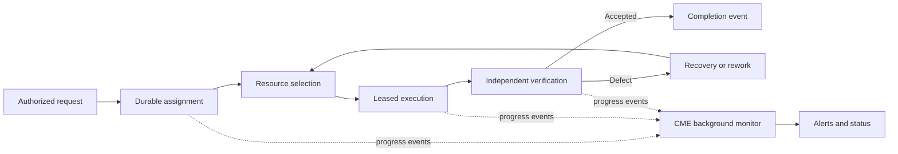

<!--
Riverview~ Controlled Document
File: docs/architecture/CORE_CONTRACT.md
Revision: 1.0.2
Migration: ENG-REV-002
-->
# Riverview~ core contract — working baseline

**Status:** founding architecture baseline; not implemented or runtime-verified. The longer locally authored `Riverview_Core_Contract_v0.1.md` remains a separate source document until imported and reconciled verbatim.

## Responsibility boundaries

- **Institutional authority:** Steward-delegated scope, office permissions, policy versions, and durable grants; neither residents nor providers self-grant.
- **Durable event bus and state:** append-only causal events with event ID, assignment ID, actor, schema version, timestamp, correlation/causation IDs and idempotency key; transactional state changes and recovery/replay.
- **Work coordination:** authoritative per-assignment lifecycle, independent concurrent assignments, fair resource scheduling, retries and failure handling.
- **CME background service:** observes progress, deadlines and health; detects stalls; requests authorized recovery; publishes status; never blocks globally on one assignment.
- **Execution:** capability-registered workers and adapters with fenced leases and durable results; models, GitHub, printers, cameras and hardware are replaceable adapters.
- **Verification:** independent evidence-based acceptance, distinct from worker self-report and successful dispatch.
- **Residents:** office, occupant, implementation, and state remain distinct; current authoritative context is regrounded before consequential actions and after interruption.
- **Reasoning:** transport-independent escalation adapters for Playwright/Doorbell/MCP, local models and optional APIs; explicit routing, budget, privacy and fallback policy.
- **Notifications:** day-one visual/audio/SMS delivery with acknowledgment tracking; durable decision requests; future SMS/app/voice replies flow through the same authenticated authority service.
- **Visualization:** actual state, progress, errors, diagnostics and workflow position accessible in 2D; spatial registry supports castle/city and future 3D/VR.
- **Undercurrent:** independent private security domain with its own events, keys, retention, purge, and approved boundary exports.

## Priority-one resident: Grace

Grace is Riverview's Director of Operations and the first resident responsible
for coordinating authorized institutional progression through the CME and
Engineering. Alfred holds the distinct Chief of Staff role; the Steward retains
final institutional authority. Grace's office and delegated authority are
durable and independent from the replaceable occupant, model, reasoning provider,
personality, voice, avatar, and presentation. Her 0.6B autonomic, 30B vision, and
80B reasoning systems are cooperating implementations of one Grace occupant.
She receives a Steward objective, reasons and revises a
persistent plan, creates assignments through the CME, uses replaceable real
engineering execution adapters, observes durable progress, consumes independent
verification evidence, and initiates follow-up or replan work until verified
completion or a genuine Steward decision point. The system must recover these
relationships across process, context, worker, and model replacement.

This is a mandatory M4.4/system-level completion requirement, not a prototype
claim or optional future enhancement. Its required interfaces are protected
during M2 development; this contract change does not start the full Grace
implementation before its roadmap dependencies are ready. See M4.4 in the
roadmap and the planned registered workflow in the canonical Grace graph.

## Canonical event progression

**No one global task cursor.** Every assignment retains independent lifecycle, leases, deadlines, and recovery state. Timers are safeguards for stalled work; events advance work.

## Non-negotiable proof

A first vertical slice must execute an authorized assignment unattended, process concurrent work independently, recover after a forced interruption without duplicate external side effects, independently verify output, expose true dashboard state and diagnostics, and deliver a notification on a defined attention condition. No live proof is claimed yet.
