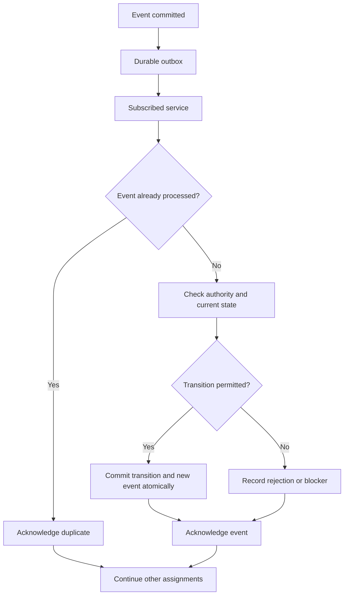

# Riverview~ Event and Assignment Contract v0.1

Status: proposed contract; not implemented or runtime-tested. This is a fresh core contract, not a claim about historical Riverview code.

## Core rule

All autonomous work advances through durable, causally linked events and independent assignment state. No chat turn, UI process, single global cursor, or resident presence may be required to continue work. One stalled assignment cannot stop another. CME observes and coordinates recovery; it does not own the institution or replace execution and verification.

## Event envelope

```json
{
  "event_id": "evt_01",
  "schema": "rv.event.v1",
  "type": "assignment.created",
  "occurred_at": "2026-10-09T18:00:00Z",
  "recorded_at": "2026-10-09T18:00:01Z",
  "assignment_id": "task_521",
  "actor_id": "resident:grace",
  "correlation_id": "corr_521",
  "causation_id": null,
  "idempotency_key": "create:task_521:v1",
  "authority_ref": "grant_123",
  "privacy_domain": "institution",
  "payload_schema": "rv.assignment.created.v1",
  "payload": {"objective_ref": "objective_521"}
}
```

IDs and example timestamps above are illustrative. The actual schema must validate event type and payload version; event ID is globally unique; correlation and causation trace an assignment; the authority reference is validated, not trusted solely because it appears in a payload. Restricted payloads must not cross privacy domains.

## Assignment state

Proposed canonical states: `queued`, `ready`, `running`, `awaiting_verification`, `rework_required`, `blocked`, `awaiting_steward`, `completed`, `cancelled`. State transitions are committed with an event in the same durable transaction. A worker reporting success is not completion; independent verification is required. Rework and recovery retain attempt history and provenance.

Each assignment records owner office, current occupant, authority reference, objective/acceptance contract, current workflow and step IDs, lease/attempt, last meaningful progress time, next deadline, blocking reason, and verified outcome. Work progress and service heartbeat are separate signals.

## Event-driven processing



Delivery is at-least-once; consumers are idempotent. External effects require fencing and explicit reconciliation. Avoid claiming exactly-once execution of remote tools. Delayed timers enqueue events for deadlines; they do not replace the event-driven engine. The event processor must support independent assignment leases, fair dispatch and backpressure.

## Resident and CME hooks

- `get_assignment(id, principal)`: authorized snapshot with workflow step, health, progress, blocker, evidence and event cursor.
- `list_assignments(filter, principal)`: authorized pagination across independent assignments.
- `subscribe_events(filter, cursor, principal)`: durable resumable stream, policy-filtered.
- `request_reassessment(id, principal)`: auditable request; no implicit authorization escalation.
- `request_recovery(id, action, principal)`: validated request within delegated authority.

## Failure cookbook

**No progress:** compare last meaningful progress event with heartbeat and deadline; inspect assignment lease and blocker; never infer progress from healthy process status.

**Repeated dispatch:** check idempotency key, fenced lease generation and prior external-effect reconciliation before retry.

**Consumer restart:** resume durable cursor; replay events idempotently; reconstruct active assignments; do not assume prior in-memory state.

**Privacy mismatch:** reject routing, emit a sanitized security event in the permitted domain, and do not log restricted payload.

## Minimum acceptance tests

Concurrent independent assignments; crash between external effect and result commit; duplicate and out-of-order delivery; stale lease fencing; rejected unauthorized transition; recovery after restart; verified completion; private-domain non-leakage; correct event-to-visualization mapping.
