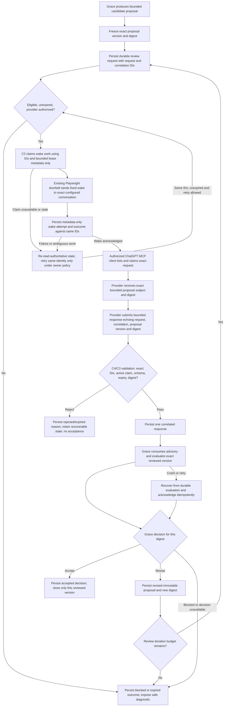

<!--
Riverview Controlled Document
File: docs/architecture/GRACE_EXACT_PROPOSAL_REVIEW_WORKFLOW_PROPOSAL.md
Component: GRACE-EXACT-PROPOSAL-REVIEW
File Revision: 1.0.0
Status: Integration proposal; NOT registered in the canonical process graph and NOT implementation evidence
Date: 2026-10-18 UTC
Purpose: Define the narrow workflow, graph proposal, acceptance evidence, and live-smoke stop conditions for exact-proposal external review
Authority: Grace retains reasoning and decision ownership; external provider response is advisory; existing Steward and execution controls remain authoritative
Source baseline: ppow1/Riverview- origin/main f6558554a1d360aebdb24036d3a8b7781e7e92b5; issue #120 comment 6254315364
History: New file; no predecessor
-->

# Grace exact-proposal review — workflow and acceptance proposal

## Status and scope

This is W3's isolated workflow and acceptance proposal for P0 implementation. It is deliberately **not** a canonical registered process graph: the implementation owners are changing their components on separate branches, and shared graph registration/projections are not W3-owned. C2/C3/C4 have agreed on the subject, claim and wake-receipt seam; decision/revision event names and bounded loop policy still need verification against implementation. Do not read a proposed transition as an implemented runtime call. After the owner branches are integrated and exact contracts are verified, the designated graph integrator can register the stable nodes and regenerate views.

The workflow reuses one durable Grace external-reasoning exchange as the review mailbox, the existing fixed-text Playwright/CDP doorbell as a wake signal, and provider-scoped MCP list/claim/submit for the review. Comms5 ingress remains separate. This proposal adds no mailbox, approval authority, resident, provider, or execution framework.

## Evidence boundary at the assigned base

Verified on `origin/main` at `f6558554a1d360aebdb24036d3a8b7781e7e92b5`:

- `src/riverview_core/doorbell/browser_bridge.py` accepts an existing request/correlation identity and invokes the fixed browser wake operation. `tools/riverview_doorbell_bridge.cjs` does not return assistant response text.
- `docs/components/CHATGPT_DOORBELL.md` documents a fixed wake string, exact configured conversation binding, metadata-only result, and that the caller/mailbox round trip is not integrated in this baseline.
- `process_graphs/chatgpt-doorbell/browser-runtime.json` marks mailbox eligibility and ChatGPT mailbox access as not integrated. Its graph describes the existing doorbell boundary; it is not a Grace proposal-review graph.
- The assigned base does not contain the durable external-reasoning exchange and connected Grace initiation/consumption source later described in the completed audit comments. Those are implementation dependencies owned by C3/C4 in this round. Their delivery must be verified on the selected integration commit before these proposed transitions are called connected.
- Historical doorbell qualification evidence is explicitly not current readiness: `evidence/checkouts/CHATGPT-DOORBELL/20261018T000144Z-14f517c/acceptance.json` recorded no mailbox round trip, no Grace consumption, and a blocked status snapshot. Do not infer current runtime state from that dated file.

The review-subject and doorbell lease APIs below now follow the cross-window agreement in issue comments 6254335379, 6254340292, and 6254345054. Exact Grace decision event names, state labels for revision exhaustion, retry limits/backoff, and the configured review-iteration cap remain implementation details C3 must publish before the graph is registered. Do not infer unreported event names from this proposal.

## Proposed workflow

The diagram expresses intended behavior, not current runtime evidence. The existing browser wake never carries proposal text and never reads a ChatGPT answer. The provider response travels only through the existing provider-scoped MCP exchange. Grace evaluates it through the existing reasoning path; a provider cannot accept, revise, approve, create an assignment, or finalize an objective on Grace's behalf.

## Canonical graph proposal (not yet registered)

Candidate workflow identity: `rv:grace-exact-review:proposal-review.v1`. Candidate node IDs use the standard `rv:<component>:<workflow>:<semantic-node>` shape, but are **unreserved** until the graph integrator checks uniqueness against the selected combined base. Every runtime edge below is a proposed runtime transition and must be changed to a prerequisite edge if implementation proves only ordering, not a call.

| Candidate semantic node | Type | Intended state/evidence |
|---|---|---|
| `candidate-proposal` | process | Grace's bounded, unapproved proposal; source proposal ID/version and content digest |
| `freeze-review-subject` | verification | Immutable subject serialization and SHA-256; no mutable alias may stand in for the exact version |
| `persist-review-request` | process | Durable provider-bound request and correlation IDs, expiry, idempotency, provenance |
| `eligible-review` | decision | Provider, privacy classification, request state, expiry, and authorization gates |
| `claim-doorbell-work` | process | C2 claims the eligible request; browser adapter receives IDs/lease metadata only |
| `wake-designated-chat` | process | Existing fixed wake sent once to exact configured binding; no proposal payload |
| `record-wake-result` | measurement | Metadata-only attempt receipt, same IDs, timestamps and stable outcome code |
| `provider-claim-review` | process | Authorized MCP provider claims exact unexpired request under bounded lease |
| `validate-review-response` | verification | Schema, provider, request/correlation, active claim, deadline and exact digest/version match |
| `persist-review-response` | process | Single bounded response and provenance committed idempotently |
| `grace-evaluate-review` | process | Existing Grace reasoner evaluates advisory against exactly the frozen proposal version |
| `decision-for-reviewed-version` | decision | Durable Grace accept/revise/blocked result; only accept can close the same digest |
| `revise-proposal` | recovery | New immutable proposal version/digest; requires a fresh review request |
| `review-budget-exhausted` | escalation | Durable blocked state and accountable escalation; never silent local-only completion |
| `resume-or-acknowledge` | recovery | Restart/replay from authoritative durable events; no duplicate proposal or closure |

Required graph edge classes: runtime transitions for calls proven by owner code; verification for digest/authority checks; diagnostic branches for invalid, expired, mismatched or unavailable stages; recovery routes for same-ID retry and restart; escalation when review budget/dependency/authorization cannot proceed; documentation links to each owner contract and operator cookbook. Cross-workflow jumps should reference existing registered reasoning/exchange/doorbell nodes only after their identities are confirmed in the combined graph. Do not register speculative IDs or generated projections from this proposal.

## Shared interface checklist

Owner assignment is authoritative: C3 owns Grace and durable exchange schema/API; C2 owns the eligible-request wake consumer and browser bridge; C4 owns provider-facing MCP contract and non-production preflight; W1 owns metadata trace; W2 owns offline recovery tests. Until C3 posts exact names, use this semantic minimum only:

| Boundary | Minimum shared data | Must not cross boundary |
|---|---|---|
| C3 durable exchange → C2 wake consumer | Eligibility is provider-scoped and metadata-only (`request_id`, `correlation_id`, `deadline_at`, `delivery_state`, optionally attempt count). `claim_next_doorbell_request(provider_id, owner_id, lease_seconds)` returns the IDs/provider/deadline, attempt ID, lease token/fence and bounded retry metadata | Proposal or response text, invented IDs, provider decision, approval authority |
| C2 → existing browser bridge | Same request/correlation IDs and designated binding required by `BrowserBridgeRunner.ring`; fixed wake action; bounded timeout | Review subject, proposal body/digest, ChatGPT response, credentials/cookies |
| C2 → C3 receipt | `record_doorbell_receipt(request_id, correlation_id, provider_id, owner_id, attempt_id, lease_token, fence, outcome, safe_error_code)`; outcomes `submitted`, `ambiguous`, `failed`; same exchange lease/fencing and retry/expiry authority | New request IDs, duplicate wake authority, response contents, browser page assertions |
| Durable exchange → C4/provider MCP | Authorized provider's top-level `review_subject` `{schema_version, subject_id, revision, sha256, proposal:{summary,steps}}`, request/correlation IDs, claim fence/lease, expiry | Other providers' requests, authority grants, mutable proposal alias |
| C4/provider MCP → C3 exchange | Existing bounded response plus explicit `review_subject_sha256` argument to `reasoning_exchange_submit_response`, provider identity, active claim/fence and idempotency identity | Client-selected state/authority, mismatched subject, execution instruction as authority |
| C3 exchange → Grace consumer | One validated response and original subject/context provenance under Grace's existing exact grant | VERIFIED-knowledge status, automatic approval, dispatch authority |
| Runtime metadata → W1/C1 operator view | Stage state, IDs/digests as permitted, timestamps/freshness, attempts, safe error/blocked code | Proposal/response bodies, token/cookie/URL, fabricated healthy state |

The minimal owner interface is now agreed in issue comments 6254340292 and 6254345054: C3 persists and exposes the exact subject from `eligible_requests()`, adds `claim_next_doorbell_request(...)` and fenced/idempotent `record_doorbell_receipt(...)`; C2 consumes metadata only and invokes the existing fixed wake; C4 returns the subject through provider-scoped MCP list/claim and passes an explicit digest echo on submit. Receipt outcome vocabulary is `submitted`, `ambiguous`, or `failed`. C4's digest algorithm, accepted by C3's subject-shape agreement, is `SHA-256(UTF-8(canonical JSON({subject_id, revision, proposal})))`, sorted keys, compact separators, `ensure_ascii=false`, `allow_nan=false`; `schema_version` and `sha256` itself are excluded. Remaining contract items before graph registration: exact decision/review state event names, retry bounds/backoff, finite iteration cap and exhausted-state semantics, privacy-classification policy for subject exposure, and recovery ownership. W3 will update these when C3 posts implementation-level names; no owner source files are modified here.

## Evidence required for each transition

Use one synthetic objective and a disposable database schema. The acceptance record must correlate one lineage without printing private content:

1. **Proposal frozen:** objective reference, proposal ID, immutable version, canonical serialization/hash algorithm, SHA-256, privacy classification, and `not_final` state.
2. **Review request persisted:** request/correlation IDs, provider principal, schema version, idempotency key, exact subject digest/version, finite deadline, and append-only creation/eligibility event.
3. **Doorbell attempt:** same IDs, designated-binding match, unique attempt/lease identity, bounded timestamps, submission verified or stable failure, retry count/next eligible time. A wake receipt proves only browser submission.
4. **Provider exchange:** authenticated fixed provider identity, list/claim against same IDs, active lease/fence, exact subject digest/version exposed, one bounded response echoing it, and durable response digest/event. No browser page scrape is evidence.
5. **Grace decision:** original request and proposal digest, exact authority result, existing reasoner evaluation, durable accept/revise/blocked decision event, and idempotent consumed/acknowledged state. Acceptance is permitted only for the identical digest.
6. **Revision loop:** changed proposal increments immutable version and changes digest; previous request remains historical; a fresh review request is created under a finite configured budget. Budget exhaustion stays visibly blocked/escalated.
7. **Restart/replay:** crash between evaluation persistence and acknowledgement recovers the same decision without a duplicate proposal, response, acceptance, or wake; duplicate response is idempotent and conflicting response fails closed.
8. **Negative evidence:** wrong provider, request/correlation, proposal version/digest, claim fence, schema, privacy class, or expired deadline is rejected with safe reason and no terminal acceptance.

## Safe isolated test plan

Owner tests remain in owner-selected modules; W2 owns the cross-component harness. The minimum test should compose the *actual* C3 exchange, C2 worker adapter against a fake `BrowserBridgeRunner`, and C4 MCP adapter with a synthetic authenticated provider in a unique disposable schema. No external URL, ChatGPT browser, production database, or real credential is required.

| Scenario | Required result |
|---|---|
| Complete synthetic review | One frozen digest → one eligible request → one fake fixed-wake receipt → one provider claim/reply → one Grace evaluation and accept/revise decision |
| Wake duplicate/replay | Same IDs; only one successful wake counted; ambiguous result does not mint another request or blindly resend |
| Wrong digest/version or correlation | Fail closed; response not attached; proposal remains not final |
| Unauthorized/mismapped provider or Grace grant absent | No request/response/decision authority bypass; safe blocked outcome |
| Crash after evaluation before ack | Restart observes durable decision and performs idempotent acknowledgement; exactly one proposal/decision |
| Proposal revised | New digest requires new review; old review cannot close the new version |
| Expiry, malformed response, max review count | Durable rejected/expired/blocked state with recovery owner; no local-only fallback or premature close |
| Privacy and authority | No subject in browser command/journal, no body in telemetry, no assignment/worker execution or grant mutation |

Run focused owner tests, disposable PostgreSQL integration tests, existing doorbell Python/Node tests, graph schema/registry checks after integration, then exact-head CI. Report skipped tests and environment limits. A structural graph check is not proof of an end-to-end runtime.

## Exact harmless live smoke plan — approval required, NOT RUN

This plan is not authorization to send. First pass the isolated synthetic test above and a current, read-only preflight. C2/C4 must independently verify that the exact designated authenticated conversation and provider route match the configured bindings without printing the target ID or viewing conversation contents. The branch must be integrated and released through the separately authorized release process before production runtime testing; this implementation dispatch does not authorize release, service restart, migration, grant changes, or credential changes.

**Proposal text to seek approval for:** one non-actionable, synthetic review subject. C3 owns the exact `schema_version` and typed `proposal.steps` serialization; the approval artifact must include the complete implementation-generated object, not this prose block alone:

`subject_id`: `RV-P0-SMOKE-A`; `revision`: `1`; `proposal.summary`: `Synthetic review only. Assess whether this proposal is clear and bounded. This review authorizes no file, database, resident, account, service, network, assignment, or production change.`; `proposal.steps`: one owner-schema-valid, non-executable review-only step containing `Assess clarity and scope; do not perform an operational action.` The exact serialized proposal and canonical SHA-256 must be generated by C3's implementation and validated against the independent C4 digest routine before it is shown for approval. If the current typed proposal schema cannot represent a non-executable review-only step, stop and ask for a safe test subject; do not invent a capability or execution step.

The provider response should be bounded to `accept|revise`, a rationale of at most 500 characters, and the exact subject ID, revision, and `review_subject_sha256` it reviewed. It must not invoke tools or instruct any operational action.

The exact `schema_version`, typed step serialization, and computed digest are unavailable on the assigned baseline and must come from the owner implementation before approval; never send a placeholder or hand-computed unverified digest. The external ChatGPT conversation receives only the fixed existing doorbell wake. Proposal text is retrieved through the provider's existing authenticated MCP claim, never placed in the browser prompt.

**Target:** the single Steward-designated ChatGPT conversation bound in the private doorbell configuration and the exact configured external-reasoning MCP resource/provider. The actual conversation ID, URL, OAuth values, and credentials stay out of GitHub and logs. The Steward must affirm the target and ChatGPT/MCP connection are authorized. Unknown or multiple target matches stop the test.

**Authority and side effects:** obtain separate explicit Steward approval naming the exact generated subject digest, target alias, one wake, one provider MCP claim/response, and UTC test window. Verify existing provider configuration and existing exact `resident.reasoning.escalate` grant through owner-approved presence/status checks only; no grant or credential changes. Expected side effects are one durable test exchange and its append-only metadata/events, one fixed wake message, one MCP response write, and one Grace decision. Do not create/edit residents, assignments, work orders, source files, or other production records. Treat the audit row as retained history; do not erase it to simulate rollback.

**Stop immediately if:** preflight is stale or not ready; auth or target is unknown; provider/Grace identity mapping or existing authorization cannot be verified; the durable IDs/digest differ at any stage; a duplicate/ambiguous send is not resolved from authoritative state; request is expired; response is malformed, mismatched, or requires extra authority; Grace cannot persist a decision for the exact digest; or the configured iteration budget/side effects differ from the approved plan. No automatic second live wake and no fallback to an unreviewed local completion.

**Pass evidence:** independently correlate the exact IDs and digest through durable request, metadata-only wake receipt, authenticated MCP claim/response, Grace evaluation decision, and final acknowledged state; show timestamps and safe outcome codes; verify no other state changed. A successful browser click alone, MCP transport exchange alone, or synthetic test is not a live end-to-end pass.

## Current completion boundary

This W3 deliverable is a workflow and acceptance proposal, not implementation or deployment evidence. On the assigned baseline the durable review exchange and its Grace exact-subject semantics are absent; the existing doorbell is isolated from a mailbox source. Owner branches must supply and test those links. Real ChatGPT review remains separately approval-gated. Component DoD Rev 1.6 remains applicable; diagrams, mocks, and issue comments do not satisfy deployment, live observability, autonomy, or Steward acceptance gates.
