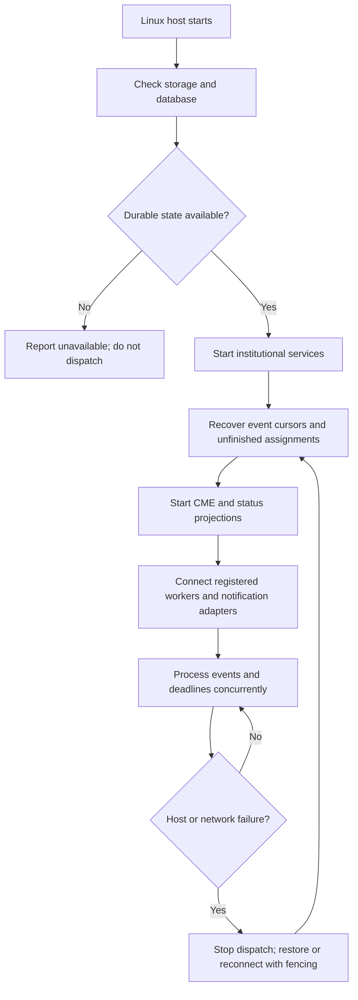

<!--
Riverview~ Controlled Document
File: docs/architecture/LINUX_DEPLOYMENT_AND_HOSTING_v0.1.md
Revision: 1.0.0
Migration: ENG-REV-002
-->
# Riverview~ Linux Deployment and Hosting Contract v0.1

**Status:** proposed design; no host selected, provisioned, deployed, or tested.

## Deployment principle

The Riverview~ institutional core is Linux-native and **host-independent**. Institutional identity, authority, durable events, assignments, and CME behavior cannot depend on a specific GPU, OctoMiner, Camrui mini-PC, or cloud provider. Separate the **control plane** (durable institutional state and event coordination) from the **execution plane** (GPU workers, reasoning providers, hardware adapters).

## Candidate hosts

| Host | Intended role | Risk to evaluate |
| --- | --- | --- |
| Camrui mini-PC | Candidate local primary core host | CPU/RAM/storage capacity, Linux compatibility, disk reliability, backup/power/network |
| OctoMiner | GPU execution and model workers | BIOS experiments, reboots, GPU saturation, power and thermal interruption |
| Dedicated Linux server | Candidate future primary core host | Additional cost, power and maintenance |
| Existing DigitalOcean droplet | Candidate secure remote gateway, notifications and remote access; possible core host | Internet dependency, recurring cost, data locality, privacy and availability |

**Initial recommendation:** evaluate Camrui for the local control plane, keep OctoMiners as replaceable workers, and use DigitalOcean only for the minimum externally reachable functions. This is not a commitment to a particular machine. Remote/cloud core hosting remains an option subject to security, latency, availability and cost measurements.

## Deployment seams

- **Core service:** versioned container/service interface; Linux process supervision; no GPU required.
- **PostgreSQL / River-style durable state:** authoritative transactional database, migrations, backup and restore; never rely on a worker's local ephemeral disk.
- **Event transport:** durable outbox/inbox and per-consumer cursors; reconnect and replay after network interruption.
- **CME:** separate always-on service observing all eligible assignments; per-assignment independence; heartbeat distinguished from meaningful progress.
- **Worker adapters:** outbound-authenticated connection from OctoMiners or other nodes; capability discovery, leases, fencing, health, and revocation.
- **Reasoning providers:** local inference, Playwright/Doorbell/MCP, or optional hosted adapters; routing policy independent of core host.
- **Notifications:** visual/audio/SMS delivery paths; remote gateway cannot become an unauthorized source of institutional authority.
- **Spatial/dashboard projection:** browser-accessible, permission-filtered, stale-state aware; future 3D/VR consumers reuse the same contract.
- **Undercurrent:** separate private trust domain; no automatic transfer to remote host, logs, notifications, or cloud backups.

## Placement and migration contract

Every service has a stable service identity, configuration schema, health endpoint, dependency list, and storage ownership declaration. Host-specific addresses are configuration, not code. Moving the core must preserve durable event IDs, assignment states, grants, office/occupant continuity, workflow versions, and audit provenance. A restore drill must prove that the previous host cannot continue writing concurrently (fencing/single-writer control).

## Startup and recovery flow

## Diagnostic cookbook

**Core unavailable:** check Linux service status, database reachability, schema migration state, and disk free space; never report healthy on a stale heartbeat.

**Worker disconnected:** check adapter connection and last accepted event; other assignments must continue. Reconcile expired leases before reassignment.

**Cloud gateway unreachable:** local core must continue permitted work; queue notifications and mark undelivered. Do not claim SMS was received.

**Migration / restore:** verify last durable event ID, assignments, grants, backup integrity, fencing epoch, and ability to resume without duplicate external effects.

## Required proof before selecting production host

Collect read-only Camrui hardware/OS/disk information, measure idle and peak core workload, exercise database backup/restore, simulate network loss, simulate worker reboot, verify notification delivery and stale telemetry, and perform an authorized host migration drill. Record power draw and operating cost where available.
