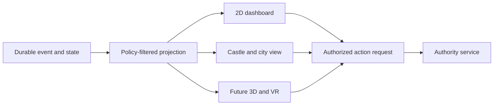

<!--
Riverview~ Controlled Document
File: docs/architecture/OBSERVABILITY_AND_SPATIAL_CONTRACT_v0.1.md
Revision: 1.0.0
Migration: ENG-REV-002
-->
# Riverview~ Observability and Spatial Contract v0.1

Status: proposed, not implemented. Source inspiration: user-supplied Riverview living institution, Estate founding/concept and Castle Memory System diagrams. Historical imagery is design reference, not proof of implemented behavior.

## One object, many views

Every office, occupant, implementation, state record, assignment, resource, service, facility and project has a stable identity. A view may represent an object in multiple places without copying authoritative state. Office != Occupant != Implementation != State. Physical placement, castle metaphor and UI rendering do not grant access rights.

Spatial registry entry fields: `object_id`, `object_type`, `parent_location_id`, `related_object_ids`, `visual_profile_id`, `layout_version`, optional 2D/3D coordinates, `permitted_actions` (derived from authority), `status_source`, `workflow_ref`, `cookbook_ref`. Future renderers consume the same read-only projection and use the same authorized action interface.

## Operational status projection

```json
{
  "object_id": "task_521",
  "projection_version": "rv.status.v1",
  "as_of_event_id": "evt_0123",
  "observed_at": "2026-10-09T18:00:05Z",
  "freshness": "current",
  "state": "awaiting_steward",
  "workflow_id": "engineering.v1",
  "step_id": "steward_decision",
  "responsible_office_id": "office:operations",
  "blocker_code": "AUTHORIZATION_REQUIRED",
  "diagnostic_ref": "cookbook:authority:AUTHORIZATION_REQUIRED",
  "decision_request_ref": "decision_521"
}
```

Example only. Freshness must distinguish `current`, `stale`, `unknown`, and `unavailable`; a disconnected source cannot remain green. Every status label links to its event provenance and actual flowchart node. Progress is derived from meaningful completed milestones, not fabricated percentages.

## Visualization levels

1. **Institutional city/castle:** Steward, Operations Keep, Research Grove, Architecture College, Engineering Foundry, Records & Memory Hall, Security Gatehouse and Character Architecture; retain historical diagrams as visual references, not as binding code architecture.
2. **Operational drill-down:** event bus, CME, assignment state, independent workers, resources, health and verification. Dashboard shows real concurrent work, stalled reasons, resource availability and notification status.
3. **Component detail:** current workflow node highlighted, input/output contract, recent permitted events, error code, diagnostic cookbook, and authorized controls.
4. **Future immersive renderer:** Quest/VR navigates same object graph and state projections; no separate institutional database or privileged VR control path.

## Privacy

Undercurrent may expose only specifically approved aggregate health to ordinary projections. No private prompt, assignment title, artifacts, content-derived labels, or event payload automatically enters ordinary status feeds or spatial metadata.

## Operational flow



## Diagnostic cookbook

If a screen is stale: inspect projection cursor and source event age; display stale status, not last-known healthy status. If a node has no workflow highlight: check workflow ID/step ID mapping and version, report missing mapping rather than guessing. If objects appear duplicated: compare stable object IDs and renderer instances. If private metadata appears in a public view: stop that projection and treat as a boundary failure.

## Acceptance tests

One task appears consistently in dashboard and castle view; step highlight tracks persisted transitions; stale telemetry becomes visibly stale; renderer does not change authorization; a privacy-domain object does not leak sensitive labels; a future 3D client can consume the same schema without core changes.
