<!-- Riverview~ controlled process view; generated from canonical JSON. -->
<!-- File Revision: 1.0.0 -->
# Account authentication lifecycle

**Component:** WEBSITE-ACCOUNT-AUTH · **Workflow:** website.account-auth.v1  
**Source:** `process_graphs/account-authentication/account-lifecycle.json`

```mermaid
flowchart LR
  subgraph g_rv_website_account_auth_account_lifecycle["WEBSITE-ACCOUNT-AUTH / website.account-auth.v1"]
    g_rv_website_account_auth_account_lifecycle_visitor_request_c85d701b(["Visitor chooses Portal Login or Request Access; login uses email and password"])
    g_rv_website_account_auth_account_lifecycle_delivery_ready_df8a509a{"Is an approved email transport configured?"}
    g_rv_website_account_auth_account_lifecycle_delivery_disabled_a05cbae2[["Fail closed and report email delivery unavailable"]]
    g_rv_website_account_auth_account_lifecycle_challenge_denied_3eb7eaae[["Reject expired, consumed, malformed or replayed email challenges"]]
    g_rv_website_account_auth_account_lifecycle_issue_challenge_60e3a39e["Rate-limit request and persist only a high-entropy challenge hash"]
    g_rv_website_account_auth_account_lifecycle_consume_enrollment_3dab1fb3["Verify the single-use email challenge before its expiry"]
    g_rv_website_account_auth_account_lifecycle_pending_steward_62998d5a["Persist verified request as pending; notify configured administrator with Steward-only page link"]
    g_rv_website_account_auth_account_lifecycle_steward_decision_7e87518d{"Does an authenticated Steward approve or reject the request?"}
    g_rv_website_account_auth_account_lifecycle_approve_role_fe7720b8["Steward records role and one-time, 90-day, one-year or permanent grant"]
    g_rv_website_account_auth_account_lifecycle_reject_request_19da5c7e(["Record Steward rejection without creating an account"])
    g_rv_website_account_auth_account_lifecycle_email_login_b6de6b34["Set or reset password through verified email challenge; applicant gets decision notice"]
    g_rv_website_account_auth_account_lifecycle_session_create_5b5bd0d4["Issue password-authenticated session; one-time grant creates at most one session, max 24 hours"]
    g_rv_website_account_auth_account_lifecycle_session_cookie_2aa0e0be["Check account disablement, revocation, expiry, role and CSRF on requests"]
    g_rv_website_account_auth_account_lifecycle_deny_session_1d9490f7[["Deny expired, revoked, disabled, role-ineligible or CSRF-invalid requests"]]
    g_rv_website_account_auth_account_lifecycle_steward_management_756368cd["Steward disables accounts, changes roles and revokes sessions"]
    g_rv_website_account_auth_account_lifecycle_local_steward_bootstrap_d31e3d73[["Root local TTY explicitly authorizes email verification linked to steward:camrui"]]
    g_rv_website_account_auth_account_lifecycle_bootstrap_verify_db3de3fc["Verify single-use bootstrap challenge for existing Steward email"]
    g_rv_website_account_auth_account_lifecycle_bootstrap_create_steward_ce2576de["Create verified account linked to steward:camrui with no default password"]
    g_rv_website_account_auth_account_lifecycle_email_admin_config_658ac0cc["Steward configures reusable SMTP settings; encrypted secret stays server-side"]
    g_rv_website_account_auth_account_lifecycle_applicant_notice_5afdb29a["Send applicant approval or denial notice; record delivery outcome"]
    g_rv_website_account_auth_account_lifecycle_password_auth_73bc3633["Verify password hash, active account, role and grant before creating session"]
    g_rv_website_account_auth_account_lifecycle_grant_check_f8e20275["Enforce grant expiry and revocation on every protected request"]
  end
  g_rv_website_account_auth_account_lifecycle_visitor_request_c85d701b --> g_rv_website_account_auth_account_lifecycle_delivery_ready_df8a509a
  g_rv_website_account_auth_account_lifecycle_delivery_ready_df8a509a -->|diagnostic_branch: No approved provider| g_rv_website_account_auth_account_lifecycle_delivery_disabled_a05cbae2
  g_rv_website_account_auth_account_lifecycle_delivery_ready_df8a509a -->|Provider configured| g_rv_website_account_auth_account_lifecycle_issue_challenge_60e3a39e
  g_rv_website_account_auth_account_lifecycle_issue_challenge_60e3a39e -->|Email link submitted| g_rv_website_account_auth_account_lifecycle_consume_enrollment_3dab1fb3
  g_rv_website_account_auth_account_lifecycle_consume_enrollment_3dab1fb3 -->|Valid enrollment challenge| g_rv_website_account_auth_account_lifecycle_pending_steward_62998d5a
  g_rv_website_account_auth_account_lifecycle_consume_enrollment_3dab1fb3 -->|diagnostic_branch: Invalid, expired or replayed challenge| g_rv_website_account_auth_account_lifecycle_challenge_denied_3eb7eaae
  g_rv_website_account_auth_account_lifecycle_pending_steward_62998d5a --> g_rv_website_account_auth_account_lifecycle_steward_decision_7e87518d
  g_rv_website_account_auth_account_lifecycle_steward_decision_7e87518d -->|Approve Viewer or Operator| g_rv_website_account_auth_account_lifecycle_approve_role_fe7720b8
  g_rv_website_account_auth_account_lifecycle_steward_decision_7e87518d -->|diagnostic_branch: Reject| g_rv_website_account_auth_account_lifecycle_reject_request_19da5c7e
  g_rv_website_account_auth_account_lifecycle_approve_role_fe7720b8 -->|Applicant requests sign-in| g_rv_website_account_auth_account_lifecycle_email_login_b6de6b34
  g_rv_website_account_auth_account_lifecycle_email_login_b6de6b34 -->|Valid email challenge| g_rv_website_account_auth_account_lifecycle_session_create_5b5bd0d4
  g_rv_website_account_auth_account_lifecycle_session_create_5b5bd0d4 --> g_rv_website_account_auth_account_lifecycle_session_cookie_2aa0e0be
  g_rv_website_account_auth_account_lifecycle_session_cookie_2aa0e0be -->|diagnostic_branch: Expired, revoked, disabled or CSRF invalid| g_rv_website_account_auth_account_lifecycle_deny_session_1d9490f7
  g_rv_website_account_auth_account_lifecycle_session_cookie_2aa0e0be -->|Steward account controls| g_rv_website_account_auth_account_lifecycle_steward_management_756368cd
  g_rv_website_account_auth_account_lifecycle_local_steward_bootstrap_d31e3d73 -->|Only after root TTY confirmation and active principal check| g_rv_website_account_auth_account_lifecycle_issue_challenge_60e3a39e
  g_rv_website_account_auth_account_lifecycle_issue_challenge_60e3a39e -->|Bootstrap email link submitted| g_rv_website_account_auth_account_lifecycle_bootstrap_verify_db3de3fc
  g_rv_website_account_auth_account_lifecycle_bootstrap_verify_db3de3fc -->|Valid single-use challenge| g_rv_website_account_auth_account_lifecycle_bootstrap_create_steward_ce2576de
  g_rv_website_account_auth_account_lifecycle_bootstrap_verify_db3de3fc -->|diagnostic_branch: Invalid, expired or replayed challenge| g_rv_website_account_auth_account_lifecycle_challenge_denied_3eb7eaae
  g_rv_website_account_auth_account_lifecycle_pending_steward_62998d5a -->|Verified request; notify administrator| g_rv_website_account_auth_account_lifecycle_applicant_notice_5afdb29a
  g_rv_website_account_auth_account_lifecycle_steward_decision_7e87518d -->|Record decision and notify applicant| g_rv_website_account_auth_account_lifecycle_applicant_notice_5afdb29a
  g_rv_website_account_auth_account_lifecycle_email_admin_config_658ac0cc -->|Provider settings saved| g_rv_website_account_auth_account_lifecycle_delivery_ready_df8a509a
  g_rv_website_account_auth_account_lifecycle_email_login_b6de6b34 -->|Password submitted| g_rv_website_account_auth_account_lifecycle_password_auth_73bc3633
  g_rv_website_account_auth_account_lifecycle_password_auth_73bc3633 -->|Approved account and active grant| g_rv_website_account_auth_account_lifecycle_session_create_5b5bd0d4
  g_rv_website_account_auth_account_lifecycle_session_cookie_2aa0e0be -->|Protected request| g_rv_website_account_auth_account_lifecycle_grant_check_f8e20275
  g_rv_website_account_auth_account_lifecycle_grant_check_f8e20275 -->|diagnostic_branch: Expired or revoked grant| g_rv_website_account_auth_account_lifecycle_deny_session_1d9490f7
  classDef failure fill:#fee,stroke:#b00,stroke-width:2px
```

See [account authentication diagnostics](ACCOUNT_AUTHENTICATION_COOKBOOK.md) and
[the account contract](ACCOUNT_AUTHENTICATION.md).
