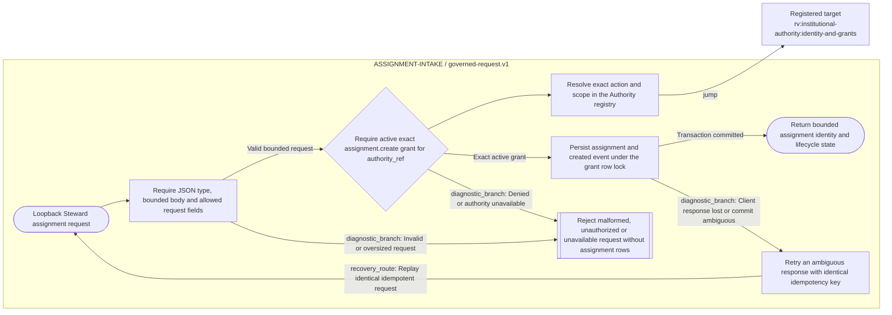

<!--
Riverview~ Controlled Document
File: docs/components/ASSIGNMENT_INTAKE_FLOW.md
Component: ASSIGNMENT-INTAKE
File Revision: 1.0.1
Purpose: Generated governed assignment request workflow
Authority: Generated from canonical process graph JSON; do not hand-edit Mermaid
Changed: 2026-10-11 UTC | RV-M3.3-GOVERNED-INTAKE-ROUTE | Register generated request flow
History: .riverview-backups/manifest.jsonl and Git
-->
# Governed assignment request flow

**Workflow:** Governed assignment create v1  
**Canonical source:** `process_graphs/assignment-intake/governed-request.json`  
**Generation:** `python3 scripts/process_graph.py generate`

