# Riverview~ assignment scheduler flow

**Document Revision:** 1.0.1
**Component:** ASSIGNMENT-SCHEDULER
**Canonical workflow:** `process_graphs/assignment-scheduler/independent-claims.json`
**Generated from:** canonical workflow JSON; do not edit the Mermaid projection by hand.

```mermaid
flowchart LR
  subgraph g_rv_assignment_scheduler_independent_claims["ASSIGNMENT-SCHEDULER / independent-assignment-claims.v1"]
    g_rv_assignment_scheduler_independent_claims_start_e3c0288f(["Scheduler claim request"])
    g_rv_assignment_scheduler_independent_claims_preflight_dfbb1b6a["Require explicitly installed M1.4 lease migration"]
    g_rv_assignment_scheduler_independent_claims_ready_query_5eea99e9["Select oldest ready assignment without active lease using SKIP LOCKED"]
    g_rv_assignment_scheduler_independent_claims_candidate_164bbb9b{"Eligible assignment found?"}
    g_rv_assignment_scheduler_independent_claims_empty_59ea8b40(["No eligible ready assignment"])
    g_rv_assignment_scheduler_independent_claims_claim_d671b973["Persist worker lease and increment fencing generation"]
    g_rv_assignment_scheduler_independent_claims_expiry_8b869afd["Track database-clock lease expiry and heartbeat"]
    g_rv_assignment_scheduler_independent_claims_reclaim_5cc48c9d["Reclaim expired lease with a strictly newer generation"]
    g_rv_assignment_scheduler_independent_claims_start_check_f588e935["Check current worker, generation, and unexpired lease atomically"]
    g_rv_assignment_scheduler_independent_claims_stale_08722cc8[["Reject stale or expired lease token"]]
    g_rv_assignment_scheduler_independent_claims_running_45ad12e4["Atomically transition ready assignment to running with causal event"]
    g_rv_assignment_scheduler_independent_claims_ready_jump_eb51ebfe["M1.3 event processor makes queued work ready"]
  end
  g_rv_event_processor_assignment_progression_advance_b0fce628["Registered target<br/>rv:event-processor:assignment-progression"]
  g_rv_assignment_scheduler_independent_claims_start_e3c0288f --> g_rv_assignment_scheduler_independent_claims_preflight_dfbb1b6a
  g_rv_assignment_scheduler_independent_claims_preflight_dfbb1b6a -->|Lease schema available| g_rv_assignment_scheduler_independent_claims_ready_query_5eea99e9
  g_rv_assignment_scheduler_independent_claims_ready_query_5eea99e9 --> g_rv_assignment_scheduler_independent_claims_candidate_164bbb9b
  g_rv_assignment_scheduler_independent_claims_candidate_164bbb9b -->|No| g_rv_assignment_scheduler_independent_claims_empty_59ea8b40
  g_rv_assignment_scheduler_independent_claims_candidate_164bbb9b -->|Yes| g_rv_assignment_scheduler_independent_claims_claim_d671b973
  g_rv_assignment_scheduler_independent_claims_claim_d671b973 --> g_rv_assignment_scheduler_independent_claims_expiry_8b869afd
  g_rv_assignment_scheduler_independent_claims_expiry_8b869afd -->|recovery_route: Expired lease; generation increments| g_rv_assignment_scheduler_independent_claims_reclaim_5cc48c9d
  g_rv_assignment_scheduler_independent_claims_claim_d671b973 --> g_rv_assignment_scheduler_independent_claims_start_check_f588e935
  g_rv_assignment_scheduler_independent_claims_start_check_f588e935 -->|diagnostic_branch: Token no longer current| g_rv_assignment_scheduler_independent_claims_stale_08722cc8
  g_rv_assignment_scheduler_independent_claims_start_check_f588e935 -->|Current lease| g_rv_assignment_scheduler_independent_claims_running_45ad12e4
  g_rv_assignment_scheduler_independent_claims_ready_jump_eb51ebfe -->|jump: Open the M1.3 ready-state producer workflow| g_rv_event_processor_assignment_progression_advance_b0fce628
  classDef failure fill:#fee,stroke:#b00,stroke-width:2px
```

