<!--
Riverview~ Controlled Document
File: docs/components/CHATGPT_DOORBELL_FLOW.md
Component: CHATGPT-DOORBELL
File Revision: 1.0.5
Purpose: Generated canonical New-Core Linux doorbell workflow view; no runtime authority
Changed: 2026-10-18 UTC | RV-C3-DOORBELL-DOD-001 | Expand workflow with explicit external owners, failure branches and recovery
-->
# ChatGPT Doorbell Flow

The implemented adapter path runs from the caller entry through metadata-only
submission confirmation. The durable request source is not connected yet. Comms5
and Grace nodes show acceptance prerequisites and their owners; they are not
runtime transitions or claims that the browser bridge implements those stages.
External dependency nodes remain blocked until their versioned contracts and
independent acceptance evidence are available.

```mermaid
flowchart LR
  subgraph g_rv_chatgpt_doorbell_browser_runtime["CHATGPT-DOORBELL / chatgpt.doorbell.v1"]
    g_rv_chatgpt_doorbell_browser_runtime_request_eligible_12caa613["Comms5 persists an eligible durable reasoning request"]
    g_rv_chatgpt_doorbell_browser_runtime_trigger_received_6c864c2c(["New-Core caller invokes the wake adapter with request and correlation identities"])
    g_rv_chatgpt_doorbell_browser_runtime_request_identity_e27c3bb7(["Caller supplies one durable request and correlation identity; this caller is not connected to a mailbox source"])
    g_rv_chatgpt_doorbell_browser_runtime_binding_check_70a09cfc["Require local conversation config to match the caller's current designated Comms5 binding"]
    g_rv_chatgpt_doorbell_browser_runtime_browser_readiness_25e25a78["Check user service, Chrome process, dedicated profile ownership, and localhost CDP listener"]
    g_rv_chatgpt_doorbell_browser_runtime_cdp_established_c2607a5b["Establish bounded CDP connection to 127.0.0.1 only"]
    g_rv_chatgpt_doorbell_browser_runtime_target_resolution_689ceaf5["Resolve exactly one configured ChatGPT conversation over localhost CDP"]
    g_rv_chatgpt_doorbell_browser_runtime_authenticated_composer_68021f6d{"Is the selected target authenticated and its composer available?"}
    g_rv_chatgpt_doorbell_browser_runtime_steward_login_62dddd20[["Steward completes supported login or MFA in the dedicated Riverview profile"]]
    g_rv_chatgpt_doorbell_browser_runtime_fixed_wake_f84be1d1["Submit only the fixed wake text with the allowlisted send control"]
    g_rv_chatgpt_doorbell_browser_runtime_submit_verification_ded1bd9a["Require click invocation and composer-cleared transition before recording success"]
    g_rv_chatgpt_doorbell_browser_runtime_metadata_result_1010d17f(["Return request/correlation identity and metadata-only evidence to the caller"])
    g_rv_chatgpt_doorbell_browser_runtime_chatgpt_mailbox_access_2c6ecbbe["Designated ChatGPT conversation accesses Comms5 mailbox operations"]
    g_rv_chatgpt_doorbell_browser_runtime_request_claimed_c7675f9f["Comms5 acknowledges and claims the same eligible request"]
    g_rv_chatgpt_doorbell_browser_runtime_correlated_response_181daf45["Comms5 accepts a response correlated to the active claim"]
    g_rv_chatgpt_doorbell_browser_runtime_grace_consumes_be1d387d["Grace consumes the completed response through its established interface"]
    g_rv_chatgpt_doorbell_browser_runtime_workflow_complete_49b5e842["Comms5 records completion and Grace continuation is evidenced"]
    g_rv_chatgpt_doorbell_browser_runtime_browser_unavailable_9afaa084[["Browser service or Chrome unavailable; block without triggering"]]
    g_rv_chatgpt_doorbell_browser_runtime_cdp_failure_ceec62f1[["CDP connection unavailable or timed out; block without triggering"]]
    g_rv_chatgpt_doorbell_browser_runtime_submission_timeout_afd05115[["Fixed message submission was not confirmed within the bounded timeout"]]
    g_rv_chatgpt_doorbell_browser_runtime_comms5_missing_35d0422e[["Required Comms5 mailbox lifecycle operations are absent; stop downstream acceptance"]]
    g_rv_chatgpt_doorbell_browser_runtime_retry_or_block_8141e961{"Is retry safe under the same request identity and owning mailbox expiry policy?"}
    g_rv_chatgpt_doorbell_browser_runtime_bounded_retry_0ad8b0e0["Retry only an unverified attempt with the same request and correlation identities"]
    g_rv_chatgpt_doorbell_browser_runtime_restart_recovery_59282408["After service restart, re-read readiness and durable caller state before resuming"]
    g_rv_chatgpt_doorbell_browser_runtime_blocked_wait_0c5caaf5[["Record blocker and await the owning Steward or component owner decision"]]
    g_rv_chatgpt_doorbell_browser_runtime_wake_failure_31d5da98[["Fail closed on binding mismatch, missing or duplicate target, or unverified submission"]]
  end
  g_rv_chatgpt_doorbell_browser_runtime_request_eligible_12caa613 -->|prerequisite: Comms5 durable request must exist; caller integration is not commissioned| g_rv_chatgpt_doorbell_browser_runtime_trigger_received_6c864c2c
  g_rv_chatgpt_doorbell_browser_runtime_trigger_received_6c864c2c --> g_rv_chatgpt_doorbell_browser_runtime_request_identity_e27c3bb7
  g_rv_chatgpt_doorbell_browser_runtime_request_identity_e27c3bb7 --> g_rv_chatgpt_doorbell_browser_runtime_binding_check_70a09cfc
  g_rv_chatgpt_doorbell_browser_runtime_binding_check_70a09cfc -->|binding matches| g_rv_chatgpt_doorbell_browser_runtime_browser_readiness_25e25a78
  g_rv_chatgpt_doorbell_browser_runtime_binding_check_70a09cfc -->|diagnostic_branch: binding differs| g_rv_chatgpt_doorbell_browser_runtime_wake_failure_31d5da98
  g_rv_chatgpt_doorbell_browser_runtime_browser_readiness_25e25a78 -->|service and profile ready| g_rv_chatgpt_doorbell_browser_runtime_cdp_established_c2607a5b
  g_rv_chatgpt_doorbell_browser_runtime_browser_readiness_25e25a78 -->|diagnostic_branch: service, Chrome, or profile unavailable| g_rv_chatgpt_doorbell_browser_runtime_browser_unavailable_9afaa084
  g_rv_chatgpt_doorbell_browser_runtime_browser_unavailable_9afaa084 -->|escalation: do not ring| g_rv_chatgpt_doorbell_browser_runtime_blocked_wait_0c5caaf5
  g_rv_chatgpt_doorbell_browser_runtime_browser_unavailable_9afaa084 -->|recovery_route: after approved service recovery| g_rv_chatgpt_doorbell_browser_runtime_restart_recovery_59282408
  g_rv_chatgpt_doorbell_browser_runtime_cdp_established_c2607a5b -->|localhost connection established| g_rv_chatgpt_doorbell_browser_runtime_target_resolution_689ceaf5
  g_rv_chatgpt_doorbell_browser_runtime_cdp_established_c2607a5b -->|diagnostic_branch: connection refused or timeout| g_rv_chatgpt_doorbell_browser_runtime_cdp_failure_ceec62f1
  g_rv_chatgpt_doorbell_browser_runtime_cdp_failure_ceec62f1 -->|escalation| g_rv_chatgpt_doorbell_browser_runtime_blocked_wait_0c5caaf5
  g_rv_chatgpt_doorbell_browser_runtime_cdp_failure_ceec62f1 -->|recovery_route| g_rv_chatgpt_doorbell_browser_runtime_restart_recovery_59282408
  g_rv_chatgpt_doorbell_browser_runtime_target_resolution_689ceaf5 -->|exactly one target| g_rv_chatgpt_doorbell_browser_runtime_authenticated_composer_68021f6d
  g_rv_chatgpt_doorbell_browser_runtime_target_resolution_689ceaf5 -->|diagnostic_branch: target missing or duplicated| g_rv_chatgpt_doorbell_browser_runtime_wake_failure_31d5da98
  g_rv_chatgpt_doorbell_browser_runtime_authenticated_composer_68021f6d -->|local composer-ready heuristic and exact target| g_rv_chatgpt_doorbell_browser_runtime_fixed_wake_f84be1d1
  g_rv_chatgpt_doorbell_browser_runtime_authenticated_composer_68021f6d -->|escalation: login/MFA required| g_rv_chatgpt_doorbell_browser_runtime_steward_login_62dddd20
  g_rv_chatgpt_doorbell_browser_runtime_steward_login_62dddd20 -->|recovery_route: Steward completes supported login; re-run preflight| g_rv_chatgpt_doorbell_browser_runtime_authenticated_composer_68021f6d
  g_rv_chatgpt_doorbell_browser_runtime_fixed_wake_f84be1d1 --> g_rv_chatgpt_doorbell_browser_runtime_submit_verification_ded1bd9a
  g_rv_chatgpt_doorbell_browser_runtime_submit_verification_ded1bd9a -->|submission transition confirmed| g_rv_chatgpt_doorbell_browser_runtime_metadata_result_1010d17f
  g_rv_chatgpt_doorbell_browser_runtime_submit_verification_ded1bd9a -->|diagnostic_branch: timeout or ambiguous submission| g_rv_chatgpt_doorbell_browser_runtime_submission_timeout_afd05115
  g_rv_chatgpt_doorbell_browser_runtime_submission_timeout_afd05115 -->|diagnostic_branch| g_rv_chatgpt_doorbell_browser_runtime_retry_or_block_8141e961
  g_rv_chatgpt_doorbell_browser_runtime_retry_or_block_8141e961 -->|recovery_route: safe under the owning mailbox contract| g_rv_chatgpt_doorbell_browser_runtime_bounded_retry_0ad8b0e0
  g_rv_chatgpt_doorbell_browser_runtime_bounded_retry_0ad8b0e0 -->|recovery_route: same request and correlation identities| g_rv_chatgpt_doorbell_browser_runtime_browser_readiness_25e25a78
  g_rv_chatgpt_doorbell_browser_runtime_retry_or_block_8141e961 -->|escalation: ambiguous outcome, expired request, or retry limit reached| g_rv_chatgpt_doorbell_browser_runtime_blocked_wait_0c5caaf5
  g_rv_chatgpt_doorbell_browser_runtime_metadata_result_1010d17f -->|prerequisite: future Comms5 integration; browser bridge does not call mailbox| g_rv_chatgpt_doorbell_browser_runtime_chatgpt_mailbox_access_2c6ecbbe
  g_rv_chatgpt_doorbell_browser_runtime_chatgpt_mailbox_access_2c6ecbbe -->|prerequisite: Codex1-owned Comms5 operation required| g_rv_chatgpt_doorbell_browser_runtime_request_claimed_c7675f9f
  g_rv_chatgpt_doorbell_browser_runtime_chatgpt_mailbox_access_2c6ecbbe -->|diagnostic_branch: required operation absent| g_rv_chatgpt_doorbell_browser_runtime_comms5_missing_35d0422e
  g_rv_chatgpt_doorbell_browser_runtime_comms5_missing_35d0422e -->|escalation: issue #96; Codex1| g_rv_chatgpt_doorbell_browser_runtime_blocked_wait_0c5caaf5
  g_rv_chatgpt_doorbell_browser_runtime_request_claimed_c7675f9f -->|prerequisite: same request/correlation lineage| g_rv_chatgpt_doorbell_browser_runtime_correlated_response_181daf45
  g_rv_chatgpt_doorbell_browser_runtime_correlated_response_181daf45 -->|prerequisite: existing Grace interface; Codex2-owned| g_rv_chatgpt_doorbell_browser_runtime_grace_consumes_be1d387d
  g_rv_chatgpt_doorbell_browser_runtime_grace_consumes_be1d387d -->|prerequisite: completion requires independent evidence| g_rv_chatgpt_doorbell_browser_runtime_workflow_complete_49b5e842
  g_rv_chatgpt_doorbell_browser_runtime_restart_recovery_59282408 -->|recovery_route: read readiness and durable request state before resume| g_rv_chatgpt_doorbell_browser_runtime_browser_readiness_25e25a78
  g_rv_chatgpt_doorbell_browser_runtime_blocked_wait_0c5caaf5 -->|recovery_route: owner clears blocker and authorizes resume| g_rv_chatgpt_doorbell_browser_runtime_restart_recovery_59282408
  g_rv_chatgpt_doorbell_browser_runtime_wake_failure_31d5da98 -->|diagnostic_branch: bounded retry policy| g_rv_chatgpt_doorbell_browser_runtime_retry_or_block_8141e961
  classDef failure fill:#fee,stroke:#b00,stroke-width:2px
```

