<!--
Riverview~ Controlled Document
File: docs/components/JESSICA_CHARACTER_ADVISORY_FLOW.md
Component: JESSICA-CHARACTER-ARCHITECTURE
File Revision: 1.0.0
Purpose: Draft focused flow projection for the isolated Jessica advisory graph proposal
Authority: Draft only; not canonical until graph registration and generated-view check pass
Changed: 2026-10-18 UTC | W3-DISPATCH-6253533433 | Add flow projection proposal
Contracts: docs/architecture/JESSICA_CANONICAL_GRAPH_INTEGRATION_PROPOSAL.md
-->
# Jessica Character Advisory Flow

**Status:** Draft projection only. Canonical JSON registration and generated-view validation are pending W1 shared revision-registry handoff. No runtime route or Jessica identity is implied.

```mermaid
flowchart LR
  subgraph g_rv_jessica_character_advisory["JESSICA-CHARACTER-ARCHITECTURE / jessica.character-advisory.v1"]
    g_rv_jessica_character_advisory_request_ca8af072(["A host calls the request-driven advisory package builder with a bounded subject and request"])
    g_rv_jessica_character_advisory_request_boundary_e65a5f9e["Validate required fields, nonnegative base revision, acceptance criteria, and mandatory advisory-only constraints"]
    g_rv_jessica_character_advisory_evidence_gate_8783da47{"Require exact source records; bind historical claims to matching evidence and keep unresolved identity fields out of factual claims"}
    g_rv_jessica_character_advisory_reject_input_9102fd80[["Reject malformed requests, missing or mismatched evidence, unsupported historical claims, identity expansion, or omitted authority boundary"]]
    g_rv_jessica_character_advisory_build_package_812a18a1["Build an in-memory PROPOSED package with request, subject, base revision, source references, claims, and advisory provenance"]
    g_rv_jessica_character_advisory_successor_revision_67aabff9["On a separate caller request, build a successor package retaining predecessor revision and evidence context"]
    g_rv_jessica_character_advisory_package_returned_fb7aa14c(["Return package to caller; no persistence, Jessica resident creation, review, approval, or activation occurs"])
    g_rv_jessica_character_advisory_import_call_0e2684b7(["A separate parent host explicitly calls the dormant import helper with a package and purported Steward principal"])
    g_rv_jessica_character_advisory_principal_shape_check_6081abe7["Helper checks only that the supplied value is a nonempty steward-prefixed string; caller authentication is not implemented here"]
    g_rv_jessica_character_advisory_deny_import_6110b6a9[["Reject non-Steward-shaped caller values before registry invocation; this does not authenticate a caller"]]
    g_rv_jessica_character_advisory_create_draft_4dae0107["Map to the existing authorized_import contract; persist a DRAFT as the supplied Steward actor and Jessica as advisory producer"]
    g_rv_jessica_character_advisory_draft_returned_75efdbc0(["Return existing registry DRAFT; review and decision remain separate Steward actions, and no Jessica route is connected"])
    g_rv_jessica_character_advisory_parent_visibility_contract_5a83bf09["Existing Steward proposal GET endpoints can retrieve a separately persisted DRAFT; no Jessica-specific status or API hook exists"]
  end
  g_rv_jessica_character_advisory_request_ca8af072 -->|builder receives request| g_rv_jessica_character_advisory_request_boundary_e65a5f9e
  g_rv_jessica_character_advisory_request_boundary_e65a5f9e -->|request shape and advisory constraints valid| g_rv_jessica_character_advisory_evidence_gate_8783da47
  g_rv_jessica_character_advisory_request_boundary_e65a5f9e -->|diagnostic_branch: required field, revision, criteria, or boundary invalid| g_rv_jessica_character_advisory_reject_input_9102fd80
  g_rv_jessica_character_advisory_evidence_gate_8783da47 -->|diagnostic_branch: evidence missing/mismatched, claim unsupported, or unresolved identity asserted| g_rv_jessica_character_advisory_reject_input_9102fd80
  g_rv_jessica_character_advisory_evidence_gate_8783da47 -->|all supplied claims map to exact supplied source records| g_rv_jessica_character_advisory_build_package_812a18a1
  g_rv_jessica_character_advisory_build_package_812a18a1 -->|caller separately requests revise_character_proposal| g_rv_jessica_character_advisory_successor_revision_67aabff9
  g_rv_jessica_character_advisory_build_package_812a18a1 -->|return initial local package| g_rv_jessica_character_advisory_package_returned_fb7aa14c
  g_rv_jessica_character_advisory_successor_revision_67aabff9 -->|return successor with predecessor revision| g_rv_jessica_character_advisory_package_returned_fb7aa14c
  g_rv_jessica_character_advisory_package_returned_fb7aa14c -->|prerequisite: a separate host call requires a package; no automatic import call is wired| g_rv_jessica_character_advisory_import_call_0e2684b7
  g_rv_jessica_character_advisory_import_call_0e2684b7 -->|host explicitly invokes optional helper| g_rv_jessica_character_advisory_principal_shape_check_6081abe7
  g_rv_jessica_character_advisory_principal_shape_check_6081abe7 -->|diagnostic_branch: value is not a nonempty steward-prefixed string| g_rv_jessica_character_advisory_deny_import_6110b6a9
  g_rv_jessica_character_advisory_principal_shape_check_6081abe7 -->|string shape passes; actual trusted authentication remains the host's unimplemented integration responsibility| g_rv_jessica_character_advisory_create_draft_4dae0107
  g_rv_jessica_character_advisory_create_draft_4dae0107 -->|existing registry returns DRAFT| g_rv_jessica_character_advisory_draft_returned_75efdbc0
  g_rv_jessica_character_advisory_draft_returned_75efdbc0 -->|documentation: parent visibility contract only; no connected Jessica route or runtime transition| g_rv_jessica_character_advisory_parent_visibility_contract_5a83bf09
  classDef failure fill:#fee,stroke:#b00,stroke-width:2px
```

