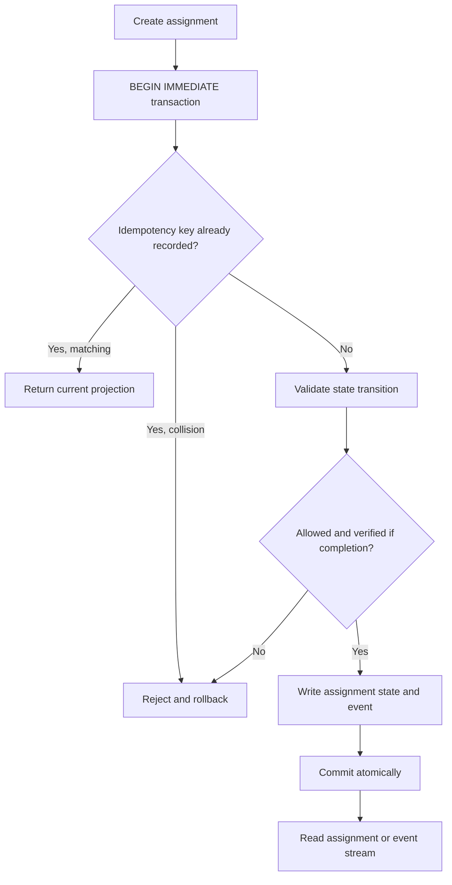

<!--
Riverview~ Controlled Document
File: docs/components/LEDGER_COOKBOOK.md
Revision: 1.0.0
Migration: ENG-REV-002
-->
# Event ledger prototype — flowchart and troubleshooting cookbook

**Scope:** minimal SQLite-backed developer prototype, not production authority, PostgreSQL, CME, or independent verifier. The `verified=True` parameter is a caller assertion only; it must be replaced by a durable verifier-issued evidence reference before real execution. No authorization boundary is enforced yet. **Do not expose this module as a remotely callable service or use it to dispatch hardware.**

## Operational flow

## Diagnostics

Run `PYTHONPATH=src python -m unittest discover -s tests -v` from repository root. All three tests should pass. If `ModuleNotFoundError`, ensure `PYTHONPATH=src`. If `sqlite3.OperationalError: database is locked`, inspect competing writers and timeout; do not delete the database. If `TransitionError`, check current assignment state and `TRANSITIONS` table. For restart verification, close and reopen the same database file, compare assignments and event count. Never equate SQLite test success with production durability or independent verification.

## Visualization projection

`Ledger.list_assignments()` exposes stable assignment ID, state, owner, workflow step, update time and version; `Ledger.events(after_seq)` exposes an ordered event cursor. These are developer inspection primitives, **not yet** a live dashboard or permission-filtered projection. Next work: PostgreSQL transaction layer, durable outbox, authority and verified evidence, CME subscriber, and actual visual monitor.
