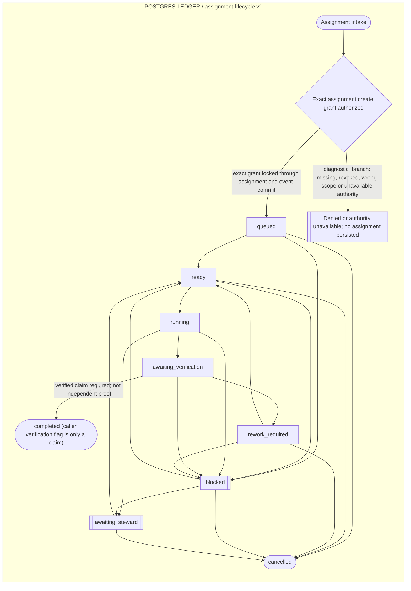

<!--
Riverview~ Controlled Document
File: docs/components/POSTGRES_LEDGER_FLOW.md
Revision: 1.0.2
Migration: ENG-REV-002
-->
# PostgreSQL ledger — component flow and Steward projection

## Transaction flow

```mermaid
flowchart LR
  subgraph g_rv_postgres_ledger_migration["POSTGRES-LEDGER / postgres-migration.v1"]
    g_rv_postgres_ledger_migration_preflight_ec94ae68["Confirm live host, database, schema owner/access, empty target and compatibility"]
    g_rv_postgres_ledger_migration_preflight_clear_0a40acce{"Preflight safe to proceed?"}
    g_rv_postgres_ledger_migration_stop_663cc7f7[["Stop on identity, compatibility or safety mismatch"]]
    g_rv_postgres_ledger_migration_backup_38573f63["Protected full database backup; checksum and restore drill"]
    g_rv_postgres_ledger_migration_backup_verified_29434f47["Recoverable backup independently restored and verified"]
    g_rv_postgres_ledger_migration_apply_0f7d74d6(["Explicit migration request for selected schema"])
    g_rv_postgres_ledger_migration_check_be5258fb{"Stored checksum matches source?"}
    g_rv_postgres_ledger_migration_drift_b98061b0[["Checksum mismatch; stop without schema changes"]]
    g_rv_postgres_ledger_migration_noop_899834d7["Identical applied migration is a no-op"]
    g_rv_postgres_ledger_migration_sql_cacb3993["Apply versioned SQL and checksum atomically"]
    g_rv_postgres_ledger_migration_require_schema_7fdaca28["PostgresLedger requires migrated target schema"]
    g_rv_postgres_ledger_migration_caller_d46bc0ce["Caller requests assignment create or transition"]
    g_rv_postgres_ledger_migration_transaction_af7f3601["Begin PostgreSQL transaction"]
    g_rv_postgres_ledger_migration_lock_149138d8["Advisory lock on idempotency key"]
    g_rv_postgres_ledger_migration_key_exists_d130912f{"Existing event key?"}
    g_rv_postgres_ledger_migration_replay_a1063a6f["Exact semantic replay returns current assignment"]
    g_rv_postgres_ledger_migration_collision_beaab03a[["Conflicting key reuse is rejected"]]
    g_rv_postgres_ledger_migration_operation_8df8b8e9{"Create or transition?"}
    g_rv_postgres_ledger_migration_create_c5874fe6["Insert assignment metadata"]
    g_rv_postgres_ledger_migration_row_lock_c211d4fd["Lock assignment row FOR UPDATE"]
    g_rv_postgres_ledger_migration_legal_4d258b71{"Legal state transition?"}
    g_rv_postgres_ledger_migration_illegal_ffce465d[["Reject illegal transition"]]
    g_rv_postgres_ledger_migration_update_e39c0a3a["Update state and workflow step"]
    g_rv_postgres_ledger_migration_event_2f58fb55["Append event with authority and causality"]
    g_rv_postgres_ledger_migration_commit_fbc6bd2d["Commit assignment and event atomically"]
    g_rv_postgres_ledger_migration_read_a87694e9["Read assignment and ordered events"]
    g_rv_postgres_ledger_migration_snapshot_94c6aa38["On-demand status snapshot"]
    g_rv_postgres_ledger_migration_dashboard_jump_408b2f81["M3.1 live dashboard (planned; not implemented)"]
  end
  g_rv_steward_dashboard_status_ingest_66a3387a["Registered target<br/>rv:steward-dashboard:status"]
  g_rv_postgres_ledger_migration_preflight_ec94ae68 -->|verification| g_rv_postgres_ledger_migration_preflight_clear_0a40acce
  g_rv_postgres_ledger_migration_preflight_clear_0a40acce -->|diagnostic_branch: No| g_rv_postgres_ledger_migration_stop_663cc7f7
  g_rv_postgres_ledger_migration_preflight_clear_0a40acce -->|Yes| g_rv_postgres_ledger_migration_backup_38573f63
  g_rv_postgres_ledger_migration_backup_38573f63 -->|verification| g_rv_postgres_ledger_migration_backup_verified_29434f47
  g_rv_postgres_ledger_migration_backup_verified_29434f47 --> g_rv_postgres_ledger_migration_apply_0f7d74d6
  g_rv_postgres_ledger_migration_apply_0f7d74d6 --> g_rv_postgres_ledger_migration_check_be5258fb
  g_rv_postgres_ledger_migration_check_be5258fb -->|diagnostic_branch: Mismatch| g_rv_postgres_ledger_migration_drift_b98061b0
  g_rv_postgres_ledger_migration_check_be5258fb -->|Already applied, identical| g_rv_postgres_ledger_migration_noop_899834d7
  g_rv_postgres_ledger_migration_check_be5258fb -->|New version| g_rv_postgres_ledger_migration_sql_cacb3993
  g_rv_postgres_ledger_migration_noop_899834d7 --> g_rv_postgres_ledger_migration_require_schema_7fdaca28
  g_rv_postgres_ledger_migration_sql_cacb3993 --> g_rv_postgres_ledger_migration_require_schema_7fdaca28
  g_rv_postgres_ledger_migration_require_schema_7fdaca28 -->|prerequisite: Verified schema contract; not a runtime call| g_rv_postgres_ledger_migration_caller_d46bc0ce
  g_rv_postgres_ledger_migration_caller_d46bc0ce --> g_rv_postgres_ledger_migration_transaction_af7f3601
  g_rv_postgres_ledger_migration_transaction_af7f3601 --> g_rv_postgres_ledger_migration_lock_149138d8
  g_rv_postgres_ledger_migration_lock_149138d8 --> g_rv_postgres_ledger_migration_key_exists_d130912f
  g_rv_postgres_ledger_migration_key_exists_d130912f -->|Exact replay| g_rv_postgres_ledger_migration_replay_a1063a6f
  g_rv_postgres_ledger_migration_key_exists_d130912f -->|diagnostic_branch: Conflict| g_rv_postgres_ledger_migration_collision_beaab03a
  g_rv_postgres_ledger_migration_key_exists_d130912f -->|New key| g_rv_postgres_ledger_migration_operation_8df8b8e9
  g_rv_postgres_ledger_migration_operation_8df8b8e9 -->|Create| g_rv_postgres_ledger_migration_create_c5874fe6
  g_rv_postgres_ledger_migration_operation_8df8b8e9 -->|Transition| g_rv_postgres_ledger_migration_row_lock_c211d4fd
  g_rv_postgres_ledger_migration_row_lock_c211d4fd --> g_rv_postgres_ledger_migration_legal_4d258b71
  g_rv_postgres_ledger_migration_legal_4d258b71 -->|diagnostic_branch: No| g_rv_postgres_ledger_migration_illegal_ffce465d
  g_rv_postgres_ledger_migration_legal_4d258b71 -->|Yes| g_rv_postgres_ledger_migration_update_e39c0a3a
  g_rv_postgres_ledger_migration_create_c5874fe6 --> g_rv_postgres_ledger_migration_event_2f58fb55
  g_rv_postgres_ledger_migration_update_e39c0a3a --> g_rv_postgres_ledger_migration_event_2f58fb55
  g_rv_postgres_ledger_migration_event_2f58fb55 --> g_rv_postgres_ledger_migration_commit_fbc6bd2d
  g_rv_postgres_ledger_migration_commit_fbc6bd2d --> g_rv_postgres_ledger_migration_read_a87694e9
  g_rv_postgres_ledger_migration_replay_a1063a6f --> g_rv_postgres_ledger_migration_read_a87694e9
  g_rv_postgres_ledger_migration_read_a87694e9 --> g_rv_postgres_ledger_migration_snapshot_94c6aa38
  g_rv_postgres_ledger_migration_snapshot_94c6aa38 --> g_rv_postgres_ledger_migration_dashboard_jump_408b2f81
  g_rv_postgres_ledger_migration_dashboard_jump_408b2f81 -->|jump| g_rv_steward_dashboard_status_ingest_66a3387a
  classDef failure fill:#fee,stroke:#b00,stroke-width:2px
```

## Assignment lifecycle

## Steward view — delivered versus planned
| Signal | On-demand snapshot | Live Steward view |
| --- | --- | --- |
| PostgreSQL connectivity | Yes | Not built |
| Assignment counts by state | Yes, if tables initialized | Not built |
| Last event sequence and timestamp | Yes, if tables initialized | Not built |
| Database health and failures over time | Single-point read only | Not built |
| Alerts, CME recovery, drill-down, authorization | No | Not built |

Use `scripts/postgres_ledger_steward_snapshot.py` to generate a read-only JSON status snapshot. It accepts `RIVERVIEW_PG_DSN` and `RIVERVIEW_PG_SCHEMA`. It never initializes tables, writes data, or starts a web service. If tables do not exist, it reports `not_initialized` rather than creating them.
