<!--
Riverview~ Controlled Document
File: docs/components/RESIDENT_REASONING_FLOW.md
Component: RESIDENT-REASONING
File Revision: 1.0.2
Purpose: Generated focused process view for resident reasoning routing
Authority: Graph-generated view; canonical source is JSON
Changed: 2026-10-11 UTC | RV-M4.2-001 | Add graph-generated resident reasoning flow
History: process_graphs/resident-reasoning/runtime.json
-->
# Resident reasoning process flow

**Document Revision:** 1.0.0
**Generated from:** `process_graphs/resident-reasoning/runtime.json`; do not edit Mermaid by hand.

```mermaid
flowchart LR
  subgraph g_rv_resident_reasoning_runtime["RESIDENT-REASONING / resident.reasoning.v1"]
    g_rv_resident_reasoning_runtime_request_7f98a7b3(["Resident reasoning request for one authoritative assignment"])
    g_rv_resident_reasoning_runtime_authorize_state_01b83150["Require exact active office.state.write grant before reading assignment context"]
    g_rv_resident_reasoning_runtime_authority_gate_f71eec68{"Is the exact resident office-state grant active?"}
    g_rv_resident_reasoning_runtime_authority_denied_24a96278[["Return AUTHORITY_DENIED without reading context or invoking provider"]]
    g_rv_resident_reasoning_runtime_load_context_d318d274["Read current office binding and assignment revision; reject credential fields and oversized inputs"]
    g_rv_resident_reasoning_runtime_ground_fedaa2c8["Ground the current assignment through knowledge-provider v1"]
    g_rv_resident_reasoning_runtime_reground_480fc411["Reground at the request trigger and retain source revision/hash"]
    g_rv_resident_reasoning_runtime_grounding_gate_64658003{"Are grounding and regrounding both VERIFIED and complete?"}
    g_rv_resident_reasoning_runtime_evidence_wait_5652c712[["Persist non-verified status and return WAITING_FOR_EVIDENCE"]]
    g_rv_resident_reasoning_runtime_knowledge_contract_jump_4dfc6c88["Use the existing assignment knowledge provider contract"]
    g_rv_resident_reasoning_runtime_binding_jump_a19c568e["Read the durable office binding and state revision"]
    g_rv_resident_reasoning_runtime_select_provider_46047639["Choose the provider matching the active office implementation provider_ref"]
    g_rv_resident_reasoning_runtime_route_gate_56e9828c{"Is the primary provider and every configured fallback exact, registered and bounded?"}
    g_rv_resident_reasoning_runtime_route_unavailable_854025a6[["Persist route failure and return UNAVAILABLE without inferred fallback"]]
    g_rv_resident_reasoning_runtime_provider_call_c528110c["Call one provider under per-call timeout and divided token budget"]
    g_rv_resident_reasoning_runtime_fallback_gate_7e77ebca{"Did the call time out or fail before returning a plan?"}
    g_rv_resident_reasoning_runtime_fallback_6dc058bf["Try the next explicitly configured provider only; no implicit provider selection"]
    g_rv_resident_reasoning_runtime_proposal_gate_8918a316["Validate typed plan schema, ordered dependencies, and attempt token budget"]
    g_rv_resident_reasoning_runtime_proposal_invalid_182e56de[["Reject malformed or over-budget output; do not persist a proposal"]]
    g_rv_resident_reasoning_runtime_freshness_gate_bef2dc13{"Did office binding and assignment revision remain current?"}
    g_rv_resident_reasoning_runtime_stale_context_20ce95a2[["Discard stale result and require a new authoritative grounding cycle"]]
    g_rv_resident_reasoning_runtime_persist_plan_66486e35["Persist source references, statuses, request metadata and plan via office-state CAS"]
    g_rv_resident_reasoning_runtime_persistence_gate_d9f96702{"Did exact-grant state write succeed against the expected revision?"}
    g_rv_resident_reasoning_runtime_state_conflict_0acad65d[["Return AUTHORITY_DENIED, STATE_CONFLICT or UNAVAILABLE; never report success"]]
    g_rv_resident_reasoning_runtime_proposal_only_27f4e7fa(["Return PROPOSED; proposal is not an approved work order or executed action"])
    g_rv_resident_reasoning_runtime_budget_gate_362686a9{"Can the total budget provide at least one token to every primary/fallback attempt?"}
    g_rv_resident_reasoning_runtime_budget_insufficient_85f3e6b9[["Reject an undersized route before invoking any provider"]]
    g_rv_resident_reasoning_runtime_task_escalation_contract_dec2e604["IMPLEMENTED CONTRACT ONLY — task escalation carries the original assignment, verified context fingerprint, exact provider target and bounded result; normal resident routing is not yet wired to invoke it"]
  end
  g_rv_worker_adapter_deterministic_attempt_ground_c2193741["Registered target<br/>rv:worker-adapter:deterministic-attempt"]
  g_rv_institutional_authority_identity_and_grants_office_state_e5a8ca22["Registered target<br/>rv:institutional-authority:identity-and-grants"]
  g_rv_resident_reasoning_runtime_request_7f98a7b3 --> g_rv_resident_reasoning_runtime_authorize_state_01b83150
  g_rv_resident_reasoning_runtime_authorize_state_01b83150 --> g_rv_resident_reasoning_runtime_authority_gate_f71eec68
  g_rv_resident_reasoning_runtime_authority_gate_f71eec68 -->|exact grant active| g_rv_resident_reasoning_runtime_load_context_d318d274
  g_rv_resident_reasoning_runtime_authority_gate_f71eec68 -->|diagnostic_branch: missing or revoked grant| g_rv_resident_reasoning_runtime_authority_denied_24a96278
  g_rv_resident_reasoning_runtime_load_context_d318d274 -->|documentation| g_rv_resident_reasoning_runtime_knowledge_contract_jump_4dfc6c88
  g_rv_resident_reasoning_runtime_knowledge_contract_jump_4dfc6c88 -->|jump| g_rv_worker_adapter_deterministic_attempt_ground_c2193741
  g_rv_resident_reasoning_runtime_ground_fedaa2c8 --> g_rv_resident_reasoning_runtime_reground_480fc411
  g_rv_resident_reasoning_runtime_reground_480fc411 --> g_rv_resident_reasoning_runtime_grounding_gate_64658003
  g_rv_resident_reasoning_runtime_grounding_gate_64658003 -->|both VERIFIED and complete| g_rv_resident_reasoning_runtime_select_provider_46047639
  g_rv_resident_reasoning_runtime_grounding_gate_64658003 -->|diagnostic_branch: otherwise| g_rv_resident_reasoning_runtime_evidence_wait_5652c712
  g_rv_resident_reasoning_runtime_select_provider_46047639 -->|documentation| g_rv_resident_reasoning_runtime_binding_jump_a19c568e
  g_rv_resident_reasoning_runtime_binding_jump_a19c568e -->|jump| g_rv_institutional_authority_identity_and_grants_office_state_e5a8ca22
  g_rv_resident_reasoning_runtime_route_gate_56e9828c -->|diagnostic_branch: unknown or invalid route| g_rv_resident_reasoning_runtime_route_unavailable_854025a6
  g_rv_resident_reasoning_runtime_provider_call_c528110c --> g_rv_resident_reasoning_runtime_fallback_gate_7e77ebca
  g_rv_resident_reasoning_runtime_fallback_gate_7e77ebca -->|provider returned| g_rv_resident_reasoning_runtime_proposal_gate_8918a316
  g_rv_resident_reasoning_runtime_fallback_gate_7e77ebca -->|recovery_route: timeout/failure with configured next provider| g_rv_resident_reasoning_runtime_fallback_6dc058bf
  g_rv_resident_reasoning_runtime_fallback_6dc058bf --> g_rv_resident_reasoning_runtime_provider_call_c528110c
  g_rv_resident_reasoning_runtime_proposal_gate_8918a316 -->|schema and budget pass| g_rv_resident_reasoning_runtime_freshness_gate_bef2dc13
  g_rv_resident_reasoning_runtime_proposal_gate_8918a316 -->|diagnostic_branch: invalid schema or token budget| g_rv_resident_reasoning_runtime_proposal_invalid_182e56de
  g_rv_resident_reasoning_runtime_freshness_gate_bef2dc13 -->|binding and assignment revisions unchanged| g_rv_resident_reasoning_runtime_persist_plan_66486e35
  g_rv_resident_reasoning_runtime_freshness_gate_bef2dc13 -->|diagnostic_branch: revision changed| g_rv_resident_reasoning_runtime_stale_context_20ce95a2
  g_rv_resident_reasoning_runtime_persist_plan_66486e35 --> g_rv_resident_reasoning_runtime_persistence_gate_d9f96702
  g_rv_resident_reasoning_runtime_persistence_gate_d9f96702 -->|durable write committed| g_rv_resident_reasoning_runtime_proposal_only_27f4e7fa
  g_rv_resident_reasoning_runtime_persistence_gate_d9f96702 -->|diagnostic_branch: denial/conflict/unavailable/size limit| g_rv_resident_reasoning_runtime_state_conflict_0acad65d
  g_rv_resident_reasoning_runtime_route_gate_56e9828c -->|route is exact, registered and bounded| g_rv_resident_reasoning_runtime_budget_gate_362686a9
  g_rv_resident_reasoning_runtime_budget_gate_362686a9 -->|budget fits all candidates| g_rv_resident_reasoning_runtime_provider_call_c528110c
  g_rv_resident_reasoning_runtime_budget_gate_362686a9 -->|diagnostic_branch: total token budget is smaller than route length| g_rv_resident_reasoning_runtime_budget_insufficient_85f3e6b9
  g_rv_resident_reasoning_runtime_select_provider_46047639 -->|prerequisite: Optional explicit task-escalation contract; distinct from provider failure fallback| g_rv_resident_reasoning_runtime_task_escalation_contract_dec2e604
  classDef failure fill:#fee,stroke:#b00,stroke-width:2px
```

