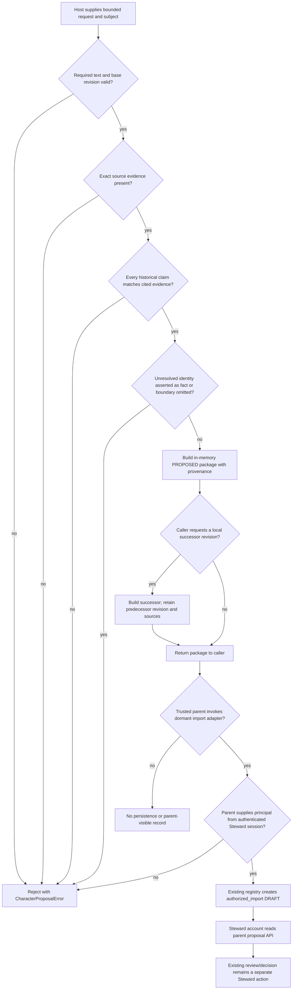

<!--
Riverview~ Controlled Document
File: docs/operations/cookbooks/JESSICA_CHARACTER_ADVISORY_COOKBOOK.md
Component: JESSICA-CHARACTER-ARCHITECTURE
File Revision: 1.0.1
Purpose: Diagnose and safely recover the dormant Jessica advisory proposal adapter
Authority: Documentation only; does not authorize resident creation, approval, grants, or production changes
Changed: 2026-10-18 UTC | W3-DOD-6253138751 | Add bounded diagnostics, recovery, and parent visibility contract
Changed: 2026-10-18 UTC | W3-DISPATCH-6253533433 | Correct CRLF sidecar diagnosis and link isolated graph patch proposal
Contracts: docs/architecture/JESSICA_CHARACTER_ARCHITECTURE_RECOVERY.md; docs/components/INSTITUTIONAL_PROPOSALS.md
History: Git commit and .riverview-backups/manifest.jsonl
-->
# Jessica Character Advisory Adapter — Recovery Cookbook

**Execution model:** Request-driven Python library. No Jessica process, route, scheduled worker, durable queue, or autonomous retry loop exists.

**Operational state:** Dormant and disconnected. `JessicaRoleProfile.active` is false. Proposal construction is in-memory. The optional `authorized_import` adapter requires a Steward principal value from the caller; the function validates its shape but cannot authenticate it. Only an approved parent host can establish that this value came from an authenticated Steward session. No Jessica principal or permission is registered.

## Implemented path and failure behavior



The diagram describes code and existing parent contracts. It is not a registered canonical process graph. No route, resident creation, review, decision, approval, publication, or promotion is performed by Jessica's module.

## Parent visibility contract

| State | Authoritative owner | Parent visibility |
|---|---|---|
| In-memory package | Calling application | The caller receives the object; Riverview has no durable event or dashboard status for it. |
| Optional imported DRAFT | Existing institutional proposal registry | Existing Steward-authenticated collection query `GET /api/v1/institutional-proposals?q=&tag=&status=&limit=` and item query `GET /api/v1/institutional-proposals/{proposal_id}?revision=N`. |
| Review or decision | Existing Steward proposal lifecycle | Existing review/decision routes and registry state; no Jessica authority is implied. |
| Jessica runtime health, assignment cursor, heartbeat | Not applicable | No independent Jessica runtime exists. Do not synthesize a healthy/active status. |

Only the parent service authenticates the Steward session and supplies the trusted principal. The registry's `created_by` remains that Steward. `advisory_producer` identifies Jessica as provenance, not as an authenticated actor. No Jessica output is currently connected to the parent API.

## Read-only diagnosis

From the repository root, inspect the exact worktree and run the focused local tests:

```powershell
git status --short --branch
git rev-parse HEAD
python -m pytest tests/test_jessica_character_architecture.py -q
python scripts/process_graph.py check
```

Expected on this Windows checkout with `core.autocrlf=true`: the command may return `FAIL` with `JSON file revision sidecar checksum mismatch: process_graphs/schema/riverview-process-graph.schema.json`. This is CRLF conversion in working-copy bytes, not tracked schema divergence: the Git blob is 3,203 LF bytes with SHA-256 `0c03d29216d6d3cb08e58ab7bff12b545211f78fbdffb0767118553b52025da7`, matching the sidecar; the Windows working copy expands it to 3,257 CRLF bytes and hashes to `95596d4def44a2ff201b2b32be7ebe1890a2903c2beff8cdabbc857e31c1b41f`. W1 reports canonical-LF graph validation passes. Do not "fix" the registry by recording CRLF bytes. The Jessica canonical graph remains unregistered pending W1 coordination on the shared `.riverview-revisions.json`; see `docs/architecture/JESSICA_CANONICAL_GRAPH_INTEGRATION_PROPOSAL.md`.

Check whether isolated database integration can be run without revealing a DSN:

```powershell
if ([string]::IsNullOrWhiteSpace($env:RIVERVIEW_TEST_PG_DSN)) { 'NOT VERIFIED: no isolated PostgreSQL DSN configured' } else { 'Isolated PostgreSQL DSN is configured' }
```

At this checkout the variable is absent. Do not substitute a production or shared database. PostgreSQL-backed adapter behavior is **NOT VERIFIED**.

## Recovery and safe recheck

1. Keep the adapter dormant. Confirm no Jessica account, route, principal binding, resident creation, or grant has appeared in the target checkout.
2. Re-run the focused tests above. If a test fails, retain its output and inspect only `src/riverview_core/jessica_character_architecture.py` and its focused tests.
3. Before changing an existing controlled file, use `python scripts/revision_control.py backup <path> --task <task-id>` and verify the reported backup SHA-256 against the saved bytes. Increment that file's revision.
4. For parent persistence, invoke only through an approved parent integration that derives the Steward principal from its authenticated session. Never accept a caller-provided principal string as authentication. The resulting DRAFT must retain the Steward as actor and Jessica as advisory producer.
5. Stop before database, route, principal, grant, review, approval, promotion, or production changes. Those require separate authorization and are outside this cookbook.
6. Canonical graph registration requires coordination with the W1 owner of `.riverview-revisions.json` to add the Jessica graph entry and regenerate the projections. Run validation from a canonical-LF checkout (`core.autocrlf=false` on Windows or an LF-native checkout); the tracked schema blob already matches its sidecar, so do not rewrite its entry to match Windows CRLF bytes. Until the shared-registry handoff is available, report W3 canonical registration as blocked.

## Revision and restoration record

The immediate predecessor of `docs/architecture/JESSICA_CHARACTER_ARCHITECTURE_RECOVERY.md` was revision 1.0.4, preserved at `.riverview-backups/20261018T175226897571Z/docs/architecture/JESSICA_CHARACTER_ARCHITECTURE_RECOVERY.md` (SHA-256 `25c2f4c2114f85fc29b69ebdc8e680442ad195be458086d006eb75f25d93d78b`). Restore by copying that exact backup over the document. The pre-change source commit will be recorded in W3 checkout evidence. The generic backup manifest records path, prior revision, SHA-256, backup path, task ID, and timestamp; this increment's evidence adds its source commit and restore instructions prospectively. Historical manifest entries are not rewritten.
