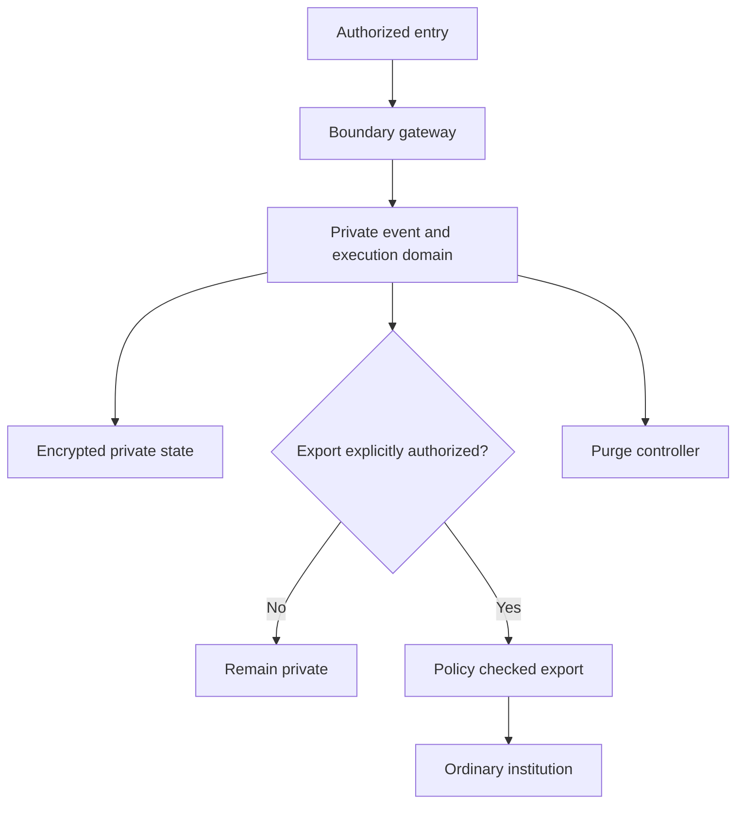

# Undercurrent boundary — working baseline

**Status:** design, not security-verified. The longer locally authored `Riverview_Undercurrent_Boundary_Contract_v0.1.md` remains a separate source document until imported and reconciled verbatim.

Undercurrent is Riverview!'s implementation of the Estate's Undercroft concept: a separate high-privacy security domain, not merely a hidden dashboard room.

## Invariants

1. Its private conversations, artifacts, assignment names and event payloads do not automatically enter the ordinary event bus, memory, search, dashboards, logs or provider contexts.
2. Independent private state, key management, internal event handling, retention, and recovery. Ordinary CME may see only explicitly permitted service-level health metadata.
3. Boundary entry, external-provider use, and export are separate authorized operations. Exports are explicit and narrowly scoped.
4. Notifications outside the domain reveal only approved generic metadata.
5. Purge procedures support session, assignment and environment scope. Encryption-key destruction may protect retained encrypted data, but purge cannot guarantee deletion from uncontrolled backups, remote providers, or volatile hardware.
6. Content confidentiality and authorization/safety constraints are distinct concerns; privacy does not grant authority to operate outside delegated boundaries.

## Boundary flow

## Diagnostic cookbook baseline

Check isolated service health, key availability, storage health and private event lag **from within** the domain. Never emit private payloads in public diagnostics. Test denied exports, purge key lifecycle, restart isolation, and non-leakage to the ordinary bus. Formal threat modeling and end-to-end purge validation remain outstanding.
